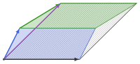
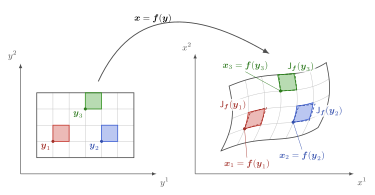

## Doel van dit hoofdstuk



Herhaling:

* Lineaire afbeeldingen: definities, elementaire eigenschappen, voorstelling als matrices

* Eigenschappen van matrices en determinanten

* Matrixinverse

* Lineaire transformaties, algemene lineaire groep, basistransformaties

* Lineaire stelsels: oplossingsstructuur en relevante matrixontbindingen

Nieuw (?)

* Lineaire functionalen en duale ruimte

* Determinanten als volume(verandering), Jacobianen en substituties in meervoudige integralen

# Lineaire afbeeldingen

## Definitie

::: {.definitie nr="2.1" title="Lineaire afbeelding"}
Een **lineaire afbeelding** is een homomorfisme tussen vectorruimten: $\varphi \in \Hom(V,W)$

* Structuurbehoud:
  * Additiviteit: $\varphi(\vv_1 + \vv_2) = \varphi(\vv_1) + \varphi(\vv_2)$
  * Homogeniteit: $\varphi(a \vv) = a \varphi(\vv)$

  $\Rightarrow$ **lineariteit**
  $$\boxed{\varphi(a_1 \vv_1 + a_2 \vv_2) = a_1 \varphi(\vv_1) + a_2 \varphi(\vv_2)}$$
:::

* Nieuwe notatie: $\map{A}:V \to W: \vv \mapsto \map{A}(\vv) = \map{A}\vv$

  (hoofdletter Latijns alfabet, hoedje, functiehaakjes niet noodzakelijk)

## Voorbeelden {.scrollable}

::: {.voorbeeld nr="2.1"}
$\Hom(\bbF^n, \bbF^m) \cong \bbF^{m \times n}$: matrices die werken op standaard kolomvectoren via matrix-vector-vermenigvuldiging
:::

* De identiteitsafbeelding $\idmap_V$

::: {.voorbeeld nr="2.2"}
Afgeleide-operator $\map{D}$, die werkt op functies op een interval $I \subseteq \bbR$ als
$$(\map{D}f)(x) = \frac{\drm f}{\drm x}(x) = f'(x)$$

* Domein $C^k(I,\bbF) \Rightarrow$ codomein $C^{k-1}(I,\bbF)$
* Domein $C^{\infty}(I,\bbF)$ = codomein: lineaire operator
:::

::: {.voorbeeld nr="2.4"}
Integraaltransformaties: Fouriertransformatie, Laplace-transformatie
:::

## Eigenschappen

::: {.propositie nr="2.1"}
$\Hom(V,W)$ is zelf een vectorruimte over $\bbF$:

* Puntsgewijze definitie, gebruik makende van vectorstructuur die bestaat in codomein $W$:
  $$(\map{A}+\map{B})(\vv) = \map{A}(\vv) + \map{B}(\vv), \quad (a \map{A})(\vv) = a \map{A}(\vv)$$
* 'Nulvector' is de nulafbeelding $\map{0}$ die voldoet aan $\map{0} \vv= \zerovec_W$, $\forall \vv \in V$
:::

::: {.propositie nr="2.2"}
Compositie van lineaire afbeeldingen:

* $\circ: \Hom(V,W) \times \Hom(U,V) \to \Hom(U,W)$
* $\map{A} \circ \map{B}$ is bilineair in zijn argumenten
:::

::: {.gevolg nr="2.3"}
$(\End(V), \circ)$ is een associatieve algebra met $\idmap_V$ als eenheidselement
:::

# Kern, beeld en rang-nulliteitsstelling

## Beeldruimte

$\im(\map{A}) = \map{A}(V) = \{\map{A}\vv; \vv \in V\}$

::: {.propositie nr="2.5"}
$\im(\map{A}) \subspace W$
:::

::: {.definitie nr="2.3"}
**Rang**: $\rank(\map{A}) = \dim(\im(\map{A}))$
:::

## Kern (of nulruimte)

Zelfde definitie als voor groep: $\ker(\map{A}) = \map{A}^{-1}(\{\zerovec_W\})$

::: {.propositie nr="2.4"}
$\ker(\map{A}) \subspace V$
:::

::: {.definitie nr="2.2"}
**Nulliteit**: $\nullity(\map{A}) = \dim(\ker(\map{A}))$
:::

::: {.propositie nr="2.7"}
Injectieve afbeelding $\Leftrightarrow \nullity(\map{A}) = 0$
:::

::: {.propositie nr="2.8"}
Injectieve afbeeldingen behouden lineaire onafhankelijkheid en dimensie

voor $U\subspace V$: $\dim(\map{A}U) = \dim(U)$
:::

Voorbeeld: $\ker(\map{D})$ de verzameling van constante functies

## Rang-nulliteitsstelling

Gegeven een afbeelding $\map{A}:V \to W$

* Equivalentierelatie $\vv \sim \vu \Leftrightarrow (\vv - \vu) \in \ker(\map{A}) \Leftrightarrow \map{A}\vv = \map{A}\vu$

* Met elke equivalentieklasse $[\vv]$ is een uniek punt in $\im(\map{A})$ geassocieerd

::: {.propositie nr="2.10"}
We kunnen een bijectieve afbeelding definiëren van de quotiëntruimte $V /\ker(\map{A})$ naar $\im(\map{A})$
:::

::: {.stelling nr="2.11" title="Rang-nulliteitsstelling"}
Voor $V$ eindig-dimensionaal:
$$\dim(\im(\map{A})) = \dim(V/\ker(\map{A})) = \dim(V) - \dim(\ker(\map{A}))$$
$$\boxed{\Rightarrow\rank(\map{A}) + \nullity(\map{A}) = \dim(V)}$$
:::

## Rang-nulliteitsstelling

Gevolgen:

::: {.gevolg nr="2.12"}
Voor $V,W$ eindigdimensionaal en $\dim(V) = \dim(W)$ zijn volgende eigenschappen equivalent:

* injectief: $\nullity(\map{A}) = 0$
* surjectief: $\rank(\map{A}) = \dim(W) = \dim(V)$
* bijectief
:::

::: {.voorbeeld nr="2.5"}
Voor een vierkante matrix $\mat{A} \in \bbF^{n \times n}$ impliceert het bestaan van een linker- of rechterinverse meteen dat dit een volwaardig inverse is: $\mat{A}^{-1}$
:::

## Voorbeeld

::: {.voorbeeld nr="2.6"}
Beschouw de vectorruimte $\bbF^{\bbN_0}$, de vectorruimte van oneindig lange tupels met als lineaire afbeeldingen:

* $\map{R}(v^1,v^2,v^3,\ldots) = (0, v^1, v^2, \ldots)$
* $\map{L}(v^1,v^2,v^3,\ldots) = (v^2,v^3,v^4, \ldots)$

Er geldt dat:

* $\map{L} \map{R} = \idmap$
* $\map{R}\map{L}=\map{P}$ met $\map{P}(v^1,v^2,v^3,\ldots) = (0, v^2, v^3, \ldots)$
:::

# Matrices en determinanten

## Matrixvoorstelling van lineaire afbeeldingen

Beschouw een lineaire afbeelding $\map{A}:V \to W$ waar $V$ en $W$ eindig-dimensionaal zijn en een basis $B_V = \{\ve_1,\ldots,\ve_n\}$ en $B_W = \{\vf_1,\ldots,\vf_m\}$ hebben:

$$\map{A}(\ve_j) = \vf_i A^i_{\ j} \Rightarrow \vw= \map{A}(\vv) = v^j \map{A}(\ve_j) = (A^i_{\ j} v^j) \vf_i = w^i \vf_i$$

::: {.definitie nr="2.4"}
Met behulp van

* $\vec{v} = \phi_{B_V}(\vv) \in \bbF^n$, $\vec{w} = \phi_{B_W}(\vw) \in \bbF^m$
* $\mat{A} = \Phi_{B_W,B_V}(\map{A}) = \phi_{B_W}\circ \map{A} \circ \phi_{B_V}^{-1} \in \bbF^{m \times n}$ : **matrixvoorstelling**

geldt dus $\vec{w}= \mat{A}\vec{v}$: matrix-vectorproduct
:::

## Matrixvoorstelling en compositie

Voor de compositie van lineaire afbeeldingen geldt:

$\map{C} = \map{A}\circ \map{B} \Rightarrow \mat{C} = \mat{A} \cdot \mat{B}$: matrix-matrixproduct "$\cdot$"

Enkele eigenschappen van matrixvermenigvuldiging:

* $\mat{A} \in \bbF^{m\times n}, \mat{B}\in\bbF^{n \times p} \Rightarrow \mat{C} \in \bbF^{m \times p}$
* Associatief, neutraal element = $\idmat_n$ ($n \times n$ eenheidsmatrix), niet commutatief, bilineair

::: {.propositie nr="2.15"}
Computationele complexiteit: $mnp$ vermenigvuldigingen en $mp(n-1)$ addities van scalairen (naïeve telling)
:::

* Geheugencomplexiteit: $mn + np + mp$ scalairen
* Voor $m \approx n \approx p$: $\order(n^3)$ bewerkingen op $\order(n^2)$ data

<!-- ## Lineaire extensie en vrije vectorruimte

* Voor een verzameling $S$ waarvan we de elementen $\{a_1, a_2,\ldots\}$ beschouwen als abstracte entiteiten zonder vooraf bestaande vectorstructuur:
  * de **vrije vectorruimte** $\bbF S$ bestaat uit alle "formele" lineaire combinaties, waarbij we de elementen van $S$ als abstracte basisvectoren beschouwen (zie H1)

* Voor verzamelingen $S,S'$ en een afbeelding $\varphi:S\to S'$: 
  * De **lineaire extensie** van $\varphi$ is een lineaire afbeelding $\Hom(\bbF S, \bbF S')$, gedefinieerd als 
  
    $$\map{\varphi}(\vv) = v^i \map{\varphi}(a_i) = v^i \varphi(a_i)$$
  
    met $\varphi(a_i)$ een element uit $S'$ (= basisvector uit $\bbF S'$).

## Voorbeeld van lineaire extensie (1)

* Beschouw de verzameling van bits $S=\{0,1\}$ en de bit-flip-operatie $\varphi:S\to S$ met $\varphi(0) =1$, $\varphi(1) = 0$

* $\bbC S \cong \bbC^2$ en $\map{\varphi} \cong \begin{bmatrix} 0 & 1 \\ 1 & 0 \end{bmatrix}$

* Indien we de standaard basisvectoren van $\bbC S$ noteren als  $\vert 0 \rangle$ en $\vert 1 \rangle$ (de zogenaamde ket-notatie van Dirac), dan komt dat overeen met de taal waarin quantum bits (qubits) geformuleerd worden. De flip-operatie op een qubit wordt beschreven door bovenstaande matrix, die ook $\sigma^x$ wordt genoemd, en 1 van de drie Pauli matrices is.

## Voorbeeld van lineaire extensie (2)

Beschouw een groep $G = \{g_1,g_2,\ldots\}$. Met elk groepselement kunnen we een element uit $\Aut(G)$ associeren, namelijk op 2 verschillende manieren:

* linker-multiplicatie: $L_{g} (h) = g h$ zodat $L_{g_1} L_{g_2} = L_{g_1 g_2}$
* rechter-multiplicatie: $R_{g}(h) = h g^{-1}$ zodat $R_{g_1} R_{g_2} = R_{g_1 g_2}$

Deze transformaties kunnen gepromoveerd worden tot lineaire transformaties op $\bbC G$, waarbij $\map{L}_g$ en $\map{R}_g$ zullen worden voorgesteld door "permutatiematrices': vierkante matrices met enkel nul en één, zodat er exact één element één is in elke rij en elke kolom. Deze staan gekend als de linker en rechter reguliere representatie, en spelen een belangrijke rol bij de ontwikkeling van representatietheorie. -->

## Bewerkingen met matrices {.scrollable}
Gegeven een matrix $\mat{A}$ met componenten $A^i_{\ j}$

::: {.definitie nr="2.5"}
**Transponeren**: $[\mat{A}^\transpose]^i_{\ j} = A^j_{\ i}$ $\Rightarrow$ later: $(\mat{A}^\transpose)_i^{\ j} = A^j_{\ i}$

* $(\mat{A}^\transpose)^\transpose =\mat{A}$
* $(a_1 \mat{A}_1 + a_2 \mat{A}_2)^\transpose = a_1 \mat{A}_1^\transpose + a_2 \mat{A}_2^\transpose$ (lineair)
* $(\mat{A}\mat{B})^\transpose = \mat{B}^\transpose \mat{A}^\transpose$
:::

::: {.definitie nr="2.6"}
**Hermitisch toevoegen** (hermitisch conjugeren, hermitisch transponeren): $(\mat{A}^\hermitian)^i_{\ j} = \conj{\left(A^j_{\ i}\right)}$

* $(\mat{A}^\hermitian)^\hermitian =\mat{A}$
* $(a_1 \mat{A}_1 + a_2 \mat{A}_2)^\hermitian = \conj{a_1} \mat{A}_1^\hermitian + \conj{a_2} \mat{A}_2^\hermitian$
* $(\mat{A} \cdot \mat{B})^\hermitian = \mat{B}^\hermitian \cdot  \mat{A}^\hermitian$
:::

## Bewerkingen met matrices {.scrollable}

::: {.opmerking nr="2.4"}
Een matrix kan de voorstelling zijn van verschillende soorten objecten uit de lineaire algebra (zie H5: bilineaire en sesquilineaire afbeeldingen).
:::

Voor matrices als voorstelling van een lineaire afbeelding hebben volgende definities geen betekenis door 'index mismatch'; desalniettemin voeren we volgende definities toch al in op het niveau van matrices. We komen ze later terug tegen in de context van bilineaire en sesquilineaire vormen, waar ze een intrinsieke betekenis hebben:

::: {.opmerking nr="2.12"}
* **Symmetrisch**: $\mat{A} = \mat{A}^\transpose$
* **Antisymmetrisch** of scheef-symmetrisch: $\mat{A} = -\mat{A}^\transpose$
:::

::: {.definitie nr="2.7"}
* **Hermitisch**: $\mat{A} = \mat{A}^\hermitian$
* **Anti-Hermitisch** of scheef-Hermitisch: $\mat{A} = -\mat{A}^\hermitian$
:::

## Rang van een matrix {.scrollable}

Een matrix $\mat{A}\in \bbF^{m \times n}$ kan een lineaire afbeelding van $\bbF^n$ naar $\bbF^m$ voorstellen.

::: {.definitie nr="2.8"}
* $\im(\mat{A}) \subspace \bbF^m$ staat ook gekend als de **kolomruimte** van $\mat{A}$, de ruimte opgespannen door de kolommen van $\mat{A}$
* De dimensie van die ruimte, zijnde $\rank(\mat{A})$, wordt soms ook de **kolomrang** genoemd
:::

::: {.definitie nr="2.9"}
* De rijen van de matrix $\mat{A}$ definiëren vectoren van lengte $n$, en spannen een deelruimte op van $\bbF^n$, de **rijruimte**
* De bijbehorende dimensie is de **rijrang** van $\mat{A}$
:::

::: {.propositie nr="2.13"}
Rijrang = kolomrang $\Rightarrow$ rang!
:::

::: {.propositie nr="2.14"}
$\rank(\mat{A}\cdot \mat{B}) \leq \min(\rank(\mat{A}), \rank(\mat{B}))$
:::

## Spoor

Gegeven een vierkante matrix $\mat{A} \in \bbF^{n \times n}$

::: {.definitie nr="2.10"}
**Spoor** $\tr(\mat{A}) = A^i_{\ i}$
:::

::: {.propositie nr="2.16"}
Triviaal: $\tr(\mat{A}\cdot \mat{B}) = \tr(\mat{B}\cdot \mat{A})$
:::

## Determinant

Gegeven een vierkante matrix $\mat{A} \in \bbF^{n \times n}$

::: {.definitie nr="2.11"}
De **determinant** via de **Leibniz-formule**:
$$\boxed{\begin{aligned}
\det(\mat{A}) &= \sum_{\sigma \in S_n} \sgn(\sigma) A^1_{\ \sigma(1)} A^2_{\ \sigma(2)} \cdots A^n_{\ \sigma(n)}\\
&= \epsilon^{j_1j_2\cdots j_n} A^1_{\ j_1} A^2_{\ j_2} \cdots A^n_{\ j_n}
\end{aligned}}$$
met het **Levi-Civita-symbool** $\epsilon^{i_1i_2\cdots i_n} = \begin{cases} \sgn(\sigma),&\sigma=(i_1,i_2,\ldots,i_n) \in S_n\\ 0, &(i_1,i_2,\ldots,i_n) \not\in S_n\end{cases}$
:::

::: {.opmerking nr="2.21"}
$n!$ termen met elk $n$ vermenigvuldigingen?
Praktische algoritmes voor de determinant hebben complexiteit $\order(n^3)$
:::

## Determinant als volume

::: {.propositie nr="2.17"}
Beschouw de determinant als een multivariate functie van de $n$ kolommen van de matrix $\mat{A} \eqsim (\vec{a}_1,\vec{a}_2, \ldots,\vec{a}_n)$. De determinant is volledig en uniek gekarakteriseerd door:

* lineariteit in elke kolom = multilineaire functie
* alternerend in twee opeenvolgende kolommen: $\vec{a}_i =\vec{a}_{i+1} \Rightarrow \det = 0$
* eenheidsmatrix $\idmat_n \eqsim$ standaardbasis $(\vec{e}_1,\ldots,\vec{e}_n)$ $\Rightarrow \det = 1$
:::

## Determinant als volume

::: {.opmerking nr="2.19"}
Eigenschappen die je verwacht voor het **volume** van een parallellepipedum opgespannen door $(\vec{a}_1, \ldots,\vec{a}_n)$
$\Rightarrow \det(\mat{A})$ is de volumeverandering door de lineaire afbeelding $\mat{A}$
:::

{fig-align="center" height="300px"}

## Determinant: verdere eigenschappen

::: {.propositie nr="2.18"}
$\det(\mat{A}) =0 \iff \rank(\mat{A}) < n$
:::

::: {.lemma nr="2.19"}
$\epsilon^{j_1j_2\cdots j_n} A^{i_1}_{\ j_1} A^{i_2}_{\ j_2} \cdots A^{i_n}_{\ j_n} = \det(\mat{A}) \epsilon^{i_1i_2\cdots i_n}$
:::

::: {.stelling nr="2.20"}
$$\boxed{\det(\mat{A}\cdot\mat{B}) = \det(\mat{A})\det(\mat{B})}$$
Twee opeenvolgende transformaties $\Rightarrow$ product van volumeveranderingen
:::

## Determinant: toepassing

Beschouw een multidimensionele integraal $\int_V g(\vec{x}) \drm x^1 \drm x^2 \cdots \drm x^n$

Stel dat we een algemene (niet noodzakelijk lineaire) coördinatentransformatie willen doorvoeren: $\vec{x} = \vec{f}(\vec{y})$ met $\vec{f}:\bbR^n \to \bbR^n$ of dus $x^i = f^i(y^1,y^2,\ldots,y^n)$

Rond een bepaald punt $\vec{x}_k =\vec{f}(\vec{y}_k)$ geldt de eerste-orde Taylorbenadering:
\begin{align*}
x^i &= f^i(\vec{y}) = f^i(\vec{y}_k + (\vec{y}-\vec{y}_k)) \\
&= f^i(\vec{y}_k) + \frac{\partial f^i}{\partial y^j}(\vec{y}_k) (y^j - y_k^j) \\
&= x^i_k + \frac{\partial f^i}{\partial y^j}(\vec{y}_k) (y^j - y_k^j)
\end{align*}

## Determinant: toepassing

De **Jacobiaan** $\mat{J}_{\vec{f}}(\vec{y})$ met componenten

$$ (\mat{J}_{\vec{f}}(\vec{y}))^i_{\ j} = \frac{\partial f^i}{\partial y^j}(\vec{y}) $$

beschrijft de lineaire benadering van $\vec{f}$ in de buurt van het punt $\vec{y}$.

{fig-align="center" height="360px"}

## Determinant: toepassing

Dit brengt een volumeverandering teweeg gegeven door

$$ \drm x^1 \drm x^2 \cdots \drm x^n = \abs{\det(\mat{J}_{\vec{f}}(\vec{y}))} \drm y^1 \drm y^2 \cdots \drm y^n$$

$$\Rightarrow\int_V g(\vec{x}) \drm x^1 \drm x^2 \cdots \drm x^n =\int_{V'} g(\vec{f}(\vec{y})) \abs{\det(\mat{J}_{\vec{f}}(\vec{y}))} \drm y^1 \drm y^2 \cdots \drm y^n$$

## Determinant: toepassing

::: {.voorbeeld nr="2.7"}
Poolcoördinaten $x = \rho \cos \theta, y = \rho \sin \theta$

\begin{align*}
  \mat{J}(\rho,\theta) = \begin{bmatrix}
    \frac{\partial x}{\partial \rho} & \frac{\partial x}{\partial \theta} \\ \frac{\partial y}{\partial \rho} & \frac{\partial y}{\partial \theta}
  \end{bmatrix} = \begin{bmatrix}
    \cos(\theta) & -\rho \sin(\theta) \\ \sin(\theta) & \rho \cos(\theta)
  \end{bmatrix}
\end{align*}

$$\abs{\det(\mat{J}(\rho,\theta))} = \rho \Rightarrow \drm x \drm y = \rho \drm \rho \drm \theta $$
:::

::: {.opmerking nr="2.22"}
De absolute waarde heeft te maken met het feit dat een determinant de verandering van een georiënteerd volume beschrijft. Voor de volume-integraal is dit teken (dat aangeeft of de oriëntatie al dan niet behouden blijft) niet van belang, of wordt het gecompenseerd door hoe de integratiegrenzen geordend worden.
:::

## Matrixinverse

::: {.definitie nr="2.12"}
**$(k,l)$-minor** $M_k^{\ l}$ van een matrix $\mat{A} \in \bbF^{n\times n}$ is de determinant van de matrix die overblijft na het verwijderen van rij $k$ en kolom $l$
:::

::: {.gevolg nr="2.23"}
**Laplace-expansie** van de determinant (geen sommatieconventie):
$$\det(\mat{A}) = \sum_l A^k_{\ l} (-1)^{k-l} M_k^{\ l}$$
Veralgemening: $\sum_l A^i_{\ l} (-1)^{k-l} M_k^{\ l} = \det(\mat{A}) \delta^i_{\ k}$
:::

## Matrixinverse

::: {.propositie nr="2.24"}
* Met behulp van $(\adj(\mat{A}))^i_{\ j} = (-1)^{j-i} M_j^{\ i}$:
  $$\mat{A} \cdot \adj(\mat{A}) = \det(\mat{A}) \idmat_n$$
* Als $\det(\mat{A})\neq 0$: $\Rightarrow\ \mat{A}^{-1} = \det(\mat{A})^{-1} \adj(\mat{A})$
:::

::: {.definitie nr="2.14"}
Als $\det(\mat{A}) = 0$: $\mat{A}$ is **singulier**, **ontaard**, niet-inverteerbaar
:::

## Afgeleide van een determinant

Beschouw een matrixwaardige functie $\mat{A}(t)$, i.e. een matrix waarvan de elementen (continue, afleidbare) functies zijn van de tijd.

* **Jacobi's formule:**

  \begin{align*}
  \frac{\drm\ }{\drm t} \det(\mat{A}(t)) &= \tr\left[\adj(\mat{A}(t)) \frac{\drm \mat{A}}{\drm t}(t)\right]\\
  &= \det(\mat{A}(t)) \tr\left[\mat{A}^{-1}(t) \frac{\drm \mat{A}}{\drm t}(t)\right]
  \end{align*}

# Algemene lineaire groep en basistransformaties

## Lineaire groep

::: {.definitie nr="2.15"}
* $\Aut(V)$ voor vectorruimte $V$ wordt genoteerd als $\GL(V)$ en de **algemene lineaire groep** voor $V$ genoemd.
* $\GL(\bbF^n)= \GL(n;\bbF)$: inverteerbare $n \times n$ matrices
  * vierkante matrices waarvoor $\det(\mat{A}) \neq 0$
  * voor $\bbF=\bbR$: $\det(\mat{A}) > 0$ of $\det(\mat{A}) < 0$

    $\Rightarrow$ twee onsamenhangende delen
  * voor $\bbF = \bbC$: samenhangend
:::

::: {.definitie nr="2.16"}
**Speciale lineaire groep** $\SL(n; \bbF)$: $n\times n$ matrices met $\det(\mat{A}) = 1$
:::

## Basistransformaties

Eindigdimensionale vectorruimte $V$ met twee verschillende keuzes van basis
$B = \{\ve_1,\ve_2,\ldots,\ve_n\}$ en $\tilde{B} = \{\tilde{\ve}_1,\ldots,\tilde{\ve}_n\}$:

* $\ve_j = \tilde{\ve}_i T^i_{\ j} \Rightarrow \vv = v^j \ve_j = \tilde{v}^i \tilde{\ve}_i = v^j T^i_{\ j} \tilde{\ve}_i \Rightarrow \tilde{\vec{v}} = \mat{T} \vec{v}$
* $\vec{v} = \phi_{B}(\vv)$ en $\tilde{\vec{v}} = \phi_{\tilde{B}}(\vv)$
  $$\Rightarrow \tilde{\vec{v}} = \phi_{\tilde{B}} \circ \phi_B^{-1}(\vec{v})$$
  $$\Rightarrow \mat{T} = \phi_{\tilde{B}} \circ \phi_B^{-1}: \bbF^n \to \bbF^n; \quad \mat{T} \in \GL(n;\bbF)$$

## Basistransformaties

Beschouw twee eindigdimensionale vectorruimten $V$ en $W$ met verschillende keuzes van basis
$B_V$ en $\tilde{B}_V$, alsook $B_W$ en $\tilde{B}_W$ en een lineaire afbeelding $\map{A}:V\to W$:

* Matrixrepresentatie $\mat{A} = \phi_{B_W} \circ \map{A} \circ \phi_{B_V}^{-1}$
* Matrixrepresentatie
  \begin{align*}
  \tilde{\mat{A}} &= \phi_{\tilde{B}_W} \circ \map{A} \circ \phi_{\tilde{B}_V}^{-1}\\
  & = \phi_{\tilde{B}_W} \circ (\phi_{B_W}^{-1} \circ \mat{A} \circ \phi_{B_V}) \circ \phi_{\tilde{B}_V}^{-1}\\
  &= (\phi_{\tilde{B}_W} \circ \phi_{B_W}^{-1}) \circ \mat{A} \circ (\phi_{\tilde{B}_V} \circ \phi_{B_V}^{-1})^{-1}\\
  &= \mat{T}_W \cdot \mat{A} \cdot \mat{T}_V^{-1}
  \end{align*}

## Basistransformaties

Voor $V = W$ en dus een lineaire operator $\map{A}$ op $V$

::: {.definitie nr="2.17"}
**Gelijkvormigheidstransformatie**:
$$\boxed{\tilde{\mat{A}} = \mat{T} \mat{A} \mat{T}^{-1}}$$
:::

::: {.propositie nr="2.27"}
Gerelateerd zijn via een gelijkvormigheidstransformatie is een equivalentierelatie
:::

## Basistransformaties

::: {.definitie nr="2.18"}
Eigenschappen van $\mat{A}$ die invariant zijn onder gelijkvormigheidstransformaties zijn **basisonafhankelijk**, en zijn dus intrinsieke eigenschappen die kunnen worden geassocieerd aan het wiskundige object $\map{A}$
:::

::: {.propositie nr="2.28"}
Voorbeelden:

* $\det(\mat{A}) = \det(\tilde{\mat{A}})$
* $\tr(\mat{A}) = \tr(\tilde{\mat{A}})$
:::

# Functionalen en duale ruimte

## Functionalen

::: {.definitie nr="2.19"}
Een **functionaal** is een afbeelding van vectorruimte $V$ naar het scalaire veld $\bbF$
:::

* Vaak in de context van functieruimten, vaak niet-lineair

::: {.voorbeeld nr="2.8"}
Pad $q(t)$ van een deeltje gedurende een tijdsinterval $I$:

* $q:I \to \bbR^3: t \mapsto q(t)$; $q \in C(I, \bbR^3)$
* Actie $S: C(I,\bbR^3) \to \bbR: q \mapsto S[q] = \int_I L(q(t),\dot{q}(t),t)\,\drm t$
:::

## Functionalen

::: {.definitie nr="2.20"}
**Lineaire functionalen**: $\Hom(V, \bbF)$
:::

* Voorbeeld: linearisatie van een functie $f:\bbR^n \to \bbR$

  $$ f(\vec{x}) = f(\vec{x}_0) + \underbrace{\frac{\partial f}{\partial x^i} (x^i-x^i_0)}_{\text{lineaire functionaal van $\vec{x}-\vec{x}_0$}} + \ldots$$

## Lineaire functionalen en duale ruimte {.scrollable}

Beschouw eindigdimensionale vectorruimte $V$ met basis $B = \{\ve_1,\ldots,\ve_n\}$:

* Lineaire functionaal = duale vector = covector
  $$\xi[\vv] = v^i \xi[\ve_i] = \begin{bmatrix} \xi[\ve_1] & \cdots & \xi[\ve_n] \end{bmatrix} \begin{bmatrix} v^1 \\ \vdots \\ v^n\end{bmatrix}$$
  $\Rightarrow$ coördinatenrepresentatie is rijmatrix

::: {.definitie nr="2.21"}
De **duale ruimte** $V^\ast = \Hom(V,\bbF)$ met $\dim(V) = \dim(V^\ast)$
:::

::: {.propositie nr="2.29"}
**Duale basis**: $B^\ast=\{\epsilon^1,\ldots,\epsilon^n\}$ met $\epsilon^i[\ve_j] = \delta^i_j$

* $\xi = \xi_i \epsilon^i$ met $\xi_i = \xi[\ve_i]$
* covariante indices
:::

## Lineaire functionalen: eigenschappen

* $\rank(\xi) \leq \dim(\bbF) = 1$
* Als $\rank(\xi) = 0$: triviale functionaal die elke vector op 0 afbeeldt
* Alle andere:
  * $\rank(\xi)=1 \Rightarrow \nullity(\xi) = \dim(V)-1$
  * $\ker(\xi)$ heeft $\codim = 1$: hypervlakken

::: {.propositie nr="2.30"}
Als $\ker(\xi) = \ker(\chi)$: $\xi = a \chi$ voor een scalair $a \in \bbF$
:::

## Lineaire functionalen: meer voorbeelden uit de fysica

::: {.voorbeeld nr="2.12"}
Kracht: duale vector die snelheid (=vector) afbeeldt op vermogen (scalair): $P = F_i v^i$
:::

::: {.voorbeeld nr="2.13"}
* Door de wet van Newton: momentum is duale vector
* Relatie tussen momentum en snelheid: $p_i = M_{ij} v^j$
  met $M$ de massa-matrix, volgt uit kinetische energie als kwadratische vorm (zie H5) van snelheid: $T = \frac{1}{2} v^i M_{ij} v^j$
:::

::: {.voorbeeld nr="2.15"}
Continue functies $V = C(\bbR; \bbF)$: Dirac-delta $\delta_a[f] = f(a)$
$\Rightarrow$ zie H9 voor theorie van distributies
:::

## Lineaire functionalen: meer voorbeelden van duale basis {.scrollable}

::: {.voorbeeld nr="2.10"}
Ruimte $\bbF[x]$ van polynomen:

* basis van monomen $B=\{e_n=x^n,n=0,1,2,\ldots\}$
* $\Rightarrow$ duale basis $B^* = \left\{\epsilon^n = \frac{1}{n!}\left.\frac{\drm^n\ }{\drm x^n}\right|_{x=0} , n=0,1,2,\ldots\right\}$
:::

::: {.voorbeeld nr="2.11"}
Ruimte $\bbF_n[x]$ van $n$de-graads polynomen:

* $n+1$ verschillende punten $\{x_0,\ldots,x_n\} \subseteq \bbR$ geven aanleiding tot duale basis
  $\tilde{B}^* = \{\varphi^i, i=0,\ldots,n\}$ waarbij $\varphi^i[p] = p(x_i)$
* $\Rightarrow$ geassocieerde basis voor $\bbF_n[x]$ bestaat uit de Lagrange-veeltermen:
  $$f_j(x) = \prod_{\substack{i=0 \\ i\neq j}}^n \frac{(x - x_i)}{(x_j - x_i)}$$
:::

## Lineaire functionalen en basistransformaties {.scrollable}

Vectorruimte $V$ met twee basissen $B$ en $\tilde{B}$

* We weten al: $\vec{v} = \phi_B(\vv)$, $\tilde{\vec{v}} = \phi_{\tilde{B}}(\vv) = (\phi_{\tilde{B}} \circ \phi_{B}^{-1})(\vec{v}) = \mat{T} \vec{v}$

* Lineaire functionaal $\xi:V \to \bbF$:
  $$\xi[\vv] = \underbrace{(\xi \circ \phi_B^{-1})}_{\text{rijvector $\xi_i$}} (\vec{v}) = (\xi \circ \phi_{\tilde{B}}^{-1})\circ (\phi_{\tilde{B}} \circ \phi_B^{-1}) (\vec{v})$$

* $\xi_j = \tilde{\xi}_i T^i_{\ j}$ of dus
  $$\tilde{\xi}_j = (\mat{T}^{-1})^i_{\ j} \xi_i = (\mat{T}^{-\transpose})^{\ i}_j \xi_i$$

::: {.opmerking nr="2.39"}
$\mat{T}^{-\transpose} = (\mat{T}^{-1})^\transpose = (\mat{T}^\transpose)^{-1}$
(duale of **contragrediënte representatie** van $\mat{T} \in \GL(n;\bbF)$), met
$$(\mat{T}_1 \mat{T}_2)^{-\transpose} = \mat{T}_1^{-\transpose} \mat{T}_2^{-\transpose}$$
:::

## Duale lineaire afbeeldingen en de getransponeerde

::: {.definitie nr="2.22"}
Gegeven vectorruimten $V, W$ en een lineaire afbeelding $\map{A} \in \Hom(V,W)$

Voor elke $\xi \in W^\ast$ definiëren we een $\chi \in V^\ast$ via

$$\boxed{\chi[\vv] = \xi[\map{A}\vv] = (\xi \circ \map{A})(\vv)}$$

We noteren $\chi = \map{A}^\ast (\xi)$ en noemen $\map{A}^\ast \in \Hom(W^\ast,V^\ast)$ de **duale lineaire afbeelding**
:::

In coördinaten:

$$ \chi_j = \xi_i A^i_{\ j} = (\mat{A}^\transpose)^{\ i}_j \xi_i$$

$\Rightarrow$ transponeren geeft de matrix-representatie van de duale lineaire afbeelding

<!-- # Affiene transformaties

## Affiene ruimten: herhaling

* Affiene ruimte $A$ over een vectorruimte $V$: verzameling van punten $A=\{P, Q, \ldots\}$ zodat voor elke $P \in A, \vv \in V$ er exact één $Q$ bestaat waarvoor $Q = P + \vv$, en vice versa, voor elke $P,Q \in A$ bestaat er exact één $\vv \in V$ zodat $Q = P + \vv$.

* Na keuze van 1 vast punt $O \in A$, de oorsprong, kunnen we elk punt $P\in A$ karakteriseren via $x_{PO}$ zodat $P = O + x_{PO}$

## Affiene transformaties

* Affiene transformaties:
  * lineaire transformaties $\map{T} \in \GL(V)$ kunnen werken als $P \mapsto P' = O + \map{T}(x_{PO})$ 
  * translaties: vectoren $\vv \in V$ kunnen werken als $P \mapsto P' = O + \vv + x_{PO}$
  * beide samen: $(\map{T},\vv): P \mapsto P' = O + \vv + \map{T} x_{PO}$

* Compositie van affiene transformaties:
  *  $(\map{T}_1,\vv_1) \circ (\map{T}_2,\vv_2) = (\map{T}_1\map{T}_2, \vv_1 + \map{T}_1 \vv_2)$
  * $(\map{T},\vv)^{-1} = (\map{T}^{-1}, -\map{T}^{-1}\vv)$
  * $\Rightarrow \Aut(A) = \Aff(V) = V \rtimes \GL(V)$ (semidirect product)

## Affiene transformaties als matrix

Voor $V = \bbF^n$ kunnen we de affiene transformaties voorstellen als

$$ 	\begin{bmatrix}
		\vec{x}'\\ 1
	\end{bmatrix} = \begin{bmatrix}
		\mat{T} & \vec{v} \\ \zeromat_{n \times 1} & 1
	\end{bmatrix} \begin{bmatrix}
		\vec{x} \\ 1
	\end{bmatrix}
$$

In abstracte termen: 

$\Aff(V)$ is een deelgroep van $\GL(V \oplus \bbF)$

# Lineaire afbeeldingen in reële en complexe vectorruimten

## Van reële naar complexe ruimte

* Gegeven een reële vectorruimte $W$. Kunnen we $W$ 'uitbreiden' tot een vectorruimte over $\bbC$? 
  * Eindigdimensionaal: Kies basis $B \Rightarrow W \cong \bbR^n$, breidt uit tot $\bbC^n$, d.w.z. laat complexe expansiecoëfficiënten toe, of dus, $W = \bbR B \Rightarrow W^{\bbC} = \bbC B$. 
  * Bemerk dat $\dim_{\bbR}(W) = \dim_{\bbC}(W^{\bbC})$
  * We zullen dit vaak impliciet doen, bvb. voor eigenwaarden en eigenvectoren van een reële matrix.

## Van reële naar complexe ruimte

* Gegeven een reële vectorruimte $W$. Kunnen we $W$ 'uitbreiden' tot een vectorruimte over $\bbC$? 
  * Basisonafhankelijke constructie:

    Definieer $W^\bbC = W \times W$, met
    * vectoradditie $(\vw_1,\vw_2) + (\vw_1',\vw_2') = (\vw_1+ \vw_1', \vw_2 + \vw_2')$ (idem als voor $W \oplus W$)
    * vermenigvuldiging met complexe scalairen: $(a + \irm b) (\vw_1,\vw_2) = (a \vw_1 - b \vw_2, b \vw_1 + a \vw_2)$

    $\Rightarrow$ genoteerd als $W^\bbC = W \oplus (\irm W)$

## Van complexe naar reële ruimte:

* Gegeven een complexe vectorruimte $V$. Kunnen we $V$ 'herinterpreteren' als een vectorruimte over $\bbR$?
  * Behoudt dezelfde verzameling van vectoren $V^{\bbR} = V$, beperk de vermenigvuldiging met scalairen tot reële scalairen
  
  $\Rightarrow$ dit verandert de betekenis van "lineaire afhankelijkheid", "lineaire span", "voortbrengendheid", "compleetheid", "basis" en "dimensie"

## Van complexe naar reële ruimte:

* Gegeven een complexe vectorruimte $V$. Kunnen we $V$ 'herinterpreteren' als een vectorruimte over $\bbR$?

  * Stel $V$ eindig-dimensionaal met basis $B=\{\ve_1,\ldots,\ve_n\}$. Om elke vector te kunnne expanderen met behulp van reële coefficiënten moeten we de basis uitbreiden tot $B^\bbR = \{\ve_1,\ldots,\ve_n,\irm \ve_1, \ldots, \irm \ve_n\}$. 

  * $\dim_{\bbC}(V) = n \Rightarrow \dim_{\bbR}(V^\bbR) = 2 n = 2 \dim_{\bbC}(V)$

  * $V \cong \bbC^n$ en $V^\bbR \cong \bbR^{2n}$ (met $V = V^\bbR$ als verzameling)

  * $\vec{v}^\bbR = (\real(\vec{v}), \imag(\vec{v}))$

## Complexe lineaire afbeeldingen

Beschouw nu twee complexe vectorruimten $V$ en $W$, en hun reële versie $V^\bbR$ en $W^\bbR$.

Een (complexe) lineaire afbeelding $\map{A}\in \Hom_{\bbC}(V,W)$ voldoet aan

$$\map{A}(a_1 \vv_1 + a_2 \vv_2) = a_1 \map{A}(\vv_1) + a_2 \map{A}(\vv_2)$$

Als dit geldt voor $a_1,a_2 \in \bbC$, dan zeker voor $a_1,a_2 \in \bbR$

$\Rightarrow \map{A} \in \Hom_{\bbR}(V^\bbR, W^\bbR)$

Er bestaat en inclusie van complexe lineaire afbeeldingen in $\Hom(V,W)$ naar reële lineaire afbeelding in $\Hom_{\bbR}(V^\bbR, W^\bbR)$

## Complexe lineaire afbeeldingen

Als matrix: $\mat{A}^\bbR = \begin{bmatrix} \real(\mat{A}) & -\imag(\mat{A}) \\ \imag(\mat{A}) & \real(\mat{A}) \end{bmatrix}$

Niet alle afbeeldingen in $\Hom_{\bbR}(V^\bbR,W^\bbR)$ komen overeen met complexe lineaire afbeeldingen $\map{A} \in \Hom_{\bbC}(V,W)$.

Wat is de betekenis van de andere, en is er een natuurlijke keuze voor het complement? 

## Complexe lineaire afbeeldingen

* In $V^\bbR$ kan je niet vermenigvuldigen met $\irm$.

* Maar je kan wel werken met de linaire afbeelding $\map{J}_V = \irm \idmap_V$, en deze vormt een geldige lineaire afbeelding die ook bestaat in $\End_{\bbR}(V^\bbR)$.

* Uiteraard geldt $\map{J}_V^2 = - \idmap_V$.

* Matrixrepresentatie als reële matrix:
  $$\mat{J}_V^\bbR = \begin{bmatrix} \zeromat_{n \times n} & -\idmat_{n \times n} \\ \idmat_{n \times n} & \zeromat_{n \times n} \end{bmatrix}$$

* Complexe lineaire afbeelding: $\map{A}\circ \map{J}_V = \map{J}_W \circ\map{A}$

## Reële lineaire afbeeldingen

Beschouw nu een willekeurige (reëel lineaire) afbeelding $\map{L} \in \Hom_{\bbR}(V^\bbR,W^\bbR)$.

We kunnen deze uniek ontbinden als

$$\map{L} = \underbrace{\frac{1}{2}(\map{L} - \map{J}_W \map{L} \map{J}_V)}_{\map{A}} + \underbrace{\frac{1}{2} (\map{L} + \map{J}_W \map{L} \map{J}_V)}_{\map{B}}$$

waarbij geldt:

* $\map{J}_W \circ \map{A} = \map{A} \circ \map{J}_V$ (complexe lineaire afbeelding)
* $\map{J}_W \circ \map{B} = - \map{B} \circ \map{J}_V$

## Antilineaire afbeeldingen

Dit leidt tot een nieuwe definitie:

Een afbeelding $\map{B}:V \to W$ tussen complexe vectorruimten $V$ en $W$ wordt **antilineair** genoemd indien ze voldoet aan

* $\map{B}(\vv_1 + \vv_2) = \map{B}(\vv_1) + \map{B}(\vv_2)$
* $\map{B}(\scalara \vv) = \conj{\scalara} \map{B}(\vv)$

## Antilineaire afbeeldingen: eigenschappen

* Compositie van even aantal antilineaire afbeeldingen is (complex) lineaire afbeelding
* Complexe lineaire combinaties van antilineaire afbeeldingen zijn antilineaire afbeeldingen (antilineaire afbeeldingen vormen een complexe vectorruimte)
* Elke reëel lineaire afbeelding tussen $V^\bbR$ en $W^\bbR$ kan uniek ontbonden worden als som van een lineaire afbeeldingen tussen $V$ en $W$ en een antilineaire afbeeldingen tussen $V$ en $W$

## Antilineaire afbeeldingen: conjugatie

* Beschouw een basis $B$ voor de complexe vectorruimte $V$, die dus een bijbehorende basis $B^\bbR = \{\ve_1,\ldots,\ve_n,\irm\ve_1,\ldots,\irm\ve_n\}$ voor $V^\bbR$ impliceert.
* De specifieke afbeelding $\map{C}_B \in \End_{\bbR}(V^\bbR)$ met matrixrepresentatie $\mat{C}_B^{\bbR} = \begin{bmatrix} \idmat_{n\times n} & \zeromat_{n \times n} \\ \zeromat_{n \times n}  & -\idmat_{n \times n} \end{bmatrix}$ noemen we de complexe conjugatie-operator geassocieerd aan de basiskeuze $B$. Ten opzichte van $V$, is $\map{C}_B$ een zuiver antilineaire operator.
* Elke andere antilineaire operator $\map{B}$ kan nu geschreven worden als een product $\map{B} = \map{B}' \circ \map{C}_B$, waarbij $\map{B}' \in \Hom(V,W)$ een gewone (complex) lineaire afbeelding.

## Reële, complexe en antilineaire afbeeldingen: matrixgedaante

\begin{align*}
	\mat{L} &= \begin{bmatrix}
		\mat{L}_{11} & \mat{L}_{12} \\ \mat{L}_{21} & \mat{L}_{22}
	\end{bmatrix} \\
  &=\begin{bmatrix}
		\mat{A}_{1} & -\mat{A}_{2} \\ \mat{A}_2 & \mat{A}_1
	\end{bmatrix} + \begin{bmatrix}
		\mat{B}_1 & \mat{B}_2 \\ \mat{B}_2 & -\mat{B}_1
	\end{bmatrix} \nonumber\\
	&= \begin{bmatrix}
		\mat{A}_{1} & -\mat{A}_{2} \\ \mat{A}_2 & \mat{A}_1
	\end{bmatrix} + \begin{bmatrix}
		\mat{B}_1 & -\mat{B}_2 \\ \mat{B}_2 & \mat{B}_1
	\end{bmatrix}\begin{bmatrix}
		\idmat & \zeromat \\ \zeromat & -\idmat
	\end{bmatrix}
\end{align*}

$$\Rightarrow \mat{A} = \mat{A}_1 + \irm \mat{A}_2$$

## Antilineaire afbeelding: voorbeeld

Tijdsomkeringsymmetrie in kwantummechanica:

* Actie op golffunctie $\map{T}: \psi(x) \mapsto \conj{\psi(x)}$

* Stel: $\psi_p(x) \sim \erm^{\irm p x} \Rightarrow \map{T} \psi_p = \psi_{-p}$

* Golffunctie in momentumruimte ($\cong$ Fouriertransformatie)
  
  $\Psi(p) \sim \int \erm^{-\irm p x} \psi(x)\,\drm x$

* Actie van tijdsomkering op momentum-golffunctie 

  $\Rightarrow (\map{T} \Psi) = \conj{\Psi(-p)}$

  = Complexe conjugatie + spiegeling van momentum -->

# Lineaire systemen

## Lineaire systemen: definitie en terminologie

::: {.definitie nr="2.24"}
Een **lineair systeem**: vind $\vx$ zodat voldaan is aan $\map{A} \vx = \vy$

* $\vy = \zerovec$: **homogeen**, $\vy \neq \zerovec$: **inhomogeen**
:::

::: {.opmerking nr="2.44"}
$\vy \in \im(\map{A})$: er bestaan één of meerdere oplossingen $\vx = \vx' + \vx_0$, met $\vx'$ een **particuliere oplossing** die voldoet aan $\map{A}\vx' = \vy$, en $\vx_0 \in \ker(\map{A})$ een oplossing van het homogene probleem
:::

::: {.opmerking nr="2.45"}
$\nullity(\map{A}) = 0$: homogeen probleem laat enkel de **triviale oplossing** $\vx_0 = \zerovec$ toe
:::

## Lineaire systemen: voorbeelden

::: {.voorbeeld nr="2.16"}
Standaardvorm eindig-dimensionaal probleem: $\mat{A} \vec{x} = \vec{y}$ met $\mat{A} \in \bbF^{m \times n}$, $\vec{x} \in \bbF^n$ en $\vec{y} \in \bbF^m$

* $m < n \Rightarrow \nullity(\mat{A}) > 0$: als oplossing bestaat is ze niet uniek (**ondergedetermineerd**)
* $m > n \Rightarrow \rank(\mat{A}) \leq n < m$: $\im(\mat{A})$ is een eigenlijke deelruimte van $\bbF^m$; er bestaan rechterleden $\vec{y}$ waarvoor geen oplossing bestaat (**overgedetermineerd**)
* het bestaan van een unieke oplossing voor elk rechterlid $\vec{y}$ kan enkel als $m=n$ en $\rank(\mat{A}) = n \Leftrightarrow \nullity(\mat{A}) = 0$
:::

## Lineaire systemen: voorbeelden

::: {.voorbeeld nr="2.17"}
* $(\map{D}+\frac{1}{\tau}\idmap)f = \zerovec \Leftrightarrow \frac{\drm\ f}{\drm t} + \frac{1}{\tau} f(t) = 0$: homogeen probleem

  $\Rightarrow f(t) = c \erm^{-\frac{t}{\tau}}$: $\Rightarrow \nullity(\map{D} + \frac{1}{\tau}\idmap) = 1$

* $\begin{cases}\frac{\drm\ f}{\drm t} + \frac{1}{\tau} f(t) = 0\\
f(0) = f_0 \end{cases}$

  $\Rightarrow f(t) = f_0 \erm^{-\frac{t}{\tau}}$ (unieke oplossing)
:::

## Lineaire systemen: oplossingsstrategie

::: {.definitie nr="2.25"}
Een matrix $\mat{A} \in \bbF^{m \times n}$ heet

* **bovendriehoeks** als $A^i_{\ j} = 0$ voor alle $1 \leq j < i \leq m$
* **benedendriehoeks** als $A^i_{\ j}=0$ voor alle $1 \leq i < j \leq n$
:::

::: {.opmerking nr="2.46"}
Voor een boven-/benedendriehoeksmatrix $\mat{A} \in \bbF^{n \times n}$ is $\rank(\mat{A}) = n$, en dus bestaat $\mat{A}^{-1}$, als alle diagonaalelementen $A^i_{\ i} \neq 0$ voor $i=1,\ldots,n$.
:::

* Voor een boven-/benedendriehoeksmatrix $\mat{A} \in \bbF^{n \times n}$ met $\rank(\mat{A}) = n$ kan de oplossing $\vx = \mat{A}^{-1}\vy$ berekend worden via voorwaartse/achterwaartse substitutie met een kost die schaalt als $\order(n^2)$, of als $\order(n^3/3)$ indien $\mat{A}^{-1}$ volledig wordt berekend.

## Lineaire systemen: oplossingsstrategie

Voor een algemene matrix $\mat{A} \in \bbF^{n \times n}$:

::: {.opmerking nr="2.47"}
Gaussische eliminatie $\Rightarrow \mat{A} = \mat{L}\mat{U}$: **LU-ontbinding**

* $L$: L(ower), benedendriehoeksmatrix met elementen $1$ op de diagonaal
* $U$: U(pper), bovendriehoeksmatrix met vrije elementen op diagonaal
* soms $\mat{A} = \mat{L} \mat{D} \tilde{\mat{U}}$ met dan ook diagonaalelementen $1$ in $\tilde{\mat{U}}$
:::

::: {.opmerking nr="2.51"}
Inclusief pivoteren: $\Rightarrow \mat{P} \mat{A} = \mat{L} \mat{U}$ met $\mat{P}$ een permutatiematrix
:::

* Complexiteit voor $m=n$: $\order(\frac{2}{3} n^3)$

## Toepassingen van LU-decompositie

::: {.opmerking nr="2.53"}
$$\underbrace{\det(\mat{P})}_{\sgn(\sigma)} \det(\mat{A}) = \underbrace{\det(\mat{L})}_{\prod_i L^i_{\ i} = 1} \underbrace{\det(\mat{U})}_{\prod_j U^j_{\ j}} \Rightarrow \order(n^3)$$
:::

::: {.voorbeeld nr="2.18"}
Multidimensionale Gaussische distributie
$$\begin{aligned}
f_{\vec{X}}(\vec{x}) &= Z \exp\left[-\frac{1}{2} \sum_{i,j=1}^{n}(x^i - \mu^i) A_{i,j} (x^j - \mu^j)\right]\\
&= Z \exp\left[-\frac{1}{2} (\vec{x}-\vec{\mu})^\transpose \mat{A} (\vec{x}-\vec{\mu})\right]
\end{aligned}$$
Hoe $Z$ kiezen zodat $\int f_{\vec{X}}(\vec{x})\,\drm^n\vec{x} = 1$?
:::

## Multidimensionale Gaussische distributie (1) {.scrollable}

::: {.voorbeeld nr="2.18"}
$f_{\vec{X}}(\vec{x}) = Z \erm^{-\frac{1}{2} (\vec{x}-\vec{\mu})^\transpose \mat{A} (\vec{x}-\vec{\mu})}$

* normering
  * $\mat{A} = \mat{A}^\transpose \Rightarrow \mat{A} = \mat{L} \mat{D} \mat{L}^\transpose$
  * substitutie: $\vec{y} = \mat{L}^\transpose(\vec{x}-\vec{\mu}) \Leftrightarrow \vec{x}=\vec{\mu} + \mat{L}^{-\transpose}\vec{y}$
    $\Rightarrow \mat{J} = \mat{L}^{-\transpose}, \det(\mat{J}) = 1$
  * $\int f_{\vec{X}}(\vec{x})\,\drm^n \vec{x}$
    $$\begin{aligned}
    &= \int_{\bbR^n} Z \exp\left[-\frac{1}{2}\vec{y}^\transpose \mat{D} \vec{y} \right] \,\drm^n \vec{y} = Z \prod_{i=1}^n\left( \int_{-\infty}^{+\infty} \erm^{-\frac{1}{2} d_i (y^i)^2}\,\drm y^i\right)\\
    &= Z \prod_{i=1}^n \sqrt{\frac{2\pi}{d_i}} = Z \frac{(2\pi)^{n/2}}{\sqrt{\det(\mat{D})}} =Z \frac{(2\pi)^{n/2}}{\sqrt{\det(\mat{A})}}
    \end{aligned}$$
  * $\Rightarrow Z = \sqrt{\frac{\det(\mat{A})}{(2\pi)^n}}$
:::

## Multidimensionale Gaussische distributie (2)

::: {.voorbeeld nr="2.19"}
$f_{\vec{X}}(\vec{x}) = Z \erm^{-\frac{1}{2} (\vec{x}-\vec{\mu})^\transpose \mat{A} (\vec{x}-\vec{\mu})}$

* gemiddelde en covariantie
  * momentgenererende functie
    $$M_{\vec{X}}(\vec{t}) = \langle \erm^{\sum_{i=1}^n t_i X^i} \rangle = \int_{\bbR^n} \erm^{\sum_{i=1}^n t_i x^i} f_{\vec{X}}(\vec{x})\,\drm^n \vec{x} =\erm^{\frac{1}{2} \vec{t}^\transpose \mat{A}^{-1} \vec{t} + \vec{t}^\transpose \vec{\mu}}$$
  * $\langle X^i\rangle = \left.\frac{\partial M_{\vec{X}}}{\partial t_i}\right|_{\vec{t}=\vec{0}} = \mu^i$
  * $\langle X^i X^j\rangle = \left.\frac{\partial^2 M_{\vec{X}}}{\partial t_i \partial t_j}\right|_{\vec{t}=\vec{0}} = (\mat{A}^{-1})^{ij} + \mu^i \mu^j$
  * covariantiematrix
    $$\Sigma^{ij} = \langle (X^i-\langle X^i \rangle)(X^j-\langle X^j \rangle)\rangle = \langle X^i X^j \rangle - \langle X^i \rangle \langle X^j \rangle = (\mat{A}^{-1})^{ij}$$
:::

<!-- ## Blokmatrices

* Lineair stelsel dat bestaat uit twee delen voor 1 groep onbekenden: $\map{A}_1 \vx = \vy_1$ en $\map{A}_2 \vx = \vy_2$

  $\Rightarrow \begin{bmatrix}
		\mat{A}_1 \\ \mat{A}_2 
	\end{bmatrix} \vec{x} = \begin{bmatrix}
		\vec{y}_1 \\ \vec{y}_2
	\end{bmatrix}$
  
  * $\mat{A}_1 \in \bbF^{m_1 \times n}, \mat{A}_2 \in \bbF^{m_2 \times n}$
  * (technisch: directe som $\vy_1 \oplus \vy_2$)

* Twee groepen van onbekenden:

  $\begin{bmatrix}
		\mat{A}_{11} & \mat{A}_{12} \\ \mat{A}_{21} & \mat{A}_{22}
	\end{bmatrix}
	\begin{bmatrix}
		\vec{x}_1 \\ \vec{x}_2
	\end{bmatrix} =
	\begin{bmatrix}
		\vec{y}_1 \\ \vec{y}_2
	\end{bmatrix}$

  * $\mat{A}_{ij} \in \bbF^{m_i \times n_j}$ voor $i,j=1,2$

## Blokmatrices en blok-LDU-decompositie:

$\begin{bmatrix}
		\mat{A}_{11} & \mat{A}_{12} \\ \mat{A}_{21} & \mat{A}_{22}
	\end{bmatrix}$ met $m_1=n_1$ en $m_2 = n_2$:

* $\mat{A}_{11}$ en $\mat{A}_{22}$ zijn vierkante matrices

* $\mat{A}_{11}$ inverteerbaar $\Rightarrow$ blok-LDU-decompositie:

  $$	\mat{A} = \underbrace{\begin{bmatrix}
		\idmat_{n_1} & \zeromat \\ \mat{A}_{21} \mat{A}_{11}^{-1} & \idmat_{n_2}
	\end{bmatrix}}_{\mat{L}}
	\underbrace{\begin{bmatrix}
		\mat{A}_{11}& \zeromat\\
		\zeromat & \mat{A}_{22} - \mat{A}_{21} \mat{A}_{11}^{-1} \mat{A}_{12} 
	\end{bmatrix}}_{\mat{D}}
	\underbrace{\begin{bmatrix}
		\idmat_{n_1} &  \mat{A}_{11}^{-1} \mat{A}_{12}\\
		\zeromat & \idmat_{n_2}
	\end{bmatrix}}_{\mat{U}}$$

* Schur complement $(\mat{A}/\mat{A}_{11}) = \mat{A}_{22} - \mat{A}_{21} \mat{A}_{11}^{-1} \mat{A}_{12}$

* $\det(\mat{A}) = \det(\mat{A}_{11}) \det(\mat{A}/\mat{A}_{11})$

## Blokmatrices en blok-LDU-decompositie:

::: {.r-fit-text}

\begin{align*}
	\mat{A}^{-1} &= \mat{U}^{-1} \mat{D}^{-1} \mat{L}^{-1}\nonumber\\
	&= \begin{bmatrix}
		\idmat_{n_1} &  -\mat{A}_{11}^{-1} \mat{A}_{12}\\
		\zeromat & \idmat_{n_2}
	\end{bmatrix}\begin{bmatrix}
		\mat{A}_{11}^{-1}& \zeromat\\
		\zeromat & (\mat{A}_{22} - \mat{A}_{21} \mat{A}_{11}^{-1} \mat{A}_{12})^{-1} 
	\end{bmatrix}\begin{bmatrix}
		\idmat_{n_1} & \zeromat \\ -\mat{A}_{21} \mat{A}_{11}^{-1} & \idmat_{n_2}
	\end{bmatrix}	\nonumber\\
	&= \begin{bmatrix}
	\mat{A}_{11}^{-1} + \mat{A}_{11}^{-1} \mat{A}_{12} (\mat{A}_{22} - \mat{A}_{21} \mat{A}_{11}^{-1} \mat{A}_{12})^{-1}  \mat{A}_{21} \mat{A}_{11}^{-1} & -\mat{A}_{11}^{-1} \mat{A}_{12} (\mat{A}_{22} - \mat{A}_{21} \mat{A}_{11}^{-1} \mat{A}_12)^{-1}\\
		-(\mat{A}_{22} - \mat{A}_{21} \mat{A}_{11}^{-1} \mat{A}_{12})^{-1}  \mat{A}_{21} \mat{A}_{11}^{-1} & (\mat{A}_{22} - \mat{A}_{21} \mat{A}_{11}^{-1} \mat{A}_{12})^{-1} 
	\end{bmatrix}
\end{align*}

:::

* Toepassing: probabiliteitsdistributie

  $f_{\vec{X}}(\vec{x}_1,\vec{x}_2) = \sqrt{\frac{\det(\mat{A})}{(2\pi)^n}} \erm^{-\frac{1}{2} \begin{bmatrix}
		\vec{x}_1 \\ \vec{x}_2\end{bmatrix}^\transpose \begin{bmatrix}
		\mat{A}_{11} & \mat{A}_{12} \\ \mat{A}_{21} & \mat{A}_{22}
	\end{bmatrix} \begin{bmatrix}
		\vec{x}_1 \\ \vec{x}_2\end{bmatrix}}$

  * marginale distributie van $\vec{X}_2$:

    $f_{\vec{X}_2}(\vec{x}_2) = \int_{\bbR^{n_1}} f_{\vec{X}}(\vec{x}_1,\vec{x}_2) \,\drm^{n_1} \vec{x}_1$

## Blokmatrices en blok-LDU-decompositie:

* Toepassing: probabiliteitsdistributie

  $f_{\vec{X}}(\vec{x}_1,\vec{x}_2) = \sqrt{\frac{\det(\mat{A})}{(2\pi)^n}} \erm^{-\frac{1}{2} \begin{bmatrix}
		\vec{x}_1 \\ \vec{x}_2\end{bmatrix}^\transpose \begin{bmatrix}
		\mat{A}_{11} & \mat{A}_{12} \\ \mat{A}_{21} & \mat{A}_{22}
	\end{bmatrix} \begin{bmatrix}
		\vec{x}_1 \\ \vec{x}_2\end{bmatrix}}$

  * marginale distributie van $\vec{X}_2$:

    $f_{\vec{X}_2}(\vec{x}_2) = \int_{\bbR^{n_1}} f_{\vec{X}}(\vec{x}_1,\vec{x}_2) \,\drm^{n_1} \vec{x}_1$

  * substitutie: $\vec{x}_1 = \vec{y}_1 - \mat{A}_{11}^{-1} \mat{A}_{12} \vec{x}_2$

  * $\Rightarrow f_{\vec{X}_2}(\vec{x}_2) =\sqrt{\frac{\det(\mat{A}/\mat{A}_{11})}{(2\pi)^{n_2}}} \erm^{-\frac{1}{2} \vec{x}_2^\transpose (\mat{A}/\mat{A}_{11}) \vec{x}_2}$

    Nog steeds Gaussische distributie. Covariantiematrix voor $\vec{x}_2$ is gegeven door $(\mat{A}/\mat{A}_{11})^{-1}$

## Sherman-Morrison-Woodbury matrixidentiteit

Voor vierkante matrices $\mat{A} \in \bbF^{n\times n}$, $\mat{C} \in \bbF^{k \times k}$ en matrices $\mat{U} \in \bbF^{n \times k}$, $\mat{V} \in \bbF^{k \times n}$, de **matrixidentiteit van Woodbury** stelt dat

\begin{equation}
	(\mat{A} + \mat{U} \mat{C} \mat{V})^{-1} = \mat{A}^{-1} - \mat{A}^{-1} \mat{U} (\mat{C}^{-1} + \mat{V} \mat{A}^{-1} \mat{U})^{-1} \mat{V} \mat{A}^{-1}
\end{equation}

* Bewijs: aan bord

* $k=1$: "rang-1 updates" $\rightarrow$ **Sherman-Morrison formule**

  $(\mat{A} + \vec{u} \vec{v}^\transpose)^{-1} = \mat{A}^{-1} - \frac{\mat{A}^{-1}\vec{u} \vec{v}^{\transpose} \mat{A}^{-1} }{1 + \vec{v}^\transpose \mat{A}^{-1} \vec{u}}$

## Toepassingen

* Recursieve structuur van inverse van som

\begin{align*}
(\mat{A} + \mat{B})^{-1} &= \mat{A}^{-1} - \mat{A}^{-1} (\mat{B}^{-1} + \mat{A}^{-1})^{-1} \mat{A}^{-1} \\
	&= \mat{A}^{-1} - \mat{A}^{-1} (\idmat + \mat{A} \mat{B}^{-1} )^{-1}\\
	&= \mat{A}^{-1} - \mat{A}^{-1} \mat{B} (\mat{A} + \mat{B})^{-1}\\
  &=  \sum_{k=0}^{\infty} (-\mat{A}^{-1} \mat{B})^k\mat{A}^{-1}
  \end{align*}

* Afgeleide van de matrixinverse van een matrixwaardige functie:

  $$\frac{\drm \mat{A}^{-1}}{\drm x}(x) = -\mat{A}^{-1}(x) \frac{\drm \mat{A}}{\drm x}(x) \mat{A}^{-1}(x)$$ -->
