## Doel van dit hoofdstuk



* Concept van inwendig product:
  
  * geeft aanleiding tot lengte, oriëntatie, geometrie (bvb Pythogoras)
  * geeft ook aanleiding tot (antilinear) isomorfisme tussen vector ruimte en zijn duale

* Concept van orthogonaliteit: orthogonale projectie, orthogonale basis:
  enorm belangrijk voor zowel theorie als praktijk (numerieke algoritmen)

* Lineaire afbeeldingen tussen inwendig product ruimten, toegevoegde afbeelding, zelftoegevoegde en normale operatoren, orthogonale en unitaire afbeeldingen

* Gerelateerde concepten: bilineare en sesquilineare vormen

* Toepassing: kleinste kwadratenoplossing voor overgedetermineerde systemen

# Proloog: Bilineaire en sesquilineaire vormen

## Bilineaire vormen

::: {.definitie nr="5.1"}
Herhaling: **bilineaire afbeelding** $B:V_1 \times V_2 \to V_3$

* $B(a \vv_1 + b \vw_1, \vv_2) = a B(\vv_1,\vv_2) + b B(\vw_1,\vv_2)$
* $B(\vv_1, a \vv_2 + b \vw_2) = a B(\vv_1,\vv_2) + b B(\vv_1,\vw_2)$
:::

::: {.definitie nr="5.2"}
**Bilineaire vorm** = bilineaire afbeelding $V \times V \to \bbF$
:::

Speciale gevallen:

::: {.definitie nr="5.3"}
**Symmetrisch** $B(\vv,\vw)=B(\vw,\vv)$
:::

::: {.definitie nr="5.4"}
**Anti-/scheef-symmetrisch** $B(\vv,\vw) = -B(\vw,\vv)$
:::

## Bilineaire vormen en matrices {.scrollable}

::: {.opmerking nr="5.1"}
Basisrepresentatie: $B_V=\{\ve_1,\ldots,\ve_n\}$ $\Rightarrow$

$$B(\vv,\vw) = \vv^i \underbrace{B(\ve_i,\ve_j)}_{B_{ij}\Rightarrow \mat{B}\in\bbF^{n\times n}} w^j = \vec{v}^\transpose \mat{B} \vec{w}$$
:::

::: {.opmerking nr="5.2"}
(Anti)symmetrisch : $\mat{B} = \pm \mat{B}^{\transpose} \Leftrightarrow B_{ij} = \pm B_{ji}$
:::

::: {.opmerking nr="5.3"}
Basistransformatie behoudt (anti)symmetrie
:::

::: {.opmerking nr="5.4"}
Basistransformatie:

* vector: $\tilde{v}^i = [\mat{T}]^i_{\ j} v^j$
* duale vector: $\tilde{\xi}_i = [\mat{T}^{-\transpose}]_i^{\ j}\xi_j$
* bilineaire vorm: $\tilde{B}_{ij} = [\mat{T}^{-\transpose}]_i^{\ k}[\mat{T}^{-\transpose}]_j^{\ l}B_{kl}$
:::

## Bilineaire en kwadratische vormen {.scrollable}

::: {.opmerking nr="5.5"}
Elke bilineaire vorm kan ontbonden worden als:
$$B(\vv,\vw) = \underbrace{\frac{1}{2}\left(B(\vv,\vw)+B(\vw,\vv)\right)}_{B_{\text{S}}(\vv,\vw)} + \underbrace{\frac{1}{2}\left(B(\vv,\vw)-B(\vw,\vv)\right)}_{B_{\text{A}}(\vv,\vw)}$$
:::

::: {.definitie nr="5.5"}
**Kwadratische vorm** = afbeelding $q:V \to \bbR$ zodat

$$\boxed{B(\vv,\vw) = \left(q(\vv+\vw)-q(\vv) - q(\vw)\right)/2}$$

een bilineaire vorm is. Er geldt dan $q(\vv)=B(\vv,\vv)$.
:::

::: {.opmerking nr="5.6"}
Kwadratische vorm equivalent met symmetrische bilineaire vorm:
het antisymmetrisch stuk geeft geen bijdrage in $B(\vv,\vv)$
:::

## Kwadratische vormen: toepassingen

::: {.opmerking nr="5.7"}
* Kwadratische Hamiltoniaan/Lagrangiaan(harmonische oscillator):
  $$H(x,p) = \frac{1}{2m} p^2 + \frac{1}{2}m \omega^2 x^2$$

* Kegelsneden: $x^2 + y^2 - z^2 = 1$

* Tweede-orde Taylorexpansie $\rightarrow$ Hessiaan:

  $$f(\vec{x}) = f(\vec{x}_0) + (x-x_0)^i \partial_i f(\vec{x}_0) +\\
  \quad\quad\qquad \frac{1}{2} (x-x_0)^i(x-x_0)^j \frac{\partial^2 f}{\partial x^i \partial x^j}(\vec{x}_0)$$
:::

## Sesquilineaire vormen {.scrollable}

Complexe vectorruimte $V$:

::: {.definitie nr="5.6"}
**Sesquilineaire vorm** is afbeelding $C:V \times V \to \bbF$ met

* $$C(\scalara \vu + \scalarb \vv,\vw) = \conj{\scalara} C(\vu,\vw) + \conj{\scalarb} C(\vv,\vw)$$
* $$C(\vu,\scalara \vv + \scalarb \vw) = \scalara C(\vu,\vv) + \scalarb C(\vu,\vw)$$
:::

Speciale gevallen:

::: {.definitie nr="5.7"}
$C(\vv,\vw) = \overline{C(\vw,\vv)}$: **hermitisch**
:::

::: {.definitie nr="5.8"}
$C(\vv,\vw) = -\overline{C(\vw,\vv)}$: **anti- of scheefhermitisch**
:::

::: {.opmerking nr="5.8"}
Herleidt zich tot (symmetrische of antisymmetrische) bilineaire vormen voor $\bbF = \bbR$
:::

## Sesquilineaire vormen en matrices {.scrollable}

::: {.opmerking nr="5.10"}
Basisrepresentatie: $B_V=\{\ve_1,\ldots,\ve_n\}$ $\Rightarrow$

$$C(\vv,\vw) = \overline{v^i} \underbrace{C(\ve_i,\ve_j)}_{C_{ij}\Rightarrow \mat{C}\in\bbF^{n\times n}} w^j = \vec{v}^\hermitian \mat{C} \vec{w}$$

* (Anti)hermitisch:
  $$\mat{C} = \pm \mat{C}^{\hermitian} \Leftrightarrow C_{ij} = \pm \overline{C_{ji}}$$
:::

::: {.opmerking nr="5.12"}
Basistransformatie:

$$\begin{aligned}
\text{vector:}\quad & \tilde{v}^i = [\mat{T}]^i_{\ j} v^j\\
\text{duale vector:}\quad & \tilde{\xi}_i = [\mat{T}^{-\transpose}]_i^{\ j}\xi_j\\
\text{sesquilineaire vorm:}\quad & \tilde{C}_{\bar{\imath}j} = [\mat{T}^{-\hermitian}]_{\bar{\imath}}^{\ \bar{k}}[\mat{T}^{-\transpose}]_{j}^{\ l} C_{\bar{k}l}
\end{aligned}$$
:::

## Bilineaire en sesquilineaire vormen {.scrollable}

Bijkomende begrippen:

::: {.definitie nr="5.10"}
**Ontaard**: als een $\vv \in V$, $\vv \neq \zerovec$, bestaat zodat $C(\vw,\vv)=0$ voor alle $\vw \in V$  $\Rightarrow \rank(\mat{C}) < \dim(V)$ of $\det(\mat{C})=0$
:::

::: {.definitie nr="5.11"}
* **Positief definiet of semidefiniet**: $C(\vv,\vv) > 0$ of $C(\vv,\vv) \geq 0$ voor alle $\vv \neq \zerovec$
* **Indefiniet**: $C(\vv,\vv)$ neemt positieve en negatieve waarden aan voor verschillende $\vv$
:::

::: {.propositie nr="5.1"}
Als $C$ positief semidefiniet is maar niet positief definiet, dan is $C$ ontaard
:::

## Bilineaire en sesquilineaire vormen

::: {style="text-align: center"}
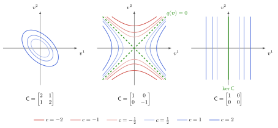{height="400px"}

[niveaucurven $q(\vv) = c$: positief definiet, indefiniet, positief semidefiniet (ontaard)]{style="color: grey; font-size: 70%"}
:::

## Bilineaire en sesquilineaire vormen {.scrollable}

::: {.definitie nr="5.9"}
$\mat{B} = \mat{T}^\transpose \tilde{\mat{B}} \mat{T}$ of $\mat{C} = \mat{T}^\hermitian \tilde{\mat{C}} \mat{T}$: **matrix congruentie** $\rightarrow$ equivalentierelatie
:::

* Behoudt (anti)symmetrisch of (anti)hermitisch
* Behoudt positief definiet / semidefiniet, indefiniet, …

::: {.opmerking nr="5.14"}
Behoudt geen eigenwaarden, niet compatibel met matrixvermenigvuldiging, machten, functies, …
:::

::: {.opmerking nr="5.15"}
Behoudt eigenwaarden $0$ en dus het ontaard zijn
:::

# Inwendig productruimten

## Inwendig product {.scrollable}

::: {.definitie nr="5.12"}
**Inwendig product** op vectorruimte $V$ = hermitische, positief definiete sesquilineaire vorm.

Notatie: $V \times V \to \bbF: (\vv,\vw) \mapsto \inner{\vv}{\vw}$, met eigenschappen

:::: {.columns}
::: {.column width="30%"}
**lineair in tweede argument**
:::
::: {.column width="70%"}
::: {style="text-align: center"}
$$\boxed{\inner{\vv}{a_1 \vw_1 + a_2 \vw_2} = a_1 \inner{\vv}{\vw_1} + a_2 \inner{\vv}{\vw_2}}$$
:::
:::
::::

:::: {.columns}
::: {.column width="30%"}
**hermitisch**
:::
::: {.column width="70%"}
::: {style="text-align: center"}
$$\boxed{\inner{\vv}{\vw} = \overline{\inner{\vw}{\vv}}}$$
[$\Rightarrow \inner{a_1 \vv_1 + a_2\vv_2}{\vw} = \overline{a_1}\inner{\vv_1}{\vw} + \overline{a_2} \inner{\vv_2}{\vw}$]{style="color: grey; font-size: 85%"}
:::
:::
::::

:::: {.columns}
::: {.column width="30%"}
**positief definiet**
:::
::: {.column width="70%"}
::: {style="text-align: center"}
$$\boxed{\vv \neq \zerovec \Rightarrow \inner{\vv}{\vv} > 0}$$
:::
:::
::::
:::

::: {.definitie nr="5.13"}
Matrixrepresentatie t.o.v. basis $B_V=\{\ve_1,\ldots,\ve_n\}$:

$\inner{\vv}{\vw} = \overline{v^i} g_{ij} w^j$ met $g_{ij} = \inner{\ve_i}{\ve_j}$ (**metriek** of **Gram matrix**)
:::

## Cauchy-Schwarz ongelijkheid {.scrollable}

::: {.stelling nr="5.2"}
**Cauchy-Schwarz-Bunjakowski**:

$$\boxed{\abs{\inner{\vv}{\vw}}^2 \leq \inner{\vv}{\vv}\inner{\vw}{\vw}}$$
:::

::: {.propositie nr="5.3"}
Gevolg: een inwendig productruimte is een genormeerde vectorruimte met de **geassocieerde norm**

$$\norm{\vv} = \sqrt{\inner{\vv}{\vv}}$$
:::

::: {.opmerking nr="5.21"}
Cauchy-Schwarz ongelijkheid: $\abs{\inner{\vv}{\vw}} \leq \norm{\vv}\norm{\vw}$
:::

::: {.opmerking nr="5.22"}
Als $\bbF=\bbR$: $-1 \leq \dfrac{\inner{\vv}{\vw}}{\norm{\vv}\norm{\vw}} \leq +1$, dus $\inner{\vv}{\vw} = \norm{\vv}\norm{\vw}\cos(\theta)$
:::

::: {.propositie nr="5.4"}
Inwendig product is continu t.o.v. de geassocieerde norm
:::

## Cauchy-Schwarz ongelijkheid

::: {.stelling nr="5.2"}
**Cauchy-Schwarz-Bunjakowski**: $\abs{\inner{\vv}{\vw}}^2 \leq \inner{\vv}{\vv}\inner{\vw}{\vw}$
:::

::: {.propositie nr="5.3"}
Gevolg: **geassocieerde norm** $\norm{\vv} = \sqrt{\inner{\vv}{\vv}}$ is een norm op $V$
:::

::: {style="text-align: center"}
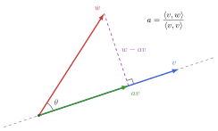{height="260px"}

[bewijsidee: projectie $a\vv$ van $\vw$ op $\vv$, met $a = \inner{\vv}{\vw}/\inner{\vv}{\vv}$; het residu $\vw - a\vv \perp \vv$, dus $\norm{a\vv} \leq \norm{\vw}$]{style="color: grey; font-size: 70%"}
:::

## Hilbertruimte

::: {.definitie nr="5.14"}
**Hilbertruimte**: inwendig productruimte die metrisch compleet is
:::

## Inwendig product: voorbeelden (eindig-dimensionaal) {.scrollable}

::: {.voorbeeld nr="5.1"}
$V=\bbR^n$: euclidisch inwendig product
$$\inner{\vec{v}}{\vec{w}}= \vec{v}^\transpose \vec{w} = v^i \delta_{ij} w^j = \sum_{i=1}^n v^i w^i$$
:::

::: {.voorbeeld nr="5.2"}
$V=\bbC^n$: natuurlijke veralgemening
$$\inner{\vec{v}}{\vec{w}}= \vec{v}^\hermitian \vec{w} = \overline{v^i} \delta_{ij} w^j = \sum_{i=1}^n \overline{v^i} w^i$$

[$\Rightarrow$ Cauchy-Schwarz ongelijkheid = specifiek geval van Hölder ($p=q=2$)]{style="margin-left: 1.5em; display: block"}
:::

::: {.voorbeeld nr="5.3"}
$V = \bbF^{m \times n}$: Frobenius inwendig product

$$\inner{\mat{A}}{\mat{B}}= \tr(\mat{A}^\hermitian \mat{B}) = \sum_{i=1}^m\sum_{j=1}^n \overline{A^i_{\ j}} B^i_{\ j}$$
:::

## Inwendig product: voorbeelden (oneindig-dimensionaal) {.smaller .scrollable}

::: {.voorbeeld nr="5.4"}
$V=\ell^2(\bbN_0, \bbF)$: rijen $\vec{v} = (v^i \in \bbF)_{i\in \bbN_0}$ waarvoor $\sum_{i=1}^{+\infty} \abs{v^i}^2 < \infty$

$$\Rightarrow \inner{\vec{v}}{\vec{w}} = \sum_{i=1}^{+\infty} \overline{v^i} w^i$$

* eindig, want $\abs{\sum_{i=1}^{+\infty} \overline{v^i} w^i} \leq \sum_{i=1}^{+\infty} \abs{\overline{v}^i w^i} \leq \frac{1}{2} \sum_{i=1}^{+\infty} \left(\abs{v^i}^2 + \abs{w^i}^2\right)$
:::

::: {.voorbeeld nr="5.5"}
$V = C^0([a,b],\bbF)$: continue functies op $[a,b]$
$$\Rightarrow \inner{f}{g} = \int_a^b\,\overline{f(x)}g(x)\,\drm x$$

* niet metrisch compleet: Cauchy rijen t.o.v. $\norm{\cdot }_2$ die niet convergeren naar continue functies
:::

::: {.voorbeeld nr="5.6"}
$V = L^2([a,b],\bbF)$: kwadratisch integreerbare functies (zie H7)
:::

## Inwendig product: voorbeelden (oneindig-dimensionaal)

:::: {.columns}
::: {.column width="45%"}
::: {style="height: 380px; display: flex; flex-direction: column; justify-content: center"}
Beschouw de rij van "hellingen"\
$f_n \in C^0([-1,1],\bbR)$, $n\in\bbN_0$:

$$f_n(x) = \begin{cases} -1, & x \leq -1/n \\ nx, & \abs{x} < 1/n \\ 1, & x \geq 1/n \end{cases}$$
:::
:::
::: {.column width="55%"}
::: {style="height: 380px; display: flex; align-items: center; justify-content: center"}
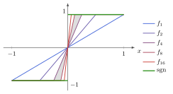{height="330px"}
:::
:::
::::

::: {style="text-align: center"}
[$C^0([-1,1])$ met $\norm{\cdot}_2$ is niet compleet: de Cauchy-rij $f_n$ convergeert naar $\operatorname{sgn}(x)$, die niet continu is]{style="color: grey; font-size: 70%"}
:::

## Inwendig product: bijkomende eigenschappen {.smaller .scrollable}

::: {.propositie nr="5.5"}
**Parallellogramwet**: voor de norm $\norm{\vv} = \sqrt{\inner{\vv}{\vv}}$ geassocieerd aan een inwendig product geldt

$$\boxed{\norm{\vv + \vw}^2 + \norm{\vv - \vw}^2 = 2(\norm{\vv}^2 + \norm{\vw}^2)}$$
:::

::: {.stelling nr="5.6"}
Gegeven een genormeerde vectorruimte $(V,\norm{\cdot})$ waarbij de norm voldoet aan de parallellogramwet. Dan kan uit die norm een inwendig product worden gedefinieerd via de zogenaamde **polarisatie-identiteit**:

\begin{align}
	\inner{\vv}{\vw} = \begin{cases}
\frac{1}{4}\norm{\vv + \vw}^2 - \frac{1}{4}\norm{\vv - \vw}^2,&\text{$V$ real}\\
\frac{1}{4}\norm{\vv + \vw}^2 - \frac{1}{4}\norm{\vv - \vw}^2 + \frac{\irm}{4}\norm{\vv - \irm \vw}^2 - \frac{\irm}{4}\norm{\vv + \irm \vw}^2,&\text{$V$ complex}
\end{cases}
\end{align}

(bewijs niet te kennen)
:::

## Inwendig product: bijkomende eigenschappen

::: {style="text-align: center"}
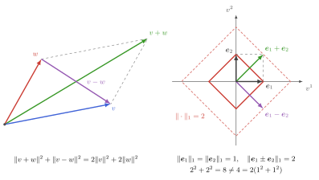{height="450px"}

[(a) parallellogramwet in $\bbR^2$; (b) de 1-norm voldoet er niet aan, en komt dus niet van een inwendig product]{style="color: grey; font-size: 70%"}
:::

# Orthogonaliteit en unitariteit

## Orthogonaliteit {.scrollable}

Gegeven een inwendig productruimte $(V,\inner{\ }{\ })$

::: {.definitie nr="5.15"}
**Orthogonaliteit**:
$$\boxed{\vv \perp \vw \iff \inner{\vv}{\vw}=0}$$
Uitbreiding voor $A,B \subseteq V$:
$$A \perp B \iff \inner{\vv}{\vw}=0 \quad \forall \vv \in A, \vw \in B$$
:::

::: {.definitie nr="5.16"}
**Genormaliseerde** vector $\vv \iff \norm{\vv} = 1$.

Elke vector $\vv \neq \zerovec$ is proportioneel met **eenheidsvector** $\vu = \vv / \norm{\vv}$
:::

## Orthogonaliteit {.scrollable}

::: {.definitie nr="5.17"}
* **Orthogonale verzameling**: $\{\vv_i; i \in I\} \iff \vv_i \perp \vv_j, \forall i\neq j$
* **Orthonormale familie / systeem**: $\{\vv_i; i \in I\}$ met $\inner{\vv_i}{\vv_j} = \delta_{i,j}$
* **Orthonormale rij**: $\{\vv_n; n \in \bbN\}$ met $\inner{\vv_n}{\vv_m} = \delta_{n,m}$
:::

::: {.propositie nr="5.7"}
Orthogonale verzameling is lineair onafhankelijk
:::

::: {.gevolg nr="5.8"}
Als $\dim(V)=n$ eindig: ten hoogste $n$ orthogonale vectoren
:::

::: {.stelling nr="5.9" title="Pythagoras"}
Orthogonale verzameling $\{\vv_i; i=1,\ldots,n\}$
$$\boxed{\norm{\sum_{i=1}^n \vv_i}^2 = \sum_{i=1}^n \norm{\vv_i}^2}$$
:::

## Orthogonaal complement {.scrollable}

:::: {.columns}
::: {.column width="64%"}
::: {.definitie nr="5.18"}
Verzameling $S \subseteq V$:

$$S^\perp = \{\vv \in V | \inner{\vw}{\vv} = 0\ \text{voor alle}\ \vw \in S\}$$
:::

eigenschappen:

::: {.propositie nr="5.10"}
$S^\perp$ is gesloten deelruimte
:::

::: {.propositie nr="5.11"}
$S^\perp = (\bbF S)^\perp = (\overline{\bbF S})^\perp$
:::

::: {.propositie nr="5.12"}
$S \cap S^\perp = \{\zerovec\}$ of $\{\}$ (afhankelijk van $\zerovec \in S$)
:::
:::
::: {.column width="36%"}
::: {style="text-align: center"}
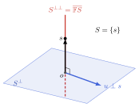{width="100%"}

[$S = \{\vec{s}\}$: $S^\perp$ is een vlak, $S^{\perp\perp} = \overline{\bbF S}$ de rechte door $\vec{s}$]{style="color: grey; font-size: 70%"}
:::
:::
::::

## Orthogonale projectie

Gegeven een **gesloten (!)** deelruimte $W \subspace V$

::: {.stelling nr="5.13"}
**Orthogonale projectie** van een vector $\vv \in V$ is de vector $\vw \in W$ die voldoet aan

$$\boxed{\norm{\vv-\vw} = \inf_{\vw' \in W}\norm{\vv-\vw'}} \qquad \text{of} \qquad \boxed{\vv - \vw \in W^\perp}$$

Beide karakterisaties zijn equivalent en leiden tot een unieke oplossing
:::

::: {.gevolg nr="5.14"}
Voor een gesloten deelruimte $W$ van een Hilbertruimte $V$: unieke **orthogonale directe som decompositie** $V = W \oplus W^\perp$
:::

## Orthogonale projectie

::: {style="text-align: center"}
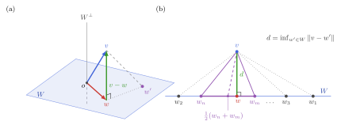{height="380px"}

[(a) $\vv - \vw \in W^\perp$: $\vw$ ligt het dichtst bij $\vv$; (b) bestaan: minimaliserende rij + parallellogramwet]{style="color: grey; font-size: 70%"}
:::

## Orthogonale projector {.scrollable}

::: {.definitie nr="5.19"}
**Orthogonale projector** $\map{P}\in\End(V)$:

$$\boxed{\map{P}^2 = \map{P}} \qquad \text{en} \qquad \boxed{\inner{\map{P}\vv}{\vw} = \inner{\vv}{\map{P}\vw} \quad \forall \vv,\vw \in V}$$
:::

::: {.lemma nr="5.15"}
$\Rightarrow$ operator norm $\norm{\map{P}} = 1$
:::

::: {.propositie nr="5.16"}
* de projector $\map{P}_W$ op gesloten deelruimte $W$ langsheen $W^\perp$ is een orthogonale projector
* elke orthogonale projector leidt tot een orthogonale directe som decompositie
  $$V = \im(\map{P}) \oplus \ker(\map{P}), \qquad \im(\map{P}) = \ker(\map{P})^\perp$$
  waarbij beide gesloten deelruimten van $V$ zijn
:::

## Orthogonale projector

::: {style="text-align: center"}
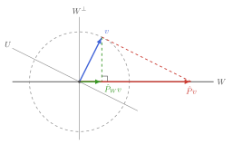{height="400px"}

[orthogonale vs. schuine projectie op $W$: enkel de orthogonale heeft $\norm{\map{P}} = 1$]{style="color: grey; font-size: 70%"}
:::

## Orthogonaal complement en directe som {.scrollable}

Bijkomende eigenschappen van orthogonaal complement en orthogonale directe som:

::: {.propositie nr="5.17"}
Voor elke deelverzameling $S$: $V = S^\perp \oplus S^{\perp\perp}$
[*aangezien $S^\perp$ gesloten deelruimte is*]{style="margin-left: 1.5em; display: block"}
:::

::: {.propositie nr="5.18"}
Voor elke gesloten deelruimte $W$: $W^{\perp\perp} = W$
[*aangezien orthogonaal complement van $W^\perp$ uniek is*]{style="margin-left: 1.5em; display: block"}
:::

::: {.propositie nr="5.19"}
Voor elke deelverzameling $S$: $S^{\perp\perp} = \overline{\bbF S}$
[*aangezien $S^\perp = (\overline{\bbF S})^\perp$ en voorgaande*]{style="margin-left: 1.5em; display: block"}
:::

::: {.propositie nr="5.20"}
Voor elke complete set $S$: $S^\perp = \{0\}$
[*aangezien $S^\perp = (\overline{\bbF S})^\perp = V^\perp$*]{style="margin-left: 1.5em; display: block"}
:::

## Orthonormale basis

* **Eindig-dimensionaal**, $\dim(V)=n$:
  * elke verzameling van $n$ orthogonale vectoren is lineair onafhankelijk en vormt een basis
  * orthogonale basis maken uit een gegeven basis: zie straks (Gram-Schmidt)
* **Oneindig-dimensionaal**, $V$ Hilbertruimte (metrisch compleet):
  * elke complete rij van orthogonale vectoren vormt een (Schauder) basis
  * bewijs in stappen op de volgende slides

## Orthonormale basis {.scrollable}

Beschouw in een **oneindig-dimensionale Hilbertruimte** $V$ een rij $(\ve_n, n \in \bbN_0)$ van orthonormale vectoren:

::: {.lemma nr="5.21"}
Orthogonale projector op $W_n = \bbF\{\ve_i,i=1,\ldots,n\}$: $\map{P}_n \vv = \sum_{i=1}^n \ve_i \inner{\ve_i}{\vv}$
:::

::: {.lemma nr="5.22"}
**Bessel's ongelijkheid**:
$$\sum_{i=1}^n \abs{\inner{\ve_i}{\vv}}^2 \leq \norm{\vv}^2$$
[$\Rightarrow$ $\sum_{i=1}^{+\infty}\abs{\inner{\ve_i}{\vv}}^2$ convergeert (stijgend en begrensd) naar een limiet $\leq \norm{\vv}^2$]{style="margin-left: 1.5em; display: block"}
:::

::: {.stelling nr="5.23" title="Expansiestelling"}
In een **Hilbertruimte** $V$ vormt een compleet orthonormale rij een Schauder basis: elke $\vv \in V$ is de convergente reeks
$$\boxed{\vv = \sum_{i=1}^{+\infty} \ve_i \inner{\ve_i}{\vv}}$$
:::

## Expansiestelling: gevolgen {.scrollable}

::: {.gevolg nr="5.24"}
Bessel's ongelijkheid $\rightarrow$ **Plancherel's identiteit**

$$\boxed{\norm{\vv}^2 = \sum_{i=1}^{+\infty} \abs{\inner{\ve_i}{\vv}}^2}$$
:::

::: {.propositie nr="5.25"}
Meer algemeen: **Parseval's identiteit**

$$\boxed{\inner{\vv}{\vw} = \sum_{i=1}^{+\infty} \inner{\vv}{\ve_i}\inner{\ve_i}{\vw} = \sum_{i=1}^{+\infty}\conj{\inner{\ve_i}{\vv}}\inner{\ve_i}{\vw}}$$
:::

## Expansiestelling: gevolgen

::: {.opmerking nr="5.28"}
De lineaire afbeelding $\vv \mapsto \sum_{i=1}^{+\infty} \ve_i \inner{\ve_i}{\vv}$ gedraagt zich als $\id_V$:

**resolutie van de identiteit**
:::

::: {.opmerking nr="5.29"}
* Expansiecoefficiënten: $(\inner{\ve_i}{\vv})_{i\in \bbN_0}$, ook wel: *veralgemeende Fourier-coefficiënten*
* Relatie $\vv\leftrightarrow (\inner{\ve_i}{\vv})_{i\in \bbN_0}$ is een Hilbertruimte-isomorfisme tussen $V$ en $\ell^2(\bbN_0, \bbF)$
  * $\ell^2(\bbN_0,\bbF)$ speelt voor oneindig-dimensionale Hilbertruimten de rol die $\bbF^n$ speelt voor eindig-dimensionale
:::

## Expansiestelling: voorbeeld {.smaller .scrollable}

::: {.voorbeeld nr="5.8"}
* $V = L^2([0,L], \bbC)$: rij $(f_k)_{k\in \bbZ}$ met

  $$f_k(x) = \frac{1}{\sqrt{L}}\exp\left(+\irm \frac{2\pi}{L} k x\right)$$

  is orthonormaal (controleer!) en compleet (geen bewijs).

* Basisexpansie is de Fourierreeks:

  $$f(x) = \frac{1}{\sqrt{L}}\sum_{k=-\infty}^{+\infty} F^k \exp\left(+\irm \frac{2\pi}{L} k x\right)$$

  met de (dubbelzijdige) rij Fouriercoëfficiënten $(F_k)_{k \in\bbZ} \in \ell^2(\bbZ,\bbC)$, gegeven door

  $$F^k = \inner{f_k}{f} = \frac{1}{\sqrt{L}} \int_{0}^{L} f(x) \exp\left(-\irm \frac{2\pi}{L} k x\right)\,\drm x$$
:::

* Zie hoofdstuk 7 voor meer details

## Expansiestelling: voorbeeld

::: {style="text-align: center"}
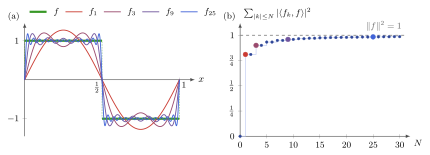{height="360px"}

[(a) Fourierreeks van de blokgolf; (b) Bessel: $\sum_{\abs{k} \leq N} \abs{\inner{f_k}{f}}^2$ stijgt naar $\norm{f}^2$ (Plancherel)]{style="color: grey; font-size: 70%"}
:::

## Gram-Schmidt {.smaller .scrollable}

::: {.definitie nr="5.20"}
Lineair onafhankelijke vectoren: $S=\{\vv_1,\vv_2,\ldots\}$

$\rightarrow$ orthonormale rij $(q_1,q_2,\ldots)$ die zelfde (deel)ruimte opspant

$\rightarrow$ meer specifiek: $\bbF\{\vv_i, i=1,\ldots,n\} = \bbF\{q_i; i=1,\ldots,n\}$ voor alle $n$

**Gram-Schmidt proces / algoritme**:

\begin{align*}
	\vw_1 &= \vv_1& \vect{q}_1 = \vw_1/\norm{\vw_1}\\
	\vw_2 &= \vv_2 - \inner{\vect{q}_1}{\vv_2} \vect{q}_1 & \vect{q}_2 = \vw_2 / \norm{\vw_2}\\
	&\ldots\\
	\vw_k &= \vv_k - \sum_{j=1}^{k-1}\inner{\vect{q}_j}{\vv_k} \vect{q}_j & \vect{q}_k = \vw_k / \norm{\vw_k}\\
	&\ldots
\end{align*}
:::

::: {.opmerking nr="5.31"}
$\vw_n$ kan enkel nul worden als $\vv_n$ lineair afhankelijk is van $\{\vv_1,\ldots,\vv_{n-1}\}$
:::

::: {.opmerking nr="5.32"}
$\vv_k = \sum_{j=1}^{k} R^{j}_{\ k} \vect{q}_{j}$ met $R^j_{\ k} = \inner{q_j}{\vv_k}$ en $R^k_{\ k} = \norm{\vv_k - \sum_{j=1}^{k-1}R^j_{\ k} \vect{q}_j} = \norm{\vw_k}$
:::

## Gram-Schmidt

::: {style="text-align: center"}
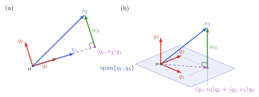{height="360px"}

[(a) tweede stap in $\bbR^2$: $\vw_2 = \vv_2 - \inner{\vect{q}_1}{\vv_2}\vect{q}_1 \perp \vect{q}_1$; (b) derde stap: de projectie op $\operatorname{span}\{\vect{q}_1, \vect{q}_2\}$ aftrekken]{style="color: grey; font-size: 70%"}
:::

## Gram-Schmidt en QR decompositie {.scrollable}

Matrixversie: $\bbF^n$ met Euclidisch inwendig product

* $m$ lineair onafhankelijke vectoren: $\mat{V} = \begin{bmatrix} \vec{v}_1 | \vec{v}_2 | \dots | \vec{v}_m \end{bmatrix} \in \bbF^{n \times m}$

::: {.definitie nr="5.21"}
Gram-Schmidt leidt tot $\mat{V} = \mat{Q} \mat{R}$ met

* bovendriekhoeksmatrix $\mat{R}$
* $\mat{Q} = \begin{bmatrix} \vec{q}_1 | \vec{q}_2 | \dots | \vec{q}_m \end{bmatrix}$

  $\Rightarrow \inner{\vec{q}_i}{\vec{q}_j} = \vec{q}_i^\hermitian \vec{q}_j = \delta_{i,j} \Rightarrow \mat{Q}^\hermitian \mat{Q} = \idmat_m$

**QR-decompositie** van een matrix
:::

::: {.opmerking nr="5.33"}
Numeriek: keuze algoritme van belang voor stabiliteit

(classical vs modified Gram-Schmidt, Householder)
:::

# Lineaire functionalen en dualiteit van Hilbertruimten

## Lineaire functionalen {.scrollable}

Gegeven een Hilbertruimte $V$:

::: {.propositie nr="5.26"}
Aan elke $\vv\in V$ associeren we een $\chi_\vv \in V^\ast$
$$\boxed{\chi_\vv: V \to \bbF : \vw \mapsto \chi_\vv[\vw] = \inner{\vv}{\vw}}$$

* Afbeelding $\vv \to \chi_{\vv}$ is antilineair (triviaal)
* Afbeelding $\vv \to \chi_{\vv}$ is injectief
* Lineaire functionaal $\chi_\vv$ is continu en dus ook begrensd
* Inderdaad: $\abs{\chi_\vv[w]} \leq \norm{\vv} \norm{\vw}$ (Cauchy-Schwarz)
:::

$\Rightarrow$ kunnen we elke (begrensde) functionaal zo bekomen?

## Lineaire functionalen

Als $V$ eindig-dimensionaal met $B_V=\{\ve_1,\ldots,\ve_n\}$:

* Duale basis $B^\ast_V=\{\varepsilon^1,\ldots,\varepsilon^n\}$: $\varepsilon^i[\ve_j] =\delta^i_{\ j}$
* $\chi_\vv[w] = \inner{\vv}{\vw} = \overline{v^i} g_{ij} w^j = (\chi_\vv)_j w^j$

  $\Rightarrow \chi_\vv = \overline{v^i} g_{ij} \varepsilon^j$

* Inverse metriek: $\mat{g}^{-1} \mat{g} = \idmat \iff \underbrace{g^{ij}}_{= (\mat{g}^{-1})^{ij}} g_{jk} = \delta^i_{\ k}$

* $\xi[\vw] = \xi_j \vw^j \rightarrow \xi[\vw] = \inner{\vv_\xi}{\vw}$

  $\Rightarrow (\vv_\xi)^j = \overline{\xi_i g^{ij}}$

## Lineaire functionalen en vectoren {.smaller .scrollable}

Voor $V$ eindig-dimensionaal kunnen we elke lineaire functionaal $\xi$ voorstellen als inwendig product met een geassocieerde vector $\vv_\xi$

Interpretatie en gevolgen:

::: {.opmerking nr="5.37"}
$\ker(\xi)$ heeft codimensie $1$ (tenzij $\xi=0$):

$\ker(\xi) = (\vv_\xi)^\perp$ (elkaars orthogonaal complement)
:::

* Met elke $\vv \in V$ is exact één $\chi \in V^\ast$ geassocieerd en vice versa ($\vv \to \chi_\vv$ en $\xi \to \vv_{\xi}$ zijn elkaars inverse)

## Representatiestelling van Riesz {.smaller .scrollable}

Geldt dit ook voor oneindig-dimensionale Hilbertruimten $V$?

::: {.opmerking nr="5.36"}
Vanaf nu: $V^\ast = \mathcal{B}(V,\bbF)$ (begrensde lineaire functionalen)
:::

::: {.stelling nr="5.27" title="Representatiestelling van Riesz"}
Voor elke $\xi \in V^\ast$ bestaat er $\vv_\xi \in V$ zodat $\xi[\vw] = \inner{\vv_\xi}{\vw}$ voor alle $\vw \in V$
:::

::: {.bewijs}
* $\ker(\xi)$ is gesloten wegens continuïteit
* orthogonaal complement is één-dimensionaal
* we kunnen een element uit $\ker(\xi)^\perp$ kiezen zodat gelijkheid geldt
:::

* Gevolg: voor Hilbertruimten geldt $V \cong V^\ast$

# Begrensde lineaire afbeeldingen tussen Hilbertruimten

## Begrensde lineaire afbeeldingen {.smaller .scrollable}

Hilbertruimten $(V, \inner{\ }{\ }_V)$ en $(W, \inner{\ }{\ }_W)$; lineaire afbeelding $\map{A} \in \mathcal{B}(V,W)$

* Geinduceerde norm:

  \begin{align*}
    \norm{\map{A}} &= \sup_{\substack{ \vv \in V\\ \vv \neq \zerovec}} \frac{\norm{\map{A}\vv}_W}{\norm{\vv}_V} = \sup_{\substack{\vv \in V\\ \norm{\vv}_V = 1}} \norm{\map{A}\vv}_W\\
    &= \sup_{\substack{\vv \in V, \vw \in W \\ \vv \neq \zerovec, \vw \neq \zerovec}} \frac{\abs{\inner{\vw}{\map{A}\vv}_W}}{\norm{\vw}_W \norm{\vv}_V} = \sup_{\substack{\vv \in V, \vw \in V \\ \norm{\vv}_V = 1, \norm{\vw}_W=1}} \abs{\inner{\vw}{\map{A}\vv}_W}.
  \end{align*}

* $\ker(\map{A})$ van begrensde lineaire afbeelding is altijd gesloten deelruimte

* $\im(\map{A})$ is niet noodzakelijk gesloten:

  * beschouw $(\vw_n \in \im(\map{A}))$ met $\lim_{n\to\infty} \vw_n =\vw$
  * voor elke $\vw_n$ bestaat er (niet noodzakelijk uniek) $\vv_n \in V$ met $\vw_n = \map{A}\vv_n$
  * geen garantie dat $(\vv_n \in V)$ Cauchy rij is, en dus dat limiet bestaat

## Eindig-dimensionaal en basisrepresentatie

* Basis voor $V$: $B_V = \{\ve_1,\ldots,\ve_n\}$

* Basis voor $W$: $B_W = \{\vf_1,\ldots,\vf_m\}$

  $\Rightarrow$ Duale basis voor $W^\ast$: $B_W^\ast = \{\varphi^1,\ldots,\varphi^m\}$

* Matrixrepresentatie $\map{A}\ve_j = A^i_{\ j} \vf_i \Rightarrow A^i_{\ j} = \varphi^i[\map{A}\ve_j]$

* Als $B_W$ een orthonormale basis is: $A^i_{\ j}= \inner{\vf_i}{\map{A}\ve_j}$

  * Inderdaad: $\varphi^i[\vf_j] = \delta^i_{\ j} = \inner{\vf_i}{\vf_j}$

    $\Rightarrow$ $\vf_i$ is de vector die door de representatiestelling van Riesz wordt geassocieerd aan de lineaire basisfunctionaal $\varphi^i$

## Toegevoegde van een afbeelding {.scrollable}

::: {.propositie nr="5.28"}
Voor elke $\map{A}\in \mathcal{B}(V,W)$ bestaat er een afbeelding in $\mathcal{B}(W,V)$ die we noteren als $\map{A}^\dagger$ en die voldoet aan

$$\inner{\vw}{\map{A}\vv} = \inner{\map{A}^\dagger\vw}{\vv},\quad \forall \vw \in W, \forall\vv \in V$$

en $\norm{\map{A}^\dagger}=\norm{\map{A}}$
:::

::: {.definitie nr="5.22"}
Eigenschappen van $\dagger$ ('dagger'):

* **antilineair**: $(a\map{A} + b \map{B})^\dagger = \conj{a} \map{A}^\dagger + \conj{b} \map{B}^\dagger$
* **anti-homomorphisme** voor compositie: $(\map{A}\map{B})^\dagger = \map{B}^\dagger \map{A}^\dagger$
* **involutief**: $\map{A}^{\dagger\dagger} = (\map{A}^\dagger)^\dagger = \map{A}$
:::

## Toegevoegde afbeelding: matrixrepresentatie

Voor $V$ en $W$ eindig-dimensionaal:

$\inner{\vw}{\map{A}\vv} = \inner{\map{A}^\dagger\vw}{\vv}$
$\quad\iff \conj{w}^i (\mat{g}_W)_{ij} A^j_{\ k} v^k = \overline{(A^\dagger)^l_{\ i} w^i} (\mat{g}_V)_{lk} v^k$

$\Rightarrow 	(A^\dagger)^l_{\ i} = \overline{(\mat{g}_W)_{ij} A^j_{\ k} (\mat{g}_V^{-1})^{k l}}$

Als $B_V$ en $B_W$ orthonormaal:

* $(A^\dagger)^l_{\ i} = \overline{A^i_{\ l}} = (\mat{A}^\hermitian)^l_{\ i}$
* Toegevoegde afbeelding voorgesteld door Hermitisch toegevoegde matrixrepresentatie

## Toegevoegde afbeelding: eigenschappen

Beschouw $\map{A}\in\mathcal{B}(V,W)$

::: {.propositie nr="5.29"}
$\norm{\map{A}^\dagger\map{A}} = \norm{\map{A}\map{A}^\dagger} = \norm{\map{A}}^2$
:::

::: {.propositie nr="5.30"}
$\ker(\map{A}^\dagger) = \im(\map{A})^\perp$. Gevolgen:

* $$W = \ker(\map{A}^\dagger) \oplus \overline{\im(\map{A})}$$
* $$V = \ker(\map{A})\oplus \overline{\im(\map{A}^\dagger)}$$
:::

## Toegevoegde afbeelding: eigenschappen

::: {style="text-align: center"}
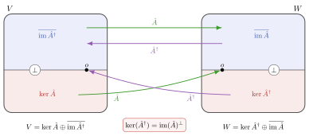{height="420px"}

[de vier fundamentele deelruimten van $\map{A}$ en $\map{A}^\dagger$]{style="color: grey; font-size: 70%"}
:::

## Toegevoegde afbeelding: voorbeeld

Oneindig-dimensionaal voorbeeld:

::: {.voorbeeld nr="5.9"}
* $V = W = \ell^2(\bbN_0,\bbF)$ (kwadratisch sommeerbare rijen)
  * $\inner{\vv}{vw} = \conj{w^1}v^1+\conj{w^2}v^2+\conj{w^3}v^3+\ldots$
* $\map{S}$ en $\map{T}$ zijn de rechtse en linkse "verschuif"-operatoren:
  * $\map{S}(v^1,v^2,v^3,\dots)= (0, v^1,v^2, \dots)$
  * $\map{T}(v^1,v^2,v^3,\dots)= (v^2,v^3,v^4,\dots)$
* $\inner{\vec{w}}{\map{S}\vec{v}} = \conj{w^2} v^1 + \conj{w^3} v^2 + \conj{w^4} v^3 + \dots = \inner{\map{T}\vec{w}}{\vec{v}}$
* $\Rightarrow \map{T} = \map{S}^\dagger$
:::

## Zelf-toegevoegde operatoren {.smaller .scrollable}

Hilbertruimte $V=W$: operatoren

::: {.definitie nr="5.23"}
Een operator is **zelftoegevoegd** als $\map{A}=\map{A}^\dagger$
:::

* Met elke operator $\map{A}\in \End(V)$ kunnen we een sesquilineaire vorm associëren:

  $$A(\vv,\vw) = \inner{\vv}{\map{A}\vw}$$

  $\Rightarrow$ eigenschappen van sesquilineaire vormen kunnen worden geassocieerd aan operatoren:

::: {.opmerking nr="5.42"}
(Anti)Hermitisch: $A(\vv,\vw) = \pm \overline{A(\vw,\vv)} \iff \inner{\vv}{\map{A}\vw} = \pm \inner{\map{A}\vv}{\vw}$

$\Rightarrow$ zelftoegevoegd impliceert Hermitisch

(en vice versa, voor begrensde operatoren, zie later voor onbegrensde)

(terminologie "zelftoegevoegd" en "Hermitisch" vaak door elkaar gebruikt)
:::

::: {.opmerking nr="5.44"}
Positief (semi)definiet: $\inner{\vv}{\map{A}\vv} > 0$ of $\geq 0$ voor alle $\vv \in V$
:::

::: {.opmerking nr="5.45"}
Matrixvoorstelling ten opzichte van orthonormale basis: $\mat{A} = \mat{A}^\hermitian$
:::

## Zelf-toegevoegde operatoren: eigenschappen {.smaller .scrollable}

::: {.opmerking nr="5.43"}
$\map{A}\in\End(V)$ zelftoegevoegd en $\map{A}\vv = \lambda \vv$:

$\inner{\vv}{\map{A}\vv} = \inner{\map{A}\vv}{\vv} \implies \lambda = \conj{\lambda}$ of dus $\lambda \in \bbR$
:::

::: {.opmerking nr="5.46"}
* $\map{A}\in\End(V)$ zelftoegevoegd:

  $p(\map{A})$ zelftoegevoegd voor $p$ een polynoom met reële coefficiënten

* $\map{A},\map{B}\in\End(V)$ zelftoegevoegd:

  $\map{A}\map{B}$ zelftoegevoegd $\iff$ $\commutator{\map{A}}{\map{B}} = \zeromap$
:::

::: {.voorbeeld nr="5.10"}
Orthogonale projector $\equiv$ zelftoegevoegde projector
:::

::: {.voorbeeld nr="5.12"}
Voorbeeld op $V =L^2([a,b])$: $\map{M}_x: f(x) \mapsto x f(x)$

$\inner{g}{\map{M}_x f} = \int_a^b \overline{g(x)} (x f(x)) \,\drm x
= \int_{a}^b \overline{x g(x)} f(x)\,\drm x = \inner{\map{M}_x g}{f}$

$\Rightarrow \map{M}_x$ is zelftoegevoegd / Hermitisch

($\map{M}_x$ is begrensd voor $L^2([a,b])$ met compact interval $[a,b]$; zie H7)
:::

## Isometrische en unitaire afbeeldingen {.smaller .scrollable}

Beschouw $\map{Q}\in \mathcal{B}(V,W)$:

::: {.propositie nr="5.31"}
Isometrisch $\iff \map{Q}^\dagger\map{Q}=\idmap_V$
:::

::: {.bewijs}
$\forall \vv,\vv' \in V$: $d_W(\map{Q}\vv,\map{Q}\vv') = \norm{\map{Q}\vv - \map{Q}\vv'} = d_V(\vv,\vv') = \norm{\vv-\vv'}$

$\iff \norm{\map{Q}\vv} = \norm{\vv}$ voor alle $\vv \in V$

$\iff \inner{\vv}{\map{Q}^\dagger \map{Q}\vv} = \inner{\vv}{\vv}$ of dus $\inner{\vv}{(\map{Q}^\dagger\map{Q}-\idmap_V)\vv}=0$ voor alle $\vv \in V$

$\iff \inner{\vv}{\map{Q}^\dagger \map{Q}\vw} = \inner{\vv}{\vw}$ voor alle $\vv,\vw \in V$

($\Leftarrow$ triviaal, $\Rightarrow$ via $\inner{\vv+a\vw}{(\map{Q}^\dagger \map{Q}-\idmap_V)(\vv+a\vw)}=0$ en $a$ juist kiezen)
:::

* Uit H4: isometrisch $\implies$ injectief

::: {.propositie nr="5.32"}
Als ook surjectief (en dus bijectief): **unitaire** transformatie ( **orthogonaal** als $\bbF=\bbR$)

als $\map{U}^{-1}$ bestaat en $\map{U}^\dagger \map{U}=\idmap_V$ $\implies$ $\map{U}^{-1}=\map{U}^\dagger$ en dus $\map{U}\map{U}^\dagger = \idmap_W$
:::

## Isometrische en unitaire afbeeldingen {.smaller .scrollable}

* (Zoals steeds) $V, W$ met $\dim(V) = \dim(W)$ eindig: isometrisch $\iff$ unitair

::: {.voorbeeld nr="5.15"}
Tegenvoorbeeld als oneindig-dimensionaal: $V=W = \ell^2(\bbN_0)$

$\map{T}\map{S}=\map{S}^\dagger\map{S} = \idmap$ en $\map{S}\map{S}^\dagger = \map{P}$ met $\map{P}(v^1,v^2,v^3,\ldots) = (0, v^2, v^3,\ldots)$
:::

::: {style="text-align: center"}
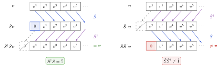{height="220px"}

[$\map{S}^\dagger\map{S} = \idmap$ maar $\map{S}\map{S}^\dagger \neq \idmap$: $\map{S}$ is isometrisch, niet unitair]{style="color: grey; font-size: 70%"}
:::

## Isometrische en unitaire afbeeldingen {.smaller .scrollable}

::: {.opmerking nr="5.49"}
Als unitaire afbeelding $V \to W$ bestaat: $V \cong W$ isomorf als Hilbertruimten
:::

::: {.voorbeeld nr="5.13"}
* elke $n$-dimensionale Hilbertruimteruimte is isomorf met $\bbC^n$ met Euclidisch inwendig product (via keuze van orthonormale basis)

* elke (separabele) oneindig-dimensionale Hilbertruimte is isomorf met $\ell^2(\bbN_0)$ via keuze van een complete orthonormale rij = orthonormale basis
:::

::: {.voorbeeld nr="5.14"}
Voor $\map{S}\in\End(V)$ met $\map{S} = -\map{S}^\dagger$:

$\map{U} = \exp(\map{S})$ is unitaire transformatie van $V$ naar zichzelf

* $\exp(\map{S})^{-1} = \exp(-\map{S}) = \exp(\map{S}^\dagger)=\exp(\map{S})^\dagger$
* vaak geschreven als $\map{U}=\exp(\irm \map{H})$ met $\map{H}=\map{H}^\dagger$
:::

* $\map{Q}$ isometrisch maar niet unitair: $\map{Q}\map{Q}^\dagger$ is orthogonale projector

## Isometrische en unitaire matrices {.smaller .scrollable}

* Unitaire matrices $\mat{U} \in \bbC^{n\times n}$: basistransformatie tussen orthonormale basissen

  * $B_V = \{\ve_1,\ve_2,\ldots,\ve_n\}$ en $\tilde{B}_V = \{\tilde{\ve}_1,\tilde{\ve}_2,\ldots,\tilde{\ve}_n\}$

  * $\tilde{\ve}_i = U^j_{\ i} \ve_{j}$

  * $\delta_{ij} = \inner{\tilde{\ve}_i}{\tilde{\ve}_j} = \overline{U^k_{\ i}} U^l_{\ j} \inner{\ve_k}{\ve_l} = \overline{U^k_{\ i}} U^l_{\ j} \delta_{kl}$ of dus $\mat{U}^\hermitian \mat{U} = \idmat$

* Isometrische matrix $\mat{Q} \in \bbC^{m \times n}$ met $m \geq n$:

  * isometrische afbeelding van $\bbC^n$ naar $\bbC^m$

    (of: matrixrepresentatie van isometrische afbeelding $V \to W$ ten opzichte van orthonormale basissen in $V$ en $W$)

  * kolommen van $\map{Q}$ definiëren orthonormale basis $\{\vec{q}_1,\ldots,\vec{q}_n\}$ voor $n$-dimensionale deelruimte $W \subspace \bbC^m$.

    ::: {.voorbeeld nr="5.11"}
    $\mat{P}_W = \sum_{i=1}^n \vec{q}_i \vec{q}_i^\hermitian = \mat{Q}\mat{Q}^\hermitian$ en $\mat{P}_{W^\perp} = \idmat - \mat{Q}\mat{Q}^\hermitian$
    :::

    $\rightarrow$ andere orthonormale basis voor $W$: $\mat{\tilde{Q}} =\mat{Q} \mat{U}$ met $\mat{U}\in\bbC^{n\times n}$ unitair $\Rightarrow$ $\mat{P}_W = \mat{\tilde{Q}}\mat{\tilde{Q}}^\dagger = \mat{Q}\mat{Q}^\dagger$

## Normale operatoren {.scrollable}

::: {.definitie nr="5.24"}
$\map{A} \in \End(V)$ voldoet aan $\map{A}\map{A}^\dagger = \map{A}^\dagger\map{A}$: **normale operator**
:::

Speciale gevallen van normaal:

::: {.opmerking nr="5.50"}
Zelftoegevoegde operator: $\map{A} = \map{A}^\dagger$
:::

::: {.opmerking nr="5.51"}
Unitaire operator: $\map{A}\map{A}^\dagger = \map{A}^\dagger\map{A} = \idmap_V$
:::

::: {.opmerking nr="5.53"}
Voor alle $\map{A} \in \End(V)$: 	$\map{A} = \underbrace{\frac{\map{A}+\map{A}^\dagger}{2}}_{\map{A}_{\text{r}}} + \irm \underbrace{\frac{\map{A} - \map{A}^\dagger}{2\irm}}_{\map{A}_{\text{i}}}$

normaal $\iff \commutator{\map{A}_{\text{r}}}{\map{A}_{\text{i}}}=\zeromap$

$\Rightarrow$ $\map{A}_{\text{r}}$ en $\map{A}_{\text{i}}$ gelijktijdig diagonaliseerbaar?
:::

## Normale operatoren: eigenschappen {.scrollable}

::: {.propositie nr="5.33"}
$\map{A}\in \End(V)$ is normaal als en slechts als
$$\norm{\map{A}\vv} = \norm{\map{A}^\dagger\vv} \quad \forall \vv \in V$$
:::

Voor $\map{A} \in \End(V)$ normaal en $\map{A}\vv = \lambda \vv$:

::: {.propositie nr="5.34"}
$\map{A}^\dagger \vv = \conj{\lambda} \vv$
[*uit voorgaande*]{style="margin-left: 1.5em; display: block"}
:::

::: {.opmerking nr="5.54"}
$\map{A}_{\text{r}}\vv = \real(\lambda) \vv,\quad\map{A}_{\text{i}}\vv = \imag(\lambda) \vv$
[*triviaal uit voorgaande*]{style="margin-left: 1.5em; display: block"}
:::

::: {.propositie nr="5.35"}
Als $\map{A}\vw = \mu \vw$ met $\mu \neq \lambda$, dan $\inner{\vv}{\vw}=0$
:::

## Normale operatoren: eigenschappen {.scrollable}

::: {.lemma nr="5.36"}
$\map{A} \in \End(V)$ en normaal: $\norm{\map{A}^n} = \norm{\map{A}}^n$
:::

::: {.propositie nr="5.37"}
$\norm{\map{A}} = \rho_{\map{A}}$ (spectraalstraal, volgt direct uit Gelfand's formule)
:::

::: {.propositie nr="5.38"}
$\map{A}$ kan niet nilpotent zijn
:::

::: {.opmerking nr="5.55"}
$V$ eindig-dimensionaal:
$\map{A}$ is diagonaliseerbaar en eigenvectoren kunnen als orthonormale basis gekozen worden (zie H6)
:::

## Hilbert-Schmidt inwendig product {.smaller .scrollable}

Inwendig product voor lineaire afbeeldingen $\map{A} \in \mathcal{B}(V,W)$?

* Geïnduceerde norm is niet afkomstig van inwendig product

::: {.definitie nr="5.25"}
Nieuwe definitie: **Hilbert-Schmidt inwendig product**

$\inner{\map{A}}{\map{B}}_{\text{HS}} = \left.\tr\right._V(\map{A}^\dagger \map{B})= \sum_{n} \inner{\ve_n}{\map{A}^\dagger \map{B} \ve_n}_V = \sum_{n} \inner{\map{A} \ve_n}{\map{B} \ve_n}_W$
$= \sum_{m,n} \inner{\map{A}\ve_n}{\vf_m}_W \inner{\vf_m}{\map{B}\ve_n}_W = \sum_{m,n} \inner{\ve_n}{\map{A}^\dagger\vf_m}_V \inner{\map{B}^\dagger \vf_m}{\ve_n}_W$
$= \sum_{m} \inner{\map{B}^\dagger \vf_m}{\map{A}^\dagger \vf_m} = \left.\tr\right._W(\map{B}\map{A}^\dagger)$

met dan ook Hilbert-Schmidt norm $\norm{\map{A}}_{\text{HS}} = \tr(\map{A}^\dagger \map{A})^{1/2}$
:::

::: {.opmerking nr="5.57"}
Eindig-dimensionaal / matrices: $\norm{\mat{A}}_{\text{HS}} = \norm{\mat{A}}_{\text{F}}$ (Frobenius)
:::

* Oneindig-dimensionaal: $\norm{\map{A}}_{\text{HS}}$ kan divergeren voor begrensde operatoren

  $\rightarrow$ voorbeeld: $\norm{\idmap}_{\text{HS}} = \sqrt{\dim(V)}$
* Hilbert-Schmidt operatoren = operatoren $\map{A}$ met $\norm{\map{A}}_{\text{HS}}$ eindig

  (spelen belangrijke theoretische rol in H7 en H8: Greense functies)

# Toepassing: kleinste-kwadratenoplossing

## Overgedetermineerd stelsel {.smaller .scrollable}

$\mat{A} \vec{x} = \vec{y}$ met $m$ vergelijkingen voor $n < m$ onbekenden:

* $\mat{A} \in \bbF^{m \times n}$, $\vec{x} \in \bbF^n$ en $\vec{y} \in \bbF^m$
* $\dim(\im(\mat{A})) = \rank(\mat{A}) < m$:

  niet voor alle $\vec{y} \in \bbF^m$ bestaat er een exacte oplossing

* Aanname: $\mat{A}$ heeft "volle rang" / maximale rang: $\rank(\mat{A})=n$

::: {.definitie nr="5.26"}
**Kleinste-kwadratenoplossing**:

$$\vec{x}^\ast = \argmin_{\vec{x} \in \bbF^n} \norm{\mat{A}\vec{x} - \vec{y}}_2$$
:::

orthogonale-projectietheorema: $\mat{A}\vec{x}^\ast = \mat{P}_{\im(\mat{A})} \vec{y}$

* Met behulp van $\mat{A}=\mat{Q}\mat{R}$: $\mat{P}_{\im(\mat{A})} = \mat{Q}\mat{Q}^\hermitian$

  * $\mat{Q}\mat{R}\vec{x}^\ast = \mat{Q}\mat{Q}^\hermitian \vec{y} \implies \vec{x}^\ast = \mat{R}^{-1}\mat{Q}^\hermitian \vec{y}$

::: {.definitie nr="5.27"}
$\mat{R}^{-1}\mat{Q}^\hermitian = (\mat{A}^\hermitian \mat{A})^{-1} \mat{A}^\hermitian = \mat{A}^+$ (**Moore-Penrose pseudo-inverse**)

(meer details in volgend hoofdstuk)
:::

## Overgedetermineerd stelsel

::: {style="text-align: center"}
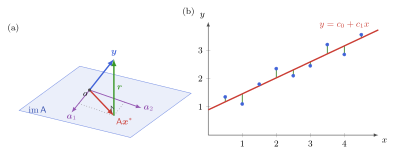{height="360px"}

[(a) $\mat{A}\vec{x}^\ast = \mat{P}_{\im(\mat{A})}\vec{y}$, het residu staat loodrecht op $\im(\mat{A})$; (b) een rechte fitten door meetpunten]{style="color: grey; font-size: 70%"}
:::
