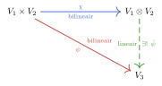
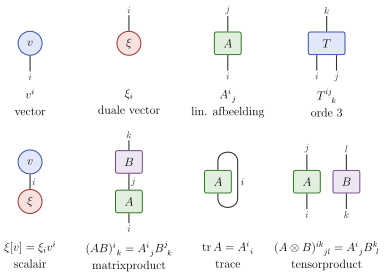
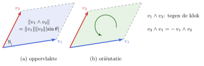



## Doel van dit hoofdstuk

Bilineaire afbeeldingen zijn **lineair in elk argument apart**, maar niet lineair op $V_1 \times V_2$:
$$B(a \vv_1, a \vv_2) = a^2 B(\vv_1, \vv_2)$$

* $\Rightarrow$ nieuwe vectorruimte $V_1 \otimes V_2$ waarop $B$ wél lineair is: het **tensorproduct**
* $\Rightarrow$ vectoren, functionalen, lineaire afbeeldingen, bilineaire vormen: allemaal **tensoren**

 

* **Tensorproduct**: definitie en universele eigenschap
* **Indexnotatie**: contractie en basistransformaties
* **Inwendig product** op $V \otimes W$
* **Antisymmetrie**: wedge product en determinant

# Terugblik: H1, H2 en H5

## Terugblik: constructies uit H1 en H2

* **Vrije vectorruimte** $\bbF S$: formele lineaire combinaties van de elementen van $S$
  * elk element van $S$ is een basisvector, ook als $S$ zelf een vectorruimte is
* **Quotiëntruimte** $V / W$: equivalentieklassen $\vv + W$
  * elementen die verschillen met een element van $W$ worden gelijk
* **Permutaties** $\sigma \in S_n$ met $\sgn(\sigma) = (-1)^{P(\sigma)}$
  * **Leibniz**: $\det(\mat{A}) = \sum_{\sigma \in S_n} \sgn(\sigma) A^1_{\ \sigma(1)} \cdots A^n_{\ \sigma(n)}$
* **Directe som** $V \oplus W$: $\dim(V \oplus W) = \dim V + \dim W$

## Terugblik: duale ruimte en basistransformaties

* **Duale ruimte** $V^\ast = \Hom(V, \bbF)$, **duale basis** $\eps^i[\ve_j] = \delta^i_{\ j}$
  * $\xi = \xi_i \eps^i$ met $\xi_i = \xi[\ve_i]$, $\xi[\vv] = \xi_i v^i$
* **Lineaire afbeelding**: $\map{A} \ve_j = A^i_{\ j} \vf_i$, $A^i_{\ j} = \varphi^i[\map{A} \ve_j]$
* **Basistransformatie**: vectoren en duale vectoren transformeren tegengesteld
  * $\tilde{v}^i = [\mat{T}]^i_{\ j} v^j$, $\tilde{\xi}_i = [\mat{T}^{-\transpose}]_i^{\ j} \xi_j$
  * index boven: **contravariant**; index onder: **covariant**
* **Bilineaire vorm**: $B(\vv, \vw) = v^i B_{ij} w^j$, twee onderindices

## Terugblik: inwendig product uit H5

* **Metriek** $g_{ij} = \inner{\ve_i}{\ve_j}$, inverse $g^{ij} = (\mat{g}^{-1})^{ij}$
  * **indices verlagen en verhogen**: $v_j = \overline{v^i} g_{ij}$, $v^j = \overline{v_i g^{ij}}$
* **Orthonormale basis**: $g_{ij} = \delta_{ij}$
* **Hilbertruimte**: metrisch compleet
  * separabel en oneindig-dimensionaal: aftelbare orthonormale basis, $V \cong \ell^2$
  * vb.: Fourierreeks in $L^2([0, L])$

# Tensorproduct van vectorruimten

## Bilineaire afbeeldingen, opnieuw

$V_1$, $V_2$ eindig-dimensionaal met basissen $\{\ve_1, \ldots, \ve_{n_1}\}$ en $\{\vf_1, \ldots, \vf_{n_2}\}$

. . .

* **Bilineaire vorm** $B : V_1 \times V_2 \to \bbF$: bepaald door $B(\ve_i, \vf_j) = B_{ij}$, een $(n_1 \times n_2)$-matrix $\mat{B}$
  * bilineaire vormen vormen een **vectorruimte**, van dimensie $n_1 n_2$
  * vgl. de duale ruimte $V^\ast = \Hom(V, \bbF)$, met $\dim V^\ast = \dim V$
* **Vraag**: zijn de bilineaire vormen op $V_1 \times V_2$ precies de functionalen $W^\ast$ op een nieuwe vectorruimte $W$, met $\dim W = n_1 n_2$?

. . .

* Niet de directe som $V_1 \oplus V_2$:
  * $\dim(V_1 \oplus V_2) = n_1 + n_2$
  * $a(\vv_1, \vv_2) = (a \vv_1, a \vv_2)$, maar $B(a \vv_1, a \vv_2) = a^2 B(\vv_1, \vv_2)$: $B$ is niet lineair op $V_1 \oplus V_2$

## Een andere vectorruimtestructuur

Bilineair: $B(a \vv_1, \vv_2) = B(\vv_1, a \vv_2) = a B(\vv_1, \vv_2)$, en zo ook voor sommen

* Identificeer daarom
  $$a(\vv_1, \vv_2) \sim (a \vv_1, \vv_2) \sim (\vv_1, a \vv_2)$$
  $$(\vv_1 + \vv'_1, \vv_2) \sim (\vv_1, \vv_2) + (\vv'_1, \vv_2), \qquad (\vv_1, \vv_2 + \vv'_2) \sim (\vv_1, \vv_2) + (\vv_1, \vv'_2)$$
* Met $\vv_1 = v_1^i \ve_i$ en $\vv_2 = v_2^j \vf_j$ volgt
  $$(\vv_1, \vv_2) \sim v_1^i v_2^j (\ve_i, \vf_j)$$
  * de koppels $(\ve_i, \vf_j)$ werken als **basis**: we noteren ze $\ve_i \otimes \vf_j$
  * $n_1 n_2$ basisvectoren: precies de gezochte dimensie

## Tensorproduct: definitie {.smaller .scrollable}

::: {.definitie nr="6.0" title="Tensorproduct"}
Het **tensorproduct** van $V_1$ en $V_2$ is de vectorruimte
$$\boxed{V_1 \otimes V_2 = \bbF\{\ve_i \otimes \vf_j \mid i = 1, \ldots, n_1;\ j = 1, \ldots, n_2\}}$$
met $\dim(V_1 \otimes V_2) = n_1 n_2$

* **Vectorruimte**: elementen $T = T^{ij} \ve_i \otimes \vf_j$
  $$a T + S = (a T^{ij} + S^{ij}) \ve_i \otimes \vf_j$$
* **Product** $\otimes : V_1 \times V_2 \to V_1 \otimes V_2$, $\vv_1 \otimes \vv_2 = v_1^i v_2^j \ve_i \otimes \vf_j$, "rekent" als een product:
  $$(a \vv_1) \otimes \vv_2 = \vv_1 \otimes (a \vv_2) = a (\vv_1 \otimes \vv_2)$$
  $$\begin{aligned} (\vv_1 + \vv'_1) \otimes \vv_2 &= \vv_1 \otimes \vv_2 + \vv'_1 \otimes \vv_2 \\ \vv_1 \otimes (\vv_2 + \vv'_2) &= \vv_1 \otimes \vv_2 + \vv_1 \otimes \vv'_2 \end{aligned}$$
:::

## Tensoren

Geen één-op-één verband tussen $V_1 \times V_2$ en $V_1 \otimes V_2$:

* Elk koppel $(\vv_1, \vv_2)$ geeft een product $\vv_1 \otimes \vv_2$
* Maar $V_1 \otimes V_2$ bevat ook **sommen** van zulke producten:
  $$T = T^{ij} \ve_i \otimes \vf_j$$
  * zulke elementen heten **tensoren**: twee bovenindices (contravariant)
  * coëfficiënten in een matrix $\mat{T} = [T^{ij}]$
  * niet elke tensor is van de vorm $\vv_1 \otimes \vv_2$
* **Outer product**: $T^{ij} = v_1^i v_2^j$, of $\mat{T} = \vec{v}_1 \vec{v}_2^\transpose$

## Terug naar bilineaire afbeeldingen

* Bilineaire vorm $B$ $\leftrightarrow$ functionaal $\beta \in (V_1 \otimes V_2)^\ast$ met $\beta[\vv_1 \otimes \vv_2] = B(\vv_1, \vv_2)$
  * lineair uitgebreid naar elke tensor:
  $$\boxed{\beta[T^{ij} \ve_i \otimes \vf_j] = T^{ij} \beta[\ve_i \otimes \vf_j] = T^{ij} B_{ij}}$$
  * volledig bepaald door $\beta[\ve_i \otimes \vf_j] = B(\ve_i, \vf_j) = B_{ij}$
* Algemener: bilineaire $\psi : V_1 \times V_2 \to V_3$ geeft een unieke lineaire $\map{\psi} : V_1 \otimes V_2 \to V_3$ met
  $$\psi(\vv_1, \vv_2) = \map{\psi}(\vv_1 \otimes \vv_2)$$
  * dit is de **universele eigenschap** van het tensorproduct
  * formele definitie: zonder te verwijzen naar een basis

## Universele eigenschap {.smaller .scrollable}

Wat het tensorproduct moet doen, zonder naar een basis te verwijzen:

::: {.definitie nr="6.2"}
Het **tensorproduct** van $V_1$ en $V_2$ is een paar $(W, \chi)$, met $W$ een vectorruimte en $\chi : V_1 \times V_2 \to W$ bilineair, zodat elke bilineaire $\psi : V_1 \times V_2 \to V_3$ een unieke ontbinding heeft
$$\boxed{\psi = \map{\psi} \circ \chi, \quad \map{\psi} \in \Hom(W, V_3)}$$
:::

{height="170px" fig-align="center"}

Met Def 6.0: $W = V_1 \otimes V_2$ en $\chi(\vv_1, \vv_2) = \vv_1 \otimes \vv_2$; $\map{\psi}$ ligt vast door $\map{\psi}(\ve_i \otimes \vf_j) = \psi(\ve_i, \vf_j)$

## Uniciteit

::: {.propositie nr="6.1"}
Voldoen $(W, \chi)$ en $(W', \chi')$ beide, dan bestaat er een isomorfisme $\map{\phi} \in \Hom(W, W')$ met $\chi' = \map{\phi} \circ \chi$, dus $W \cong W'$
:::

* **Bewijs**: de universele eigenschap twee keer toepassen
  * $\chi'$ is bilineair, dus $\chi' = \map{\phi} \circ \chi$ voor een lineaire $\map{\phi} : W \to W'$
  * omgekeerd $\chi = \map{\phi}' \circ \chi'$, en dan volgt $\map{\phi}' = \map{\phi}^{-1}$
* **Gevolg**: Def 6.0 hangt niet af van de basis
  * andere basissen: dezelfde universele eigenschap, dus een isomorfe ruimte
* Het tensorproduct is dus "het" tensorproduct, op isomorfisme na

## Universele eigenschap: toepassing

::: {.opmerking nr="6.2"}
$V_1 \otimes V_2 \cong V_2 \otimes V_1$: universele eigenschap op $(\vv_1, \vv_2) \mapsto \vv_2 \otimes \vv_1$, en omgekeerd
:::

::: {.opmerking nr="6.3"}
In een basis: $T^{ij} \ve_i \otimes \vf_j \mapsto T^{ij} \vf_j \otimes \ve_i = (\mat{T}^\transpose)^{ji} \vf_j \otimes \ve_i$: de getransponeerde
:::

* Verschillende ruimten, wel isomorf

## Bestaan: formele definitie

**Vraag**: kunnen we zo'n ruimte *construeren* zonder naar een basis te verwijzen?

::: {.definitie nr="6.1" title="Tensorproduct"}
Voor vectorruimten $V_1$, $V_2$ over $\bbF$ is de **tensorproductruimte**
$$\boxed{V_1 \otimes V_2 = \bbF(V_1 \times V_2) / \bbF(S_1 \cup S_2)}$$
met
$$\begin{aligned}
S_1 &= \{(a \vv_1 + b \vw_1, \vv_2) - a(\vv_1, \vv_2) - b(\vw_1, \vv_2)\} \\
S_2 &= \{(\vv_1, a \vv_2 + b \vw_2) - a(\vv_1, \vv_2) - b(\vv_1, \vw_2)\}
\end{aligned}$$
voor alle $a, b \in \bbF$, $\vv_1, \vw_1 \in V_1$, $\vv_2, \vw_2 \in V_2$.
:::

## Formele definitie: het idee {.smaller .scrollable}

::: {.opmerking nr="6.1"}
De equivalentieklasse van $(\vv_1, \vv_2)$ noteren we $\vv_1 \otimes \vv_2$.

* Elk element van $V_1 \otimes V_2$ is een eindige som $\sum_{i=1}^n \vv_1^{(i)} \otimes \vv_2^{(i)}$
* Deze ontbinding is niet uniek
:::

Begin *zonder* enig verband, en leg precies de bilineariteit op, en niets meer:

* $\bbF(V_1 \times V_2)$: vrije vectorruimte, *elk* koppel $(\vv_1, \vv_2)$ is een basisvector
  * overaftelbare basis, al voor $V_1 = V_2 = \bbF^1$
  * geen enkel verband tussen $(a \vv_1, \vv_2)$, $(\vv_1, a \vv_2)$ en $a(\vv_1, \vv_2)$
* Quotiënt met $\bbF(S_1 \cup S_2)$: elementen van $S_1 \cup S_2$ worden de nulvector
  $$\begin{aligned} (a \vv_1 + b \vw_1) \otimes \vv_2 &= a\, \vv_1 \otimes \vv_2 + b\, \vw_1 \otimes \vv_2 \\ \vv_1 \otimes (a \vv_2 + b \vw_2) &= a\, \vv_1 \otimes \vv_2 + b\, \vv_1 \otimes \vw_2 \end{aligned}$$

[Def 6.1: $S_1 = \{(a \vv_1 + b \vw_1, \vv_2) - a(\vv_1, \vv_2) - b(\vw_1, \vv_2)\}$, $S_2 = \{(\vv_1, a \vv_2 + b \vw_2) - a(\vv_1, \vv_2) - b(\vv_1, \vw_2)\}$]{style="font-size: 0.8em; color: gray;"}

## Formele definitie: universele eigenschap {.smaller .scrollable}

Def 6.1 voldoet aan Def 6.2, met $\chi(\vv_1, \vv_2) = \vv_1 \otimes \vv_2$. Gegeven $\psi : V_1 \times V_2 \to V_3$ bilineair:

1. **Lineair uitbreiden**: de koppels zijn een basis van $\bbF(V_1 \times V_2)$; met $\vx_k \in V_1$, $\vy_k \in V_2$:
   $$\map{\Psi}\Big(\sum_k a_k (\vx_k, \vy_k)\Big) = \sum_k a_k \psi(\vx_k, \vy_k) \in V_3$$
2. **Nul op de relaties**, want $\psi$ is bilineair:
   $$\begin{aligned}
   &\map{\Psi}\big((a \vv_1 + b \vw_1, \vv_2) - a(\vv_1, \vv_2) - b(\vw_1, \vv_2)\big) \\
   &\quad = \psi(a \vv_1 + b \vw_1, \vv_2) - a \psi(\vv_1, \vv_2) - b \psi(\vw_1, \vv_2) = \zerovec
   \end{aligned}$$
   idem voor $S_2$, dus $\bbF(S_1 \cup S_2) \subseteq \ker(\map{\Psi})$
3. **Naar het quotiënt**: $\map{\Psi}$ is constant op elke equivalentieklasse
   $$\map{\psi}(\vv_1 \otimes \vv_2) = \psi(\vv_1, \vv_2), \qquad \text{dus } \psi = \map{\psi} \circ \chi$$
4. **Uniek**: de $\vv_1 \otimes \vv_2$ spannen $V_1 \otimes V_2$ op (Opm 6.1)

## Tensorproduct van lineaire afbeeldingen {.smaller .scrollable}

::: {.definitie nr="6.3"}
Voor $\map{A}_1 \in \Hom(V_1, W_1)$ en $\map{A}_2 \in \Hom(V_2, W_2)$ is $\map{A}_1 \otimes \map{A}_2 \in \Hom(V_1 \otimes V_2, W_1 \otimes W_2)$ de lineaire afbeelding die via de universele eigenschap hoort bij de bilineaire afbeelding
$$(\vv_1, \vv_2) \mapsto (\map{A}_1 \vv_1) \otimes (\map{A}_2 \vv_2)$$
:::

* Basissen $\{\ve_k\} \subset V_1$, $\{\vf_l\} \subset V_2$, $\{\vect{g}_i\} \subset W_1$, $\{\vect{h}_j\} \subset W_2$; op de productbasis:
  $$(\map{A}_1 \otimes \map{A}_2)(\ve_k \otimes \vf_l) = (\map{A}_1 \ve_k) \otimes (\map{A}_2 \vf_l) = (A_1)^i_{\ k} (A_2)^j_{\ l}\, \vect{g}_i \otimes \vect{h}_j$$
* Tensor als vector: $T^{kl} = T^K$ met $K = (k-1) n_2 + l$ (matrix "afvlakken")
* Matrixvoorstelling van $\map{A} = \map{A}_1 \otimes \map{A}_2$, van grootte $m_1 m_2 \times n_1 n_2$:
  $$\boxed{(\mat{A})^I_{\ K} = A^{(i,j)}_{\ \ (k,l)} = (\mat{A}_1)^i_{\ k} (\mat{A}_2)^j_{\ l}}$$
  $$I = (i-1) m_2 + j, \quad K = (k-1) n_2 + l, \qquad n_i = \dim V_i, \quad m_i = \dim W_i$$

## Kronecker product {.smaller .scrollable}

::: {.opmerking nr="6.4"}
Voor matrices: **Kronecker product** of **(matrix) direct product**, in blokvorm
$$\mat{A}_1 \otimes \mat{A}_2 = \begin{bmatrix}
(\mat{A}_1)^1_{\ 1} \mat{A}_2 & (\mat{A}_1)^1_{\ 2} \mat{A}_2 & \cdots & (\mat{A}_1)^1_{\ n_1} \mat{A}_2 \\
(\mat{A}_1)^2_{\ 1} \mat{A}_2 & (\mat{A}_1)^2_{\ 2} \mat{A}_2 & \cdots & (\mat{A}_1)^2_{\ n_1} \mat{A}_2 \\
\vdots & \vdots & \ddots & \vdots \\
(\mat{A}_1)^{m_1}_{\ 1} \mat{A}_2 & (\mat{A}_1)^{m_1}_{\ 2} \mat{A}_2 & \cdots & (\mat{A}_1)^{m_1}_{\ n_1} \mat{A}_2
\end{bmatrix}$$
:::

::: {.opmerking nr="6.5"}
In Python (NumPy), MATLAB en Julia: `kron`
:::

::: {.voorbeeld}
$\begin{bmatrix} 1 & 2 \\ 3 & 4 \end{bmatrix} \otimes \begin{bmatrix} 0 & 1 \\ 1 & 0 \end{bmatrix} = \begin{bmatrix} 0 & 1 & 0 & 2 \\ 1 & 0 & 2 & 0 \\ 0 & 3 & 0 & 4 \\ 3 & 0 & 4 & 0 \end{bmatrix}$
:::

## Multilineaire afbeeldingen {.smaller .scrollable}

* **Multilineaire afbeelding** $M : V_1 \times \cdots \times V_N \to W$: lineair in elk argument apart
  * coëfficiënten $M^i_{\ j_1 j_2 \ldots j_N}$; **$N$-vorm**: $V^{\times N} \to \bbF$ (vgl. 1-vorm = functionaal)
* Verwacht, zoals bij bilineair: $M \leftrightarrow \map{M} \in \Hom(V_1 \otimes \cdots \otimes V_N, W)$
  * maar wat is een tensorproduct van meer dan twee ruimten?

::: {.propositie nr="6.2"}
$(U \otimes V) \otimes W$ en $U \otimes (V \otimes W)$ zijn isomorf
:::

::: {.opmerking nr="6.6"}
In de praktijk: tensorproduct associatief, we schrijven $U \otimes V \otimes W$
:::

::: {.opmerking nr="6.7"}
Eindig-dimensionaal, met basissen $\{\ve_i\}$, $\{\vf_j\}$, $\{\vect{g}_k\}$ van $U$, $V$, $W$:
$$T = T^{ijk}\, \ve_i \otimes \vf_j \otimes \vect{g}_k \in U \otimes V \otimes W$$
:::

## Orde van een tensor {.smaller .scrollable}

::: {.definitie nr="6.4"}
Een tensor $T \in V_1 \otimes \cdots \otimes V_N$ heeft coëfficiënten $T^{i_1 i_2 \ldots i_N}$ met $N$ indices: de **orde**, **graad**, **rang** of **dimensionaliteit** van de tensor
:::

::: {.opmerking nr="6.9"}
Programmeertalen: **multidimensionale array**; aantal indices `ndim` (NumPy), `ndims` (Julia, MATLAB)
:::

* **Scalairen**: $\bbF \times V \to V : (a, \vv) \mapsto a \vv$ is bilineair
  * via de universele eigenschap: lineaire, bijectieve $\map{L} : \bbF \otimes V \to V$, $a \otimes \vv \mapsto a \vv$
  * dus $\bbF \otimes V \cong V$: we schrijven $\bbF \otimes V = V$
  * op een computer niet onzichtbaar: een index van dimensie 1 verandert de orde

## Lineaire afbeelding als bilineaire vorm {.smaller .scrollable}

$\map{A} \in \Hom(V, W)$; basissen $\{\ve_j\}$ van $V$ en $\{\vf_i\}$ van $W$, duale basissen $\{\eps^j\}$ en $\{\varphi^i\}$

* Met inwendig product (H5): sesquilineaire vorm $(\vw, \vv) \mapsto \inner{\vw}{\map{A} \vv}$ op $W \times V$
* *Zonder* inwendig product: een bilineaire vorm op $W^\ast \times V$
  $$\boxed{A(\xi, \vv) = \xi[\map{A} \vv]}$$
  * via de universele eigenschap: lineaire functionaal $\xi \otimes \vv \mapsto \xi[\map{A} \vv]$ op $W^\ast \otimes V$
  * een element van $\Hom(W^\ast \otimes V, \bbF) = (W^\ast \otimes V)^\ast$
  * coëfficiënten: $A(\varphi^i, \ve_j) = \varphi^i[\map{A} \ve_j] = A^i_{\ j}$
  * dezelfde getallen als in de matrix van $\map{A}$: $\map{A} \ve_j = A^i_{\ j} \vf_i$

## Lineaire afbeelding als tensor

* Met dezelfde coëfficiënten: $\map{A} \cong A^i_{\ j} \vf_i \otimes \eps^j \in W \otimes V^\ast$
* **Werking**: de $V^\ast$-factor "eet" de vector (contractie)
  $$(\vf_i \otimes \eps^j)(\vv) = \vf_i\, \eps^j[\vv] = v^j \vf_i \qquad \Rightarrow \qquad (A^i_{\ j} \vf_i \otimes \eps^j)(\vv) = A^i_{\ j} v^j \vf_i = \map{A} \vv$$
* **Rang 1**: $\vw \otimes \xi$ werkt als $\vv \mapsto \vw\, \xi[\vv]$; matrix $\vec{w} \vec{\xi}^\transpose$ (outer product)

$$\boxed{\Hom(V, W) \cong \Hom(W^\ast \otimes V, \bbF) \cong \Hom(\bbF, W \otimes V^\ast) \cong W \otimes V^\ast}$$

* Afbeelding, bilineaire vorm, tensor: dezelfde coëfficiënten $A^i_{\ j}$

## Identiteit, natuurlijke paring en trace

$V = W$: $\Hom(V, V) \cong V \otimes V^\ast \cong \Hom(V^\ast \otimes V, \bbF)$

* **Identiteit**: $\idmap_V \cong \delta^i_{\ j} \ve_i \otimes \eps^j = \ve_i \otimes \eps^i$ (in elke basis hetzelfde element)
* Als functionaal op $V^\ast \otimes V$: de **natuurlijke paring** of **evaluatie**
  $$\boxed{\eps^i \otimes \ve_j \mapsto \eps^i[\ve_j] = \delta^i_{\ j}, \qquad \xi \otimes \vv \mapsto \xi[\vv]}$$
  * gebruikt geen basis en geen inwendig product
* **Trace**: de paring toegepast op $\map{A} \in V \otimes V^\ast$: $\tr \map{A} = A^i_{\ j} \delta^j_{\ i} = A^i_{\ i}$
* **Samenstellen**: $(\map{A} \map{B})^i_{\ k} = A^i_{\ j} B^j_{\ k}$: de paring van de middelste factoren

## Bra-ketnotatie {.smaller .scrollable}

Kwantummechanica, Hilbertruimte $\mathcal{H}$: de Dirac-notatie maakt deze constructies zichtbaar

|  | **wiskunde** | **bra-ket** |
|---|:---:|:---:|
| vector | $\vv \in \mathcal{H}$ | $\lvert v \rangle$ (ket) |
| functionaal | $\xi \in \mathcal{H}^\ast$ | $\langle \xi \rvert$ (bra) |
| natuurlijke paring | $\xi[\vv]$ | $\langle \xi \vert v \rangle$ |
| tensor in $\mathcal{H} \otimes \mathcal{H}^\ast$ | $\vw \otimes \xi$ | $\lvert w \rangle \langle \xi \rvert$ |
| werking: contractie | $\vw\, \xi[\vv]$ | $\lvert w \rangle \langle \xi \vert v \rangle$ |
| bilineaire vorm (matrixelement) | $\xi[\map{A} \vv]$ | $\langle \xi \vert \map{A} \vert v \rangle$ |

* **Riesz** (5.27): elke bra is $\langle v \rvert = \inner{\vv}{\cdot}$, antilineair in $\vv$; zo wordt $\langle w \vert v \rangle = \inner{\vw}{\vv}$
* Een bra naast een ket sluit het haakje: **contractie**, een getal

## Indexnotatie

* Algemeen, met associativiteit en $V_1 \otimes V_2 \cong V_2 \otimes V_1$:
  $$\begin{aligned}
  V_1 \otimes \cdots \otimes V_N &\cong \Hom(V_1^\ast \otimes \cdots \otimes V_N^\ast, \bbF) \\
  &\cong \Hom(V_{\sigma_1}^\ast \otimes \cdots \otimes V_{\sigma_k}^\ast, V_{\sigma_{k+1}} \otimes \cdots \otimes V_{\sigma_N})
  \end{aligned}$$
  * *één tensor, veel interpretaties als multilineaire afbeelding*
* Vaak één primaire ruimte $V$ (ruimte, ruimtetijd, raakruimte): factoren $V$ en $V^\ast$
  * index **boven** voor $V$ (contravariant), **onder** voor $V^\ast$ (covariant)
  * vb. $T \in V \otimes V^\ast \otimes V^\ast \otimes V$: coëfficiënten $T^{i\ \ \ l}_{\ jk}$
* **(Abstracte) indexnotatie**: indices als plaatshouders, niet als getallen

## Tensoroperaties

$T^{i\ \ \ l}_{\ jk} \in V \otimes V^\ast \otimes V^\ast \otimes V$ en $S_i^{\ jk} \in V^\ast \otimes V \otimes V$:

* **Indexpermutatie**: indices herschikken, met behoud van boven/onder
  $$U_{j\ \ k}^{\ l\ \ i} = T^{i\ \ \ l}_{\ jk} \quad \text{(orde 2: transponeren)}$$
* **Tensorproduct** (outer product): $U^{i\ \ \ l\ \ np}_{\ jk\ m} = T^{i\ \ \ l}_{\ jk} S_m^{\ np}$
* **Contractie**: een boven- en een onderindex gelijkstellen en sommeren (natuurlijke paring)
  * binnen één tensor (veralgemeende trace): $V^i_{\ j} = T^{i\ \ \ k}_{\ jk}$
  * tussen tensoren: $W^{i\ n}_{\ j} = T^{i\ \ \ l}_{\ jk} S_l^{\ nk}$
  * oorsprong van Einsteins sommatieconventie

## Tensordiagrammen

Grafische indexnotatie (Penrose; *niet in de cursus*): elke index is een **beentje**

* beentje omlaag: index boven ($V$); beentje omhoog: index onder ($V^\ast$)
* beentjes verbinden = contractie (boven met onder); invoer boven, uitvoer onder

{height="380px" fig-align="center"}

## Basistransformaties van tensoren

Basis $\{\ve_i\} \to \{\tilde{\ve}_i\}$ met $\ve_j = \tilde{\ve}_i L^i_{\ j}$:

* vector: $\tilde{v}^i = L^i_{\ j} v^j$; duale vector: $\tilde{\chi}_i = (\mat{L}^{-1})^j_{\ i} \chi_j$
* tensor: elke index transformeert volgens zijn positie
  $$\boxed{\tilde{T}^{i\ \ \ l}_{\ jk} = (\mat{L})^i_{\ i'} (\mat{L}^{-1})^{j'}_{\ j} (\mat{L}^{-1})^{k'}_{\ k} (\mat{L})^l_{\ l'} T^{i'\ \ \ \ l'}_{\ j'k'}}$$
* contractie van een boven- met een onderindex: basisonafhankelijk
  * vb. $\xi[\vv] = \xi_i v^i$, trace $A^i_{\ i}$

# Tensoren in inwendig productruimten

## Inwendig product op een tensorproduct {.smaller .scrollable}

Basissen $\{\ve_i\}$ van $V$, $\{\vf_j\}$ van $W$; metrieken $g_{ik} = \inner{\ve_i}{\ve_k}_V$, $h_{jl} = \inner{\vf_j}{\vf_l}_W$

* **Intuïtief**: metriek op $V \otimes W$: $\inner{\ve_i \otimes \vf_j}{\ve_k \otimes \vf_l} = g_{ik} h_{jl}$, dus
  $$\inner{S}{T}_{V \otimes W} = \overline{S^{ij}} g_{ik} h_{jl} T^{kl}$$
  * metriek $\mat{g} \otimes \mat{h}$ (Kronecker): positief definiet, eigenwaarden $\lambda_i \mu_j > 0$
* **Orthonormale basissen**: $g_{ik} = \delta_{ik}$, $h_{jl} = \delta_{jl}$
  $$\inner{S}{T}_{V \otimes W} = \sum_{i,j} \overline{S^{ij}} T^{ij}, \qquad \norm{T}^2 = \sum_{i,j} \abs{T^{ij}}^2$$
  * $\norm{T}$ is de Hilbert-Schmidt-norm van $\mat{T}$ (H5)
* Op producttensoren, zonder basis:
  $$\boxed{\inner{\vv \otimes \vw}{\vv' \otimes \vw'}_{V \otimes W} = \inner{\vv}{\vv'}_V \inner{\vw}{\vw'}_W}$$

## Inwendig product: zonder basis {.smaller .scrollable}

Zoals Def 6.1 voor Def 6.0: dezelfde definitie, zonder naar een basis te verwijzen

* Definieer $\inner{(\vv, \vw)}{(\vv', \vw')} = \inner{\vv}{\vv'}_V \inner{\vw}{\vw'}_W$ op $\bbF(V \times W)$, (anti)lineair uitgebreid
  * ontaard: de nulruimte is precies $\bbF(S_1 \cup S_2)$ $\to$ welgedefinieerd op het quotiënt $V \otimes W$
* **Positief definiet**: $T = \sum_{i=1}^n \vv_i \otimes \vw_i$; Gram-Schmidt geeft orthonormale $\{\ve_k\}$, $\{\vf_k\}$:
  $$\inner{T}{T} = \sum_{i,j,k,l} \overline{T^{ij}} T^{kl} \inner{\ve_i}{\ve_k} \inner{\vf_j}{\vf_l} = \sum_{i,j} \abs{T^{ij}}^2 > 0$$
  * dat is de intuïtieve formule, met orthonormale stelsels die van $T$ afhangen
  * werkt ook in oneindige dimensie: elke $T$ is een *eindige* som
* Gevolg: de intuïtieve formule hangt niet af van de gekozen orthonormale basissen

## Indices verhogen en verlagen {.smaller .scrollable}

Reële $V$, eindig-dimensionaal, metriek $\mat{g}$ (niet noodzakelijk orthonormaal):

* $v_i = g_{ij} v^j$, $v^i = g^{ij} v_j$: elke index van een tensor kan omhoog of omlaag
  * vb. $T^{ij}_{\ \ kl} = g^{jj'} g_{ll'} T^{i\ \ \ \ l'}_{\ j'k}$, met hetzelfde symbool
* Inwendig product door contractie:
  $$\inner{T}{\tilde{T}} = T^{i\ \ \ l}_{\ jk} \tilde{T}^{i'\ \ \ \ l'}_{\ j'k'} g_{ii'} g^{jj'} g^{kk'} g_{ll'} = T_{ijkl} \tilde{T}^{ijkl}$$
* Lineaire afbeelding $A^i_{\ j}$ $\leftrightarrow$ bilineaire vorm $A_{ij} = g_{ik} A^k_{\ j}$ (H5)
* Orthonormale basis, $g_{ij} = \delta_{ij}$: verhogen en verlagen verandert niets
  * **Cartesische tensoren**: enkel onderindices; basistransformaties zijn orthogonaal

## Tensorproduct van Hilbertruimten {.smaller .scrollable}

* $V \otimes W$ bevat enkel *eindige* sommen $\sum_{i=1}^n \vv_i \otimes \vw_i$: niet compleet
  * Cauchy-rijen $T^{(k)} = \sum_{i=1}^{n_k} \vv_i^{(k)} \otimes \vw_i^{(k)}$ met een limiet die geen eindige som is
* **Definitie** voor Hilbertruimten: de completering
  $$\boxed{V \otimes W = \overline{\bbF(V \times W) / \bbF(S_1 \cup S_2)}}$$
  * orthonormale basissen $\{\ve_m\}$, $\{\vf_n\}$ $\Rightarrow$ orthonormale basis $\{\ve_m \otimes \vf_n \mid m, n \in \bbN\}$

::: {.opmerking nr="6.10"}
Zonder norm kan dit niet: functies op $\bbR^2$ zijn geen eindige sommen $g(x) h(y)$, en er is geen limiet
:::

::: {.opmerking nr="6.11"}
Kwantummechanica, samengesteld systeem: $\mathcal{H}_{AB} = \mathcal{H}_A \otimes \mathcal{H}_B$
:::

## Voorbeeld: functies van twee variabelen {.smaller .scrollable}

::: {.voorbeeld nr="6.1"}
$V = L^2([0, L_x])$ (functies $g(x)$), $W = L^2([0, L_y])$ (functies $h(y)$)
:::

* **Product**: $g \otimes h$ is de functie $f(x, y) = g(x) h(y)$ op de rechthoek $R = [0, L_x] \times [0, L_y]$
  * kwadratisch integreerbaar, en het inwendig product klopt:
  $$\iint_R \overline{g(x) h(y)}\, g'(x) h'(y)\, \drm x\, \drm y = \inner{g}{g'} \inner{h}{h'} = \inner{g \otimes h}{g' \otimes h'}$$
* **Algebraïsch** $V \otimes W$: eindige sommen $\sum_{k=1}^n g_k(x) h_k(y)$
  * vgl. matrices: een "matrix" $f(x, y)$ van eindige rang
  * niet alle functies: $\erm^{-(x-y)^2} = \sum_{n=0}^\infty \frac{2^n}{n!} (x^n \erm^{-x^2})(y^n \erm^{-y^2})$ vraagt oneindig veel termen
* **Hilbert** $V \otimes W$ (completering): alle limieten van zulke sommen
  $$\boxed{L^2([0, L_x]) \otimes L^2([0, L_y]) = L^2([0, L_x] \times [0, L_y])}$$

## Voorbeeld 6.1: Fourierbasis {.smaller .scrollable}

* Orthonormale basissen (H5): $e_k(x) = \frac{1}{\sqrt{L_x}} \erm^{\irm 2\pi k x / L_x}$, $f_l(y) = \frac{1}{\sqrt{L_y}} \erm^{\irm 2\pi l y / L_y}$, $k, l \in \bbZ$
* Basis van het tensorproduct: $e_k \otimes f_l$, de **tweedimensionale Fourierfuncties**
  $$(e_k \otimes f_l)(x, y) = \frac{1}{\sqrt{L_x L_y}} \erm^{\irm 2\pi (k x / L_x + l y / L_y)}$$
* **Expansie** (Stelling 5.23): elke $f \in L^2(R)$ is
  $$f = \sum_{k,l=-\infty}^{+\infty} F_{kl}\, e_k \otimes f_l, \qquad F_{kl} = \inner{e_k \otimes f_l}{f}$$
  * gelijkheid in de 2-norm; $\sum_{k,l} \abs{F_{kl}}^2 = \norm{f}^2$: een "oneindige matrix" $F_{kl}$
* Afgeknot tot $\abs{k}, \abs{l} \leq N$: een *eindige* som van producten $\to$ die zijn dicht in $L^2(R)$

# Tensoralgebra en exterieure producten

## Tensoren van type $(p, q)$ {.smaller .scrollable}

Eén primaire ruimte $V$: $V^{\otimes k} = V \otimes \cdots \otimes V$ ($k$ keer), $V^{\otimes 0} = \bbF$

* Algemeen, factoren herschikt:
  $$\boxed{\mathcal{T}^p_{\ q}(V) = V^{\otimes p} \otimes (V^\ast)^{\otimes q}}$$
  * **contravariante graad** $p$, **covariante graad** $q$
  * vector $(1, 0)$, duale vector $(0, 1)$, lineaire afbeelding $(1, 1)$, bilineaire vorm $(0, 2)$
* $(p, q)$-tensor $\leftrightarrow$ multilineaire vorm op $(V^\ast)^{\times p} \times V^{\times q}$

::: {.opmerking nr="6.12"}
In een basis: $t^{i_1 \ldots i_p}_{\qquad j_1 \ldots j_q}\, \ve_{i_1} \otimes \cdots \otimes \ve_{i_p} \otimes \eps^{j_1} \otimes \cdots \otimes \eps^{j_q}$
:::

::: {.opmerking nr="6.13"}
$\mathcal{T}^p_{\ q}(V)^\ast \cong \mathcal{T}^p_{\ q}(V^\ast) \cong \mathcal{T}^q_{\ p}(V)$: volledige contractie geeft een scalair
:::

## Tensoralgebra {.smaller .scrollable}

* $\otimes : V^{\otimes k} \times V^{\otimes l} \to V^{\otimes (k+l)}$: bilineair, associatief, $1 \otimes T = T$ voor $1 \in \bbF$
  * maar geen product *binnen* één ruimte
* **Tensoralgebra**: directe som van alle graden
  $$\boxed{\mathcal{T}(V) = \bigoplus_{k=0}^{+\infty} V^{\otimes k} = \bbF \oplus V \oplus V^{\otimes 2} \oplus \cdots}$$
  * $\otimes$ maakt $\mathcal{T}(V)$ tot een associatieve algebra met eenheid $1 \in \bbF = V^{\otimes 0}$
  * elementen $t_{(0)} + t_{(1)}^i \ve_i + t_{(2)}^{ij} \ve_i \otimes \ve_j + \cdots$ (formele som)
  * **homogeen** element: in één $V^{\otimes k}$

::: {.opmerking nr="6.14"}
Een ruimte die zo ontbindt in componenten met een (gehele) index heet een *graded vector space*
:::

## Symmetrie onder indexpermutatie {.smaller .scrollable}

* $V \otimes W \cong W \otimes V$, maar $\otimes$ is niet commutatief: $\vv \otimes \vw \neq \vw \otimes \vv$
* Orde 2: symmetrisch en antisymmetrisch deel, zoals bij matrices:
  $$\mat{T} = \underbrace{\frac{\mat{T} + \mat{T}^\transpose}{2}}_{\mathcal{S}\mat{T}} + \underbrace{\frac{\mat{T} - \mat{T}^\transpose}{2}}_{\mathcal{A}\mat{T}}$$
* Orde $p$: $\sigma \in S_p$ herschikt de factoren: de factor op plaats $m$ gaat naar plaats $\sigma(m)$
  $$\sigma \triangleright T = T^{i_1 \ldots i_p}\, \ve_{i_{\sigma^{-1}(1)}} \otimes \cdots \otimes \ve_{i_{\sigma^{-1}(p)}}$$
  * in componenten:
  $$\boxed{(\sigma \triangleright T)^{j_1 j_2 \ldots j_p} = T^{j_{\sigma(1)} j_{\sigma(2)} \ldots j_{\sigma(p)}}}$$
  * representatie van $S_p$: $\sigma \triangleright (\tau \triangleright T) = (\sigma \circ \tau) \triangleright T$

## Symmetrie onder indexpermutatie: voorbeeld

$p = 3$ en de cyclische permutatie $\sigma$:

| plaats $m$ | $1$ | $2$ | $3$ |
|:---:|:---:|:---:|:---:|
| $\sigma(m)$ | $2$ | $3$ | $1$ |

* **Op een product**: $\vu$ gaat van plaats 1 naar 2, $\vv$ van 2 naar 3, $\vw$ van 3 naar 1
  $$\sigma \triangleright (\vu \otimes \vv \otimes \vw) = \vw \otimes \vu \otimes \vv$$
* **In componenten**: $(\sigma \triangleright T)^{j_1 j_2 j_3} = T^{j_{\sigma(1)} j_{\sigma(2)} j_{\sigma(3)}} = T^{j_2 j_3 j_1}$
  * controle met $T = \vu \otimes \vv \otimes \vw$, dus $T^{ijk} = u^i v^j w^k$:
  $$T^{j_2 j_3 j_1} = u^{j_2} v^{j_3} w^{j_1} = w^{j_1} u^{j_2} v^{j_3}: \quad \text{de coëfficiënten van } \vw \otimes \vu \otimes \vv$$

## Symmetrie onder indexpermutatie {.smaller .scrollable}

::: {.opmerking nr="6.15"}
$\map{G} \in \GL(V)$ werkt op $V^{\otimes p}$ als $\map{G}^{\otimes p}$:
$$\begin{aligned}
\map{G}^{\otimes p} T &= T^{i_1 \ldots i_p} (\map{G} \ve_{i_1}) \otimes \cdots \otimes (\map{G} \ve_{i_p}) \\
(\map{G}^{\otimes p} T)^{j_1 \ldots j_p} &= G^{j_1}_{\ i_1} \cdots G^{j_p}_{\ i_p} T^{i_1 \ldots i_p}
\end{aligned}$$
een representatie van $\GL(V)$ op $V^{\otimes p}$
:::

::: {.opmerking nr="6.16"}
Beide acties commuteren: $\sigma \triangleright (\map{G}^{\otimes p} T) = \map{G}^{\otimes p}(\sigma \triangleright T)$

* Deelruimten invariant onder $S_p$ zijn ook invariant onder $\GL(V)$: *Schur-Weyl-dualiteit*
:::

## Antisymmetrische tensoren

::: {.definitie nr="6.5"}
De **totaal antisymmetrische deelruimte** $\Lambda^p(V)$ van $V^{\otimes p}$ bevat de tensoren met
$$\boxed{\sigma \triangleright T = \sgn(\sigma) T \quad \forall \sigma \in S_p}$$
:::

::: {.opmerking nr="6.17"}
$\Lambda^0(V) = \bbF$ en $\Lambda^1(V) = V$
:::

* Voorbeelden: $\vv \otimes \vw - \vw \otimes \vv \in \Lambda^2(V)$; antisymmetrische matrices $\mat{T}^\transpose = -\mat{T}$

## Antisymmetrisatie {.smaller .scrollable}

::: {.definitie nr="6.6"}
**Antisymmetrisatie-operator** $\mathcal{A} \in \End(V^{\otimes p})$, een projector met $\im(\mathcal{A}) = \Lambda^p(V)$:
$$\boxed{\mathcal{A} T = \frac{1}{p!} \sum_{\sigma \in S_p} \sgn(\sigma) (\sigma \triangleright T)}$$
:::

* **Vb.** $p = 2$: $\mathcal{A}(\vv \otimes \vw) = \frac{1}{2}(\vv \otimes \vw - \vw \otimes \vv)$, voor matrices $\frac{1}{2}(\mat{T} - \mat{T}^\transpose)$
* **Eigenschappen**: $\mathcal{A} T$ is antisymmetrisch, $T \in \Lambda^p(V) \Rightarrow \mathcal{A} T = T$, dus $\mathcal{A}^2 = \mathcal{A}$
  * bewijs: $\tau \circ \sigma$ doorloopt $S_p$ (vaste $\tau$), $\sgn(\sigma) = \sgn(\tau) \sgn(\tau \circ \sigma)$:
  $$\tau \triangleright \mathcal{A} T = \frac{1}{p!} \sum_\sigma \sgn(\sigma) (\tau \circ \sigma) \triangleright T = \sgn(\tau) \mathcal{A} T$$

::: {.opmerking nr="6.18"}
Voor elke $p$ een eigen $\mathcal{A}$; we gebruiken hetzelfde symbool
:::

## Wedge product {.smaller .scrollable}

* $\mathcal{A}(T \otimes S) = \mathcal{A}((\mathcal{A} T) \otimes S) = \mathcal{A}(T \otimes (\mathcal{A} S))$ $\to$ product direct tussen de $\Lambda^p$

::: {.definitie nr="6.7"}
Het **wedge product** of **exterieur product** $\wedge : \Lambda^p(V) \times \Lambda^q(V) \to \Lambda^{p+q}(V)$:
$$\boxed{T \wedge S = \sqrt{\frac{(p+q)!}{p!\, q!}}\, \mathcal{A}(T \otimes S)}$$
:::

::: {.opmerking nr="6.19"}
Bilineair, associatief en alternerend (antisymmetrisch)
:::

::: {.opmerking nr="6.20"}
De factor is een conventie ($1$, $\frac{(p+q)!}{p!\, q!}$ of deze): met deze keuze komt het inwendig product van de tensorruimte overeen met dat van de exterieure algebra
:::

## Wedge product van vectoren

$$\begin{aligned}
\vv_1 \wedge \vv_2 &= \frac{1}{\sqrt{2}} (\vv_1 \otimes \vv_2 - \vv_2 \otimes \vv_1) \\
\vv_1 \wedge \vv_2 \wedge \vv_3 &= \frac{1}{\sqrt{6}} (\vv_1 \otimes \vv_2 \otimes \vv_3 - \vv_2 \otimes \vv_1 \otimes \vv_3 + \vv_2 \otimes \vv_3 \otimes \vv_1 \\
&\qquad\quad - \vv_1 \otimes \vv_3 \otimes \vv_2 + \vv_3 \otimes \vv_1 \otimes \vv_2 - \vv_3 \otimes \vv_2 \otimes \vv_1)
\end{aligned}$$

$$\boxed{\vv_1 \wedge \vv_2 \wedge \cdots \wedge \vv_p = \frac{1}{\sqrt{p!}} \sum_{\sigma \in S_p} \sgn(\sigma)\, \vv_{\sigma(1)} \otimes \vv_{\sigma(2)} \otimes \cdots \otimes \vv_{\sigma(p)}}$$

* $\vv_2 \wedge \vv_1 = -\vv_1 \wedge \vv_2$, dus $\vv \wedge \vv = 0$; lineair afhankelijk $\Rightarrow$ $\vv_1 \wedge \cdots \wedge \vv_p = 0$

## Basis van $\Lambda^p(V)$ {.smaller .scrollable}

$\dim V = n$, geordende basis $\{\ve_1, \ldots, \ve_n\}$:
$$B_{\Lambda^p(V)} = \{\ve_{i_1} \wedge \ve_{i_2} \wedge \cdots \wedge \ve_{i_p} \mid 1 \leq i_1 < i_2 < \cdots < i_p \leq n\}$$

* $\Lambda^0$: $\{1\}$, $\Lambda^1$: $\{\ve_i\}$, $\Lambda^2$: $\{\ve_i \wedge \ve_j \mid i < j\}$, …, $\Lambda^n$: $\{\ve_1 \wedge \cdots \wedge \ve_n\}$
  $$\boxed{\dim \Lambda^p(V) = \binom{n}{p} = \frac{n!}{p!(n-p)!}}$$
  * $\dim \Lambda^n(V) = 1$; $p > n$: geen niet-nul antisymmetrische tensoren

::: {.opmerking nr="6.21"}
Basisonafhankelijke **determinant**: voor $T \in \Lambda^n(V)$ is $\map{A}^{\otimes n} T = \det(\map{A}) T$, want
$$\map{A}^{\otimes n}(\ve_1 \wedge \cdots \wedge \ve_n) = (\map{A} \ve_1) \wedge \cdots \wedge (\map{A} \ve_n) = \det(\map{A})\, \ve_1 \wedge \cdots \wedge \ve_n$$
:::

[Leibniz (H2, Def 2.11): $\det(\mat{A}) = \sum_{\sigma \in S_n} \sgn(\sigma) A^1_{\ \sigma(1)} A^2_{\ \sigma(2)} \cdots A^n_{\ \sigma(n)}$]{style="font-size: 0.8em; color: gray;"}

## Wedge product en inwendig product

::: {.propositie nr="6.3"}
Voor een inwendig productruimte $V$ en $\vv_i, \vw_i \in V$:
$$\inner{\vw_1 \wedge \cdots \wedge \vw_p}{\vv_1 \wedge \cdots \wedge \vv_p} = \det \begin{bmatrix} \inner{\vw_1}{\vv_1} & \cdots & \inner{\vw_1}{\vv_p} \\ \vdots & \ddots & \vdots \\ \inner{\vw_p}{\vv_1} & \cdots & \inner{\vw_p}{\vv_p} \end{bmatrix}$$
:::

::: {.voorbeeld nr="6.2"}
$V = \bbR^n$:
$$\norm{\vec{v}_1 \wedge \vec{v}_2} = \sqrt{\norm{\vec{v}_1}^2 \norm{\vec{v}_2}^2 - \abs{\inner{\vec{v}_1}{\vec{v}_2}}^2} = \norm{\vec{v}_1} \norm{\vec{v}_2} \abs{\sin(\theta)}$$
de oppervlakte van het parallellogram opgespannen door $\vec{v}_1$ en $\vec{v}_2$
:::

## Wedge product: volume en oriëntatie

* $\norm{\vv_1 \wedge \cdots \wedge \vv_p}$ = **volume** van het $p$-dimensionale parallellepipedum
  * basis voor integralen in hogere dimensie (differentiaalmeetkunde)
* Volgorde telt: **oriëntatie**, het georiënteerde volume
* Orthonormale basis van $V$ $\Rightarrow$ $B_{\Lambda^p(V)}$ is orthonormaal

{height="260px" fig-align="center"}

## Exterieure algebra

::: {.definitie nr="6.8"}
Voor eindig-dimensionale $V$ is
$$\boxed{\Lambda(V) = \bigoplus_{p=0}^{\dim V} \Lambda^p(V)}$$
met het wedge product een associatieve algebra: de **exterieure algebra** of **Grassmann-algebra**. Elementen: *multivectoren*; homogeen in $\Lambda^p(V)$: *$p$-vectoren*.

* $\Lambda(V)$ is een deelruimte van $\mathcal{T}(V)$ met $\dim \Lambda(V) = \sum_{p=0}^n \binom{n}{p} = 2^n$
* Met inwendig product op $V$: de $\Lambda^p(V)$ zijn onderling orthogonaal
:::

::: {.opmerking nr="6.22"}
Fysica: identiek aan de *Fock-ruimte* voor fermionische veeldeeltjessystemen
:::
