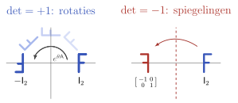
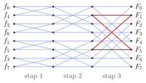
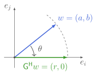
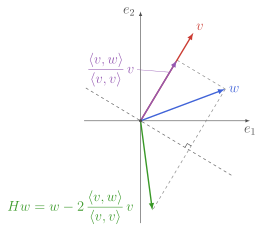
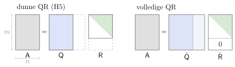
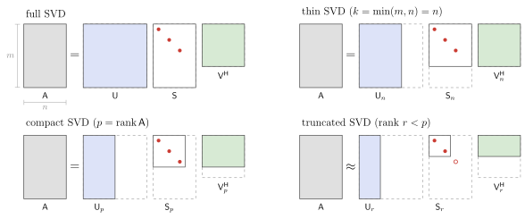
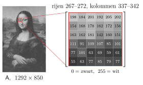
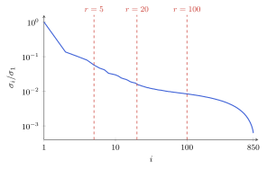

## Doel van dit hoofdstuk



**Unitaire** matrices bewaren lengtes en hoeken:
$$\norm{\mat{U}\vx} = \norm{\vx}, \quad \inner{\mat{U}\vx}{\mat{U}\vy} = \inner{\vx}{\vy}, \quad \kappa(\mat{U}) = 1$$

* $\Rightarrow$ afrondingsfouten worden niet versterkt: **stabiele algoritmen**
* $\Rightarrow$ ze zetten een orthonormale basis om in een orthonormale basis

Hoe ver kun je een matrix vereenvoudigen met **enkel unitaire** transformaties?

| **transformatie** | **canonische vorm** | **waarvoor** |
|--------------------------------------|--------------------------------|------------------------------|
| gelijkvormig: $\mat{V}^{-1}\mat{A}\mat{V}$ | Jordan (H3) | numeriek instabiel |
| unitair gelijkvormig: $\mat{Z}^\hermitian\mat{A}\mat{Z}$ | Schur: bovendriehoeks | eigenwaarden |
| unitair equivalent: $\mat{U}^\hermitian\mat{A}\mat{V}$ | SVD: diagonaal, $\sigma_i \geq 0$ | rang, normen, benaderingen |

## Doel van dit hoofdstuk

**Algoritmen**, **decomposities** en **toepassingen** van unitaire transformaties

<br>

* **Elementaire unitaire transformaties**
  * permutaties, discrete Fouriertransformatie, Givens, Householder
* **QR decompositie**
* **Unitaire gelijkvormigheid**: Schur triangulatie
  * basis voor eigenwaardeproblemen
* **Unitaire equivalentie**: singuliere waardendecompositie (SVD)
  * kleinste kwadraten, Moore-Penrose inverse
  * matrixnormen, lage-rang benaderingen
* **Bilineaire vormen**: traagheidswet van Sylvester

# Terugblik: H2–H5

wat we nodig hebben

## Terugblik: rang en eigenwaarden (H2–H3)

* **Rang**: $\rank(\mat{A}) = \dim \im(\mat{A})$
  * rang-nulliteit: $n = \rank(\mat{A}) + \dim\ker(\mat{A})$ [(St 2.11)]{style="color: grey; font-size: 80%"}
* **Gelijkvormig**: $\mat{T}^{-1}\mat{A}\mat{T}$ heeft dezelfde eigenwaarden [(Def 2.17)]{style="color: grey; font-size: 80%"}

* **Multipliciteit** van eigenwaarde $\lambda$:
  * algebraïsch: $q_\lambda$ = multipliciteit als nulpunt van $\det(\mat{A} - \lambda\idmat)$
  * meetkundig: $r_\lambda = \dim\ker(\mat{A} - \lambda\idmat) \leq q_\lambda$
  * diagonaliseerbaar $\Leftrightarrow$ $r_\lambda = q_\lambda$ voor alle $\lambda$

* $\mat{A}\mat{B}$ en $\mat{B}\mat{A}$ hebben dezelfde eigenwaarden $\neq 0$ [(Prop 3.11)]{style="color: grey; font-size: 80%"}

## Terugblik: normen (H4) {.scrollable}

* **Geïnduceerde norm** [(Prop 4.18)]{style="color: grey; font-size: 80%"}
  $$\norm{\mat{A}} = \sup_{\vx \neq 0} \frac{\norm{\mat{A}\vx}}{\norm{\vx}} \geq \rho_{\mat{A}}$$
* **Gelfand** [(Prop 4.19)]{style="color: grey; font-size: 80%"}
  $$\rho_{\mat{A}} = \lim_{k \to \infty} \norm{\mat{A}^k}^{1/k}$$
* **Frobenius** [(Prop 4.17)]{style="color: grey; font-size: 80%"}
  $$\norm{\mat{A}}_{\text{F}} = \sqrt{\tr(\mat{A}^\hermitian\mat{A})}$$
* **Conditiegetal**: versterkt relatieve fouten
  $$\kappa(\mat{A}) = \norm{\mat{A}}\norm{\mat{A}^{-1}}, \qquad \frac{\norm{\Delta\vx}}{\norm{\vx}} \leq \kappa(\mat{A})\frac{\norm{\Delta\vy}}{\norm{\vy}}$$

## Terugblik: inwendig product (H5)

* **Isometrie**: $\mat{Q}^\hermitian\mat{Q} = \idmat$ [(Prop 5.31)]{style="color: grey; font-size: 80%"}
* **Unitair**: ook $\mat{U}\mat{U}^\hermitian = \idmat$ [(Prop 5.32)]{style="color: grey; font-size: 80%"}

* **Normaal**: $\mat{A}^\hermitian\mat{A} = \mat{A}\mat{A}^\hermitian$, bv. hermitisch of unitair [(Def 5.24)]{style="color: grey; font-size: 80%"}
  * eigenvectoren bij verschillende eigenwaarden zijn orthogonaal [(Prop 5.35)]{style="color: grey; font-size: 80%"}
  * $\norm{\mat{A}}_2 = \rho_{\mat{A}}$ [(Prop 5.37)]{style="color: grey; font-size: 80%"}

* **QR via Gram-Schmidt**: $\mat{A} = \mat{Q}\mat{R}$, $\mat{Q}^\hermitian\mat{Q} = \idmat$, $\mat{R}$ bovendriehoeks [(Def 5.21)]{style="color: grey; font-size: 80%"}
* **Kleinste kwadraten**, $\mat{A}$ met volle kolomrang [(Def 5.26–5.27)]{style="color: grey; font-size: 80%"}
  $$\vx^\ast = \argmin_{\vx} \norm{\mat{A}\vx - \vy}_2 = \mat{R}^{-1}\mat{Q}^\hermitian\vy = \mat{A}^+\vy$$

# Unitaire en orthogonale groep

## Unitaire groep en speciaal unitaire groep {.smaller .scrollable}

::: {.definitie nr="7.1"}
**Unitaire groep**:
$$\boxed{\Unitary(n) = \{\mat{U}\in\bbC^{n\times n} \mid \mat{U}^\hermitian \mat{U} = \idmat_n = \mat{U}\mat{U}^\hermitian\}}$$
:::

* $\abs{\det(\mat{U})} = 1 \implies \det(\mat{U}) \in \Unitary(1)$
* Deelgroep: **speciaal unitaire groep** $\SU(n) = \{\mat{U}\in \Unitary(n) \mid \det(\mat{U})=1\}$

::: {.opmerking nr="7.1"}
$\Unitary(n)$ is een gesloten en begrensde deelverzameling van $\bbC^{n \times n}$ (geen deelruimte)\
$\Rightarrow$ unitaire matrices kunnen niet divergeren: belangrijk voor numerieke stabiliteit
:::

::: {.opmerking nr="7.2"}
$\mat{U}$ is normaal $\Rightarrow$ diagonaliseerbaar met orthonormale eigenvectoren;\
$\mat{U}\vec{v} = \lambda\vec{v}$ $\Rightarrow$ $\abs{\lambda} = 1$, dus $\lambda \in \Unitary(1)$
:::

## Unitaire groep en speciaal unitaire groep {.smaller .scrollable}

**Exponentiële parametrisatie**:
$$\boxed{\mat{U}(t) = \exp(t\mat{A}) \in \Unitary(n) \quad\Leftrightarrow\quad \mat{A} = -\mat{A}^\hermitian}$$

* oplossing van $\frac{\drm\ }{\drm t}\mat{U}(t) = \mat{A}\mat{U}(t)$ met $\mat{U}(0) = \idmat_n$
* vaak $\mat{A} = \irm \mat{H}$ met $\mat{H} = \mat{H}^\hermitian$
* $\mat{A}$ of $\mat{H}$ geparameteriseerd door $n^2$ reële getallen
* $\mat{U}(t) \in \SU(n) \iff \tr(\mat{A})=0$: $n^2-1$ reële getallen

<br>

**$\Unitary(n)$ is samenhangend**: elke twee elementen verbonden door een continu pad in $\Unitary(n)$

* continu pad $\mat{U}(t)=\exp(t \mat{A})$ verbindt $\mat{U}(0)=\idmat_n$ met $\mat{U}(1)= \mat{U}$
* via de keuze $\mat{A}=\log(\mat{U})$: bestaat steeds, maar niet uniek

## Orthogonale groep en speciaal orthogonale groep {.smaller}

::: {.definitie nr="7.2"}
**Orthogonale groep**:
$$\boxed{\Orthogonal(n) = \{\mat{O}\in\bbR^{n\times n} \mid \mat{O}^\transpose \mat{O} = \idmat_n = \mat{O}\mat{O}^\transpose\} = \Unitary(n) \cap \bbR^{n \times n}}$$
:::

* Deelgroep: **speciaal orthogonale groep** $\SO(n) = \{\mat{O}\in \Orthogonal(n) \mid \det(\mat{O})=1\}$: "rotaties"

::: {.opmerking nr="7.3"}
$\Orthogonal(n)$ is gesloten en begrensd, maar $\det(\mat{O}) = \pm 1$ $\implies$ $\Orthogonal(n)$ niet samenhangend
:::

::: {.opmerking nr="7.4"}
$\mat{O}(t) = \exp(t\mat{A})$ met $\mat{A} = -\mat{A}^\transpose$ $\implies \mat{O}(t) \in \SO(n)$:\
$\SO(n)$ is het samenhangende deel dat $\idmat_n$ bevat
:::

## Orthogonale groep en speciaal orthogonale groep {.smaller}

::: {.opmerking nr="7.5"}
$\det(\mat{O}) = -1$: rotatie met een spiegeling erbij, bv.\
$\mat{O} = \mathrm{diag}(-1, +1, \ldots, +1)$\
niet via een continu pad verbonden met $\idmat_n$, wel met elke andere $\tilde{\mat{O}}$ met $\det(\tilde{\mat{O}})=-1$
:::

::: {.opmerking nr="7.6"}
$\det(-\idmat_n)= (-1)^n$: puntspiegeling $-\idmat_n$ is een rotatie als $n$ even is
:::

::: {style="text-align: center"}
{height="200px"}

[werking op het vlak: geen continue rotatie brengt F naar zijn spiegelbeeld]{style="color: grey; font-size: 70%"}
:::

# Elementaire unitaire transformaties

## Permutatiematrices

Permutatie van $n$ elementen: $\sigma \in S_n$

::: {.definitie nr="7.3"}
**Permutatiematrix** $\mat{P}(\sigma)$: $(\mat{P}(\sigma))^i_{\ j} = \delta^i_{\sigma(j)}$
:::

::: {.opmerking nr="7.7"}
$\Rightarrow$ $\mat{P}(\sigma) \in \Orthogonal(n)$: $\mat{P}(\sigma)^\transpose = \mat{P}(\sigma)^{-1} = \mat{P}(\sigma^{-1})$
:::

::: {.opmerking nr="7.8"}
Elke orthogonale/unitaire matrix met enkel 0 en 1 als elementen is een permutatiematrix (exact één element 1 in elke rij en elke kolom)
:::

::: {.opmerking nr="7.9"}
**Transpositie** $\tau_{ij}$: verwisselt $i$ en $j$, de rest blijft staan\
$\mat{P}(\tau_{ij}) = \idmat_n$ met rijen $i$ en $j$ verwisseld $\Rightarrow \det \mat{P}(\tau_{ij}) = -1$\
Elke $\sigma = \tau_1 \circ \cdots \circ \tau_k$ $\Rightarrow$ $\det \mat{P}(\sigma) = (-1)^k = \sgn(\sigma)$
:::

## Discrete Fouriertransformatie {.smaller .scrollable}

Functies $f:\{0,\ldots,n-1\} \to \bbC$ $\quad(\eqsim (f_0,f_1,\ldots,f_{n-1})=\vec{f} \in \bbC^n)$

::: {.definitie nr="7.4"}
De **discrete Fouriertransformatie**:
$$\boxed{F_k = \frac{1}{\sqrt{n}}\sum_{j=0}^{n-1} f_j \exp\left(-\irm \frac{2\pi}{n}j k \right),\quad \forall k=0,\ldots,n-1}$$

met evenzeer $\vec{F} = (F_0,\ldots,F_{n-1}) \in \bbC^n$
:::

::: {.propositie nr="7.1"}
Inverse transformatie:
$$f_j = \frac{1}{\sqrt{n}}\sum_{k=0}^{n-1} F_k \exp\left(+\irm \frac{2\pi}{n}j k \right)$$
:::

## Discrete Fouriertransformatie {.smaller .scrollable}

::: {.opmerking nr="7.10"}
$\vec{F} = \mat{U} \vec{f}$ en $\vec{f} = \mat{U}^\hermitian \vec{F}$ met dus $\mat{U} \in \Unitary(n)$, gegeven door
$$	\mat{U} = \frac{1}{\sqrt{n}}\begin{bmatrix}
		1 & 1  &1 &\dots & 1\\
		1 & \omega  & \omega^2 & \dots & \omega^{n-1}\\
		1 & \omega^2  & \omega^4 & \dots & \omega^{2(n-1)}\\
		\vdots &  & & \ddots & \vdots\\
		1 & \omega^{n-1} & \omega^{2(n-1)} & \dots &  \omega^{(n-1)^2}
	\end{bmatrix}, \qquad \omega = \erm^{-\irm 2\pi/n}$$
:::

::: {.opmerking nr="7.11"}
$f_j$ en $F_k$ zijn natuurlijk periodiek met periode $n$:
$$f_{j+n} = f_j, \qquad F_{k+n} = F_k$$
$\Rightarrow$ sommen mogen over elke $n$ opeenvolgende gehele getallen lopen
:::

## Discrete Fouriertransformatie {.smaller .scrollable}

::: {.opmerking nr="7.12"}
Praktisch algoritme: **fast Fourier transform** (zie Py4Sci):\
complexiteit van $\vec{F} = \mat{U}\vec{f}$ van $\order(n^2)$ naar $\order(n \log_2 n)$
:::

:::: {.columns}
::: {.column width="62%"}
* **Vlinder**: $(a, b) \mapsto (a + \omega^k b,\ a - \omega^k b)$
* $\log_2 n$ stappen van $n/2$ vlinders
* bv. $n = 2^{20}$: $n^2 \approx 10^{12}$, $n \log_2 n \approx 2 \cdot 10^7$
:::
::: {.column width="38%"}
::: {style="text-align: center"}
{width="100%"}

[$n = 8$, input in bit-omgekeerde volgorde]{style="color: grey; font-size: 70%"}
:::
:::
::::

* **Toepassingen**:
  * relaties met "andere Fouriertransformaties" (zie later)
  * diagonalisatie van **circulante matrices** (volgende slide)

## Discrete Fouriertransformatie: circulante matrices

::: {.definitie nr="7.5"}
$\mat{A}\in \bbC^{n \times n}$ is **circulant** als $A^i_{\ j} = f_{(j-i)\bmod n}$
:::

::: {.opmerking nr="7.13"}
Fysisch: circulant = ring (periodieke randvoorwaarden) = translatie-invariant
:::

::: {.propositie nr="7.2"}
Met $\vec{u}_k$ de $k$de kolom uit $\mat{U}$: $(\vec{u}_k)^j = n^{-1/2} \omega^{kj}$\
$\Rightarrow \mat{A}\vec{u}_k = \lambda_k \vec{u}_k$ met $\lambda_k = \sum_{j=0}^{n-1} f_j \erm^{-\irm \frac{2\pi}{n} k j} = \sqrt{n} F_k$
:::

$\Rightarrow$ translatie-invariante systemen worden gediagonaliseerd in Fourier ($\approx$ momentum) basis, momentum is behouden grootheid

## Givenstransformatie {.smaller .scrollable}

**Waarom?** Unitaire bouwsteen die **één element** van een vector op nul zet $\rightarrow$ QR decompositie zonder het (numeriek instabiele) Gram-Schmidt

::: {.definitie}
**Givenstransformatie** $\mat{G} \in \bbF^{n \times n}$: $\idmat_n$ behalve in rijen en kolommen $i < j$:
$$\boxed{\begin{bmatrix} G^i_{\ i} & G^i_{\ j} \\ G^j_{\ i} & G^j_{\ j} \end{bmatrix} = \begin{bmatrix} c & -s \\ \conj{s} & c \end{bmatrix}, \qquad c \in \bbR,\ c^2 + \abs{s}^2 = 1}$$
:::

:::: {.columns}
::: {.column width="70%"}
* $\bbF = \bbR$, $c = \cos\theta$, $s = \sin\theta$: **rotatie** in het $(i, j)$-vlak
* **Toepassing**: $a = w^i$, $b = w^j$, $c = \frac{\abs{a}}{\rho}$, $s = \frac{a}{\abs{a}} \frac{\conj{b}}{\rho}$
  $$\Rightarrow \mat{G}^\hermitian \begin{bmatrix} a \\ b \end{bmatrix} = \begin{bmatrix} r \\ 0 \end{bmatrix}, \quad r = \frac{a}{\abs{a}} \rho, \quad \rho = \sqrt{\abs{a}^2+\abs{b}^2}$$
:::
::: {.column width="30%"}
::: {style="text-align: center"}
{height="190px"}
:::
:::
::::

## Householdertransformatie {.smaller .scrollable}

**Waarom?** Zet in één stap **alle elementen op één na** van een vector op nul $\rightarrow$ het standaardalgoritme voor de QR decompositie van dichte matrices

::: {.definitie}
**Householdertransformatie** op basis van $\vec{v} \in \bbF^n$:
$$\boxed{\mat{H} = \idmat_n - \frac{2}{\vec{v}^\hermitian \vec{v}}\vec{v}\vec{v}^\hermitian}$$
:::

:::: {.columns}
::: {.column width="65%"}
* $\mat{H}^\hermitian = \mat{H}^{-1} = \mat{H}$
* $\bbF = \bbR$: **spiegeling** t.o.v. het hypervlak $\perp \vec{v}$ ($\det \mat{H} = -1$)
* **Toepassing**: $\vec{v} = \vec{w} + \alpha \vec{e}_1$ met $\alpha = \pm \frac{w^1}{\abs{w^1}}\norm{\vec{w}}$
  $$\Rightarrow \mat{H}\vec{w} = \mp \frac{w^1}{\abs{w^1}}\norm{\vec{w}} \vec{e}_1$$
:::
::: {.column width="35%"}
::: {style="text-align: center"}
{height="230px"}
:::
:::
::::

# QR decompositie herbekeken

## Volledige QR decompositie {.smaller .scrollable}

**Hoofdstuk 5** ($m \geq n$): $\mat{A} = \mat{Q}\mat{R}$ via Gram-Schmidt, $\mat{Q}^\hermitian\mat{Q} = \idmat_n$, $\mat{R} \in \bbF^{n \times n}$ bovendriehoeks

**Volledige QR decompositie**: vul $\mat{Q}$ aan met $m - n$ orthonormale kolommen
$$\boxed{\mat{A} = \tilde{\mat{Q}}\tilde{\mat{R}}, \qquad \tilde{\mat{Q}} \in \Unitary(m),\ \tilde{\mat{R}} = \begin{bmatrix} \mat{R} \\ \zeromat \end{bmatrix} \in \bbF^{m \times n}}$$

* ook voor $n > m$: $\tilde{\mat{R}} \in \bbF^{m \times n}$ bovendriehoeks ($\tilde{R}^i_{\ j} = 0$ voor $i > j$)
* equivalent: zoek $\tilde{\mat{Q}} \in \Unitary(m)$ zodat $\tilde{\mat{Q}}^\hermitian\mat{A}$ bovendriehoeks is\
  $\rightarrow$ bouw $\tilde{\mat{Q}}$ uit Givens- of Householdertransformaties

{height="190px" fig-align="center"}

## QR decompositie via Householder {.smaller .scrollable}

$\mat{H}_k$: Householdertransformatie op rijen $k, \ldots, m$ die kolom $k$ onder de diagonaal op nul zet, bv. $m = 4$, $n = 3$:

::: {style="font-size: 90%"}
$$\begin{bmatrix} \times & \times & \times \\ \times & \times & \times \\ \times & \times & \times \\ \times & \times & \times \end{bmatrix}
\xrightarrow{\mat{H}_1^\hermitian}
\begin{bmatrix} \times & \times & \times \\ \textcolor{#CB3C33}{0} & \times & \times \\ \textcolor{#CB3C33}{0} & \times & \times \\ \textcolor{#CB3C33}{0} & \times & \times \end{bmatrix}
\xrightarrow{\mat{H}_2^\hermitian}
\begin{bmatrix} \times & \times & \times \\ 0 & \times & \times \\ 0 & \textcolor{#CB3C33}{0} & \times \\ 0 & \textcolor{#CB3C33}{0} & \times \end{bmatrix}
\xrightarrow{\mat{H}_3^\hermitian}
\begin{bmatrix} \times & \times & \times \\ 0 & \times & \times \\ 0 & 0 & \times \\ 0 & 0 & \textcolor{#CB3C33}{0} \end{bmatrix}
= \tilde{\mat{R}}$$
:::

$$\mat{H}_n^\hermitian \ldots \mat{H}_2^\hermitian \mat{H}_1^\hermitian \mat{A} = \tilde{\mat{R}} \quad\implies\quad \mat{A} = \underbrace{\mat{H}_1 \mat{H}_2 \ldots \mat{H}_n}_{\tilde{\mat{Q}}} \tilde{\mat{R}}$$

* $\mat{H}_k$ laat kolommen $1, \ldots, k-1$ ongemoeid; $\mat{H}_n$ is niet nodig als $m = n$
* in de praktijk: enkel de vectoren $\vec{v}_k$ opslaan, niet de $m \times m$ matrices $\mat{H}_k$
* $\tilde{\mat{Q}}^\hermitian\tilde{\mat{Q}} = \idmat$ op machineprecisie na $\rightarrow$ numeriek veel stabieler dan Gram-Schmidt

# Schur decompositie en machtsmethode

## Schur decompositie {.smaller .scrollable}

Beschouw vierkante matrices $\mat{A} \in \bbC^{n \times n}$

* Gelijkvormigheidstransformaties $\tilde{\mat{A}}=\mat{V}^{-1} \mat{A} \mat{V}$ met $\mat{V} \in \GL(n)$\
  $\Rightarrow$ canonische vorm is Jordan-vorm $\mat{J}_{\mat{A}}$
* Unitaire gelijkvormigheidstransformaties $\tilde{\mat{A}}=\mat{Z}^{\hermitian} \mat{A} \mat{Z}$ met $\mat{Z} \in \Unitary(n)$\
  $\Rightarrow$ canonische vorm is de Schur bovendriehoeksvorm:

::: {.stelling nr="7.3" title="Schur-triangulatie"}
Elke matrix $\mat{A} \in \bbC^{n \times n}$ heeft een **Schur-decompositie**, van de vorm
$$\boxed{\mat{A} = \mat{Z} \mat{T}\mat{Z}^\hermitian}$$
waarbij $\mat{Z} \in \Unitary(n)$ en $\mat{T} \in \bbC^{n \times n}$ een bovendriehoeksmatrix is ($T^i_{\ j}=0$ voor $j < i$).
:::

$\mat{A} \in \bbR^{n \times n}$: ook, maar in het algemeen $\mat{Z}, \mat{T} \notin \bbR^{n \times n}$

::: {.opmerking nr="7.14"}
$\Rightarrow$ $\text{diag}(\mat{T}) = \sigma(\mat{T}) = \sigma(\mat{A})$
:::

## Schur decompositie {.smaller .scrollable}

::: {.opmerking nr="7.15"}
Niet uniek: de eigenwaarden op de diagonaal van $\mat{T}$ kunnen in elke volgorde staan
:::

::: {.opmerking nr="7.16"}
Reële $\mat{A}$ en reële orthogonale $\mat{Z}$: $\mat{T}$ heeft op de diagonaal $1 \times 1$ blokken (reële eigenwaarden) en $2 \times 2$ blokken (paren complex toegevoegde eigenwaarden)
:::

<br>

**Berekening**: geen algoritme bepaalt de eigenwaarden exact in een eindig aantal stappen

* elke veelterm $p$ is de karakteristieke veelterm van zijn companion matrix $\mat{C}_p$ (Prop 3.12)\
  $\Rightarrow$ eigenwaarden exact bepalen = nulpunten van willekeurige veeltermen bepalen
* Abel-Ruffini: voor graad $\geq 5$ geen formule voor de nulpunten met $+$, $-$, $*$, $/$, $\cdot^n$, $\sqrt[n]{\cdot}$

## Schur decompositie van normale matrices {.smaller .scrollable}

::: {.propositie nr="7.4"}
Als $\mat{A}$ normaal is, dan is voor elke Schur-decompositie $\mat{A} = \mat{Z}\mat{T}\mat{Z}^\hermitian$ de bovendriehoeksmatrix $\mat{T}$ diagonaal: $\mat{A}$ wordt gediagonaliseerd door een unitaire matrix, en Schur- en eigenwaardedecompositie vallen samen.
:::

::: {.bewijs}
* normaliteit blijft behouden onder unitaire basistransformatie: $\mat{T}^\hermitian\mat{T} = \mat{T}\mat{T}^\hermitian$
* diagonaalelement $(i, i)$: norm² van [kolom $i$]{style="color: #4063D8"} = norm² van [rij $i$]{style="color: #CB3C33"}
  $$(\mat{T}^\hermitian \mat{T})^i_{\ i} = \sum_{k=1}^i \abs{T^k_{\ i}}^2 = \sum_{k=i}^n \abs{T^i_{\ k}}^2 = (\mat{T} \mat{T}^\hermitian)^i_{\ i}$$
* $i = 1$: kolom 1 $= T^1_{\ 1}$ $\Rightarrow$ rij 1 nul naast de diagonaal\
  $i = 2$: kolom 2 $= (0, T^2_{\ 2})$ $\Rightarrow$ rij 2 nul naast de diagonaal; enz.
:::

## Schur decompositie van normale matrices {.smaller .scrollable}

**Normale $\mat{A}$**: Schur-decompositie = eigenwaardedecompositie

* orthonormale basis van eigenvectoren
* altijd diagonaliseerbaar, nooit niet-triviale Jordanblokken
* spectrale decompositie $V = \sum_{\lambda \in \sigma(\mat{A})} V_\lambda$: orthogonale directe som

::: {.opmerking nr="7.17"}
Hermitisch $\mat{A} = \mat{A}^\hermitian$: $\mat{T} = \mat{T}^\hermitian$ $\Rightarrow$ reële eigenwaarden\
Reëel symmetrisch: ook reële eigenvectoren $\Rightarrow$ gediagonaliseerd door orthogonale $\mat{Z}$
:::

::: {.opmerking nr="7.18"}
Niet-normale $\mat{A}$: $\mat{T}$ niet diagonaal, maar Schur is wel de (stabiele) basis om eigenwaarden numeriek te bepalen

* eerste kolom van $\mat{Z}$: eigenvector bij $T^1_{\ 1}$
* eigenvector bij $T^k_{\ k}$: uit een bovendriehoekig stelsel
:::

## Machtsmethode {.smaller .scrollable}

::: {.definitie nr="7.6"}
Gegeven een vierkante matrix $\mat{A}$: de **machtsmethode** of **machtsiteratie** (power method/iteration) start van een vector $\vec{v}_0$ en herhaalt voor $k=0,1,2,\ldots$:

1. $\vec{q}_k =\vec{v}_k / \norm{\vec{v}_k}$ (normalisatie)
2. $\vec{v}_{k+1} = \mat{A}\vec{q}_k$
3. $\mu_{k} = \inner{\vec{q}_k}{\vec{v}_{k+1}}= \vec{q}_k^\hermitian \mat{A}\vec{q}_k$
:::

::: {.propositie nr="7.5"}
Zij $\mat{A} \in \bbF^{n \times n}$ zodat

* $\lambda_1$ de unieke eigenwaarde van grootste modulus is: $\abs{\lambda_1} = \rho_{\mat{A}} > \abs{\lambda_i}$ voor $i \geq 2$
* $\lambda_1$ simpel of semisimpel is (geen niet-triviale Jordanblokken)

en $\mat{P}_1$ de projector op $V_{\lambda_1}$ langs de andere (veralgemeende) eigenruimten. Dan geldt voor elke $\vec{v}_0$ met $\mat{P}_1 \vec{v}_0 \neq \zerovec$:
$$\boxed{\mu_k \to \lambda_1 \ \text{ en }\ \vec{q}_k \to \vec{q}_\infty \text{, een genormeerde eigenvector in } V_{\lambda_1}}$$
:::

## Machtsmethode {.smaller .scrollable}

::: {.propositie nr="7.5"}
Zij $\mat{A} \in \bbF^{n \times n}$ zodat

* $\lambda_1$ de unieke eigenwaarde van grootste modulus is: $\abs{\lambda_1} = \rho_{\mat{A}} > \abs{\lambda_i}$ voor $i \geq 2$
* $\lambda_1$ simpel of semisimpel is (geen niet-triviale Jordanblokken)

en $\mat{P}_1$ de projector op $V_{\lambda_1}$ langs de andere (veralgemeende) eigenruimten. Dan geldt voor elke $\vec{v}_0$ met $\mat{P}_1 \vec{v}_0 \neq \zerovec$: $\mu_k \to \lambda_1$ en $\vec{q}_k \to \vec{q}_\infty$, een genormeerde eigenvector in $V_{\lambda_1}$.
:::

**Waarom**:

1. $\mat{A} = \lambda_1 \mat{P}_1 + \tilde{\mat{A}}$ met $\mat{P}_1 \tilde{\mat{A}} = \tilde{\mat{A}} \mat{P}_1 = \zeromat$ en $\sigma_{\tilde{\mat{A}}} = (\sigma_{\mat{A}} \setminus \{\lambda_1\}) \cup \{0\}$ $\Rightarrow$ $\rho_{\tilde{\mat{A}}} = \abs{\lambda_2} < \abs{\lambda_1}$
2. gemengde termen vallen weg: $\mat{A}^k = \lambda_1^k \mat{P}_1 + \tilde{\mat{A}}^k$, dus
   $$\mat{A}^k \vec{v}_0 = \lambda_1^k \left(\mat{P}_1 \vec{v}_0 + \frac{\tilde{\mat{A}}^k}{\lambda_1^k} \vec{v}_0\right)$$
3. Gelfand: $\norm{\tilde{\mat{A}}^k}^{1/k} \to \rho_{\tilde{\mat{A}}} < \abs{\lambda_1}$ $\Rightarrow$ $\norm{\tilde{\mat{A}}^k} / \abs{\lambda_1}^k \to 0$
4. $\vec{q}_k$ is $\mat{A}^k \vec{v}_0$ genormeerd $\Rightarrow$ $\vec{q}_\infty = \mat{P}_1 \vec{v}_0 / \norm{\mat{P}_1 \vec{v}_0}$ en $\mu_\infty = \inner{\vec{q}_\infty}{\mat{A} \vec{q}_\infty} = \lambda_1$

## Machtsmethode {.smaller .scrollable}

::: {.opmerking nr="7.19"}
Convergentie: $\norm{\vec{q}_k-\vec{q}_\infty} = \order\left(\abs{\frac{\lambda_2}{\lambda_1}}^k\right)$\
fout daalt met factor $r = \abs{\lambda_2 / \lambda_1} < 1$ per stap: **lineaire convergentie**
:::

::: {.opmerking nr="7.20"}
Voorwaarde $\abs{\lambda_2} < \abs{\lambda_1}$ is nodig, en faalt makkelijk:\
reële $\mat{A}$ met complexe $\lambda_1$ heeft ook $\lambda_2 = \conj{\lambda_1}$\
$\Rightarrow$ $\vec{q}_k$ blijft roteren in het vlak van $\mat{P}_1 \vec{v}_0$ en $\mat{P}_2 \vec{v}_0$
:::

## Deelruimte-iteratie {.smaller .scrollable}

::: {.definitie nr="7.7"}
Gegeven $\mat{A} \in \bbF^{n \times n}$: de **deelruimte-iteratie** (subspace iteration) start van $p \leq n$ vectoren, de kolommen van $\mat{V}_0 \in \bbF^{n \times p}$, en herhaalt voor $k=0,1,2,\ldots$:

1. $\mat{Q}_k \mat{R}_k = \mat{V}_k$ (QR decompositie)
2. $\mat{V}_{k+1} = \mat{A}\mat{Q}_k$
3. $\mat{T}_k = \mat{Q}_k^\hermitian \mat{V}_{k+1} = \mat{Q}_k^\hermitian \mat{A}\mat{Q}_k$
:::

**Bij convergentie** (voorwaarden buiten deze cursus):
$$\mat{V}_\infty = \mat{A} \mat{Q}_\infty = \mat{Q}_\infty \mat{R}_\infty \qquad\text{en}\qquad \mat{T}_\infty = \mat{R}_\infty$$

* $\mat{Q}_\infty$: orthonormale basis voor een invariante deelruimte van $\mat{A}$
* restrictie van $\mat{A}$ daarop is $\mat{T}_\infty = \mat{R}_\infty$: bovendriehoeks $\rightarrow$ Schur canonische vorm, eigenwaarden van $\mat{T}_\infty$ zijn eigenwaarden van $\mat{A}$
* $p = n$: volledige Schur-decompositie
* eerste kolom van $\mat{Q}_k$ ondergaat dezelfde stappen als de machtsmethode

## QR-iteratie {.smaller .scrollable}

**Waarom?** Praktisch algoritme voor de Schur-decompositie (deelruimte-iteratie, $p = n$)

::: {.definitie}
**QR-iteratie**: start van $\mat{T}_0 = \mat{A}$, $\mat{Z}_0 = \idmat$; herhaal voor $k = 1, 2, \ldots$:

1. $\mat{Q}_k \mat{R}_k = \mat{T}_{k-1}$ (QR decompositie)
2. $\mat{Z}_k = \mat{Z}_{k-1} \mat{Q}_k$
3. $\mat{T}_k = \mat{R}_k \mat{Q}_k$
:::

* elke stap is een unitaire gelijkvormigheid:
  $$\begin{aligned}\mat{A} = \mat{T}_0 &= \mat{Q}_1 \mat{R}_1 = \mat{Q}_1 \underbrace{\mat{R}_1 \mat{Q}_1}_{\mat{T}_1} \mat{Q}_1^\hermitian = \mat{Q}_1 \underbrace{\mat{Q}_2 \mat{R}_2}_{\mat{T}_1} \mat{Q}_1^\hermitian = \mat{Q}_1 \mat{Q}_2 \underbrace{\mat{R}_2 \mat{Q}_2}_{\mat{T}_2} \mat{Q}_2^\hermitian \mat{Q}_1^\hermitian \\ &= \ldots = \underbrace{\mat{Q}_1 \mat{Q}_2 \cdots \mat{Q}_k}_{\mat{Z}_k} \mat{T}_k \mat{Z}_k^\hermitian\end{aligned}$$
* convergentie: $\mat{Q}_k \to \idmat$, $\mat{T}_k \approx \mat{R}_k \to \mat{T}$ bovendriehoeks, $\mat{Z}_k \to \mat{Z}$ $\Rightarrow$ Schur: $\mat{A} = \mat{Z}\mat{T}\mat{Z}^\hermitian$

# Singuliere waardendecompositie en polaire decompositie

## Unitaire equivalentie {.smaller}

**Matrixnormen** gebaseerd op de Euclidische norm, voor $\mat{A} \in \bbF^{m \times n}$:

* geïnduceerde 2-norm: $\displaystyle\norm{\mat{A}}_{2\to 2} = \max_{\norm{\vec{v}}_2 = 1} \norm{\mat{A}\vec{v}}_2$
* Frobeniusnorm: $\norm{\mat{A}}_{\text{F}} = \sqrt{\tr(\mat{A}^\hermitian \mat{A})}$

**Unitaire equivalentie**:
$$\boxed{\tilde{\mat{A}} = \mat{U}^\hermitian \mat{A}\mat{V}, \qquad \mat{U} \in \Unitary(m),\ \mat{V} \in \Unitary(n)}$$

* beide normen zijn invariant: $\norm{\tilde{\mat{A}}}_{2\to 2} = \norm{\mat{A}}_{2\to 2}$, $\norm{\tilde{\mat{A}}}_{\text{F}} = \norm{\mat{A}}_{\text{F}}$

<br>

::: {style="text-align: center"}
**Welke canonische vorm?**
:::

## Singuliere waardendecompositie {.smaller}

::: {.propositie nr="7.6"}
**Singuliere waardendecompositie** van een matrix $\mat{A}\in\bbF^{m \times n}$:
$$\boxed{\mat{A} = \mat{U} \mat{S} \mat{V}^\hermitian}$$

met hierin

* $\mat{U}\in \Unitary(m)$
* $\mat{V}\in \Unitary(n)$
* $\mat{S} \in \bbF^{m \times n}$ met $\mat{S}^i_{\ j} = (\sigma_i) \delta^i_{\ j}$ en:
  * $\sigma_1 \geq \sigma_2 \geq \ldots \geq \sigma_p > \sigma_{p+1} = \ldots = \sigma_{\min(m,n)} = 0$
  * $p \leq \min(m,n)$
:::

## Singuliere waardendecompositie: eigenschappen {.smaller .scrollable}

::: {.opmerking nr="7.21"}
$\mat{A}\mat{A}^\hermitian = \mat{U} \mat{S}\mat{S}^\hermitian \mat{U}^\hermitian$: $\mat{U}$ diagonaliseert $\mat{A}\mat{A}^\hermitian$, met eigenwaarden $\sigma_1^2, \ldots, \sigma_p^2$ en $m - p$ keer $0$
:::

**Notatie**

| | |
|--------------------|--------------------------------------------------------------------------------|
| $\vec{u}_i$, $\vec{v}_i$ | $i$de kolom van $\mat{U}$, $\mat{V}$: linker- en rechter singuliere vectoren |
| $\mat{U}_k$, $\mat{V}_k$ | eerste $k$ kolommen van $\mat{U}$, $\mat{V}$: $\mat{U}_k \in \bbF^{m \times k}$, $\mat{V}_k \in \bbF^{n \times k}$ |
| $\mat{S}_k$ | eerste $k$ rijen en kolommen van $\mat{S}$: $\mat{S}_k \in \bbF^{k \times k}$ |

::: {.opmerking nr="7.22"}
$\mat{A}\mat{V}_k = \mat{U}_k \mat{S}_k$ en $\mat{A}^\hermitian \mat{U}_k = \mat{V}_k \mat{S}_k$ voor alle $k=1,\ldots,\min(m,n)$, of kolom per kolom:
$$\mat{A} \vec{v}_i = \sigma_i \vec{u}_i, \qquad \mat{A}^\hermitian \vec{u}_i = \sigma_i \vec{v}_i$$
Dit legt de singuliere waarden rechtstreeks vast (zonder kwadraat).
:::

## Singuliere waardendecompositie: eigenschappen {.smaller .scrollable}

::: {.opmerking nr="7.23" title="Uniciteit"}
De singuliere waarden zijn uniek, de singuliere vectoren niet:

* $\mat{U}_p \to \mat{U}_p\mat{Q}$ en $\mat{V}_p \to \mat{V}_p\mat{Q}$ met $\mat{Q} \in \Unitary(p)$ en $[\mat{Q},\mat{S}_p]=\zeromat$\
  alle $\sigma_i$ verschillend: $\mat{Q}$ diagonaal, met complexe fasen op de diagonaal
* de kolommen $p+1,\ldots,m$ van $\mat{U}$ en $p+1,\ldots,n$ van $\mat{V}$: onafhankelijke unitaire transformaties
:::

::: {.opmerking nr="7.24"}
Reële $\mat{A}$: $\mat{U} \in \Orthogonal(m)$, $\mat{V} \in \Orthogonal(n)$, waarvan minstens één (als $m \neq n$: beide) als rotatie te kiezen is. De SVD ontbindt $\mat{A}$ dan in

1. een rotatie ($\mat{V}^\transpose$)
2. een herschaling van de assen ($\mat{S}$)
3. een rotatie, eventueel met spiegeling ($\mat{U}$)
:::

## Singuliere waardendecompositie: algoritme {.smaller .scrollable}

::: {.opmerking nr="7.25"}
Het bewijs lijkt constructief, maar is numeriek niet nauwkeurig: $\sigma_i^2$ (eigenwaarde van $\mat{A}^\hermitian\mat{A}$) met absolute fout $\epsilon$ geeft
$$\sigma_i^2 + \epsilon \quad\Rightarrow\quad \sigma_i + \order(\epsilon/\sigma_i)$$
:::

::: {.opmerking nr="7.26"}
Vierkante $\mat{A} \in \bbF^{n\times n}$: de SVD geeft de eigenwaardedecompositie van een hermitische $2n \times 2n$ matrix, en dat is de basis voor het praktische algoritme:
$$ \begin{bmatrix}
		\zeromat & \mat{A} \\ \mat{A}^\hermitian & \zeromat
	\end{bmatrix}\left(\frac{1}{\sqrt{2}}\begin{bmatrix}
		\mat{U} & \mat{U} \\ \mat{V}  & -\mat{V}
	\end{bmatrix}\right)
 = \left(\frac{1}{\sqrt{2}}\begin{bmatrix}
		\mat{U} & \mat{U} \\ \mat{V}  & -\mat{V}
	\end{bmatrix}\right)
\begin{bmatrix}
		\mat{S} & \zeromat \\ \zeromat  & -\mat{S}
	\end{bmatrix}$$
:::

::: {.opmerking nr="7.27"}
Niet-vierkante $\mat{A}\in \bbF^{m\times n}$, bv. $m > n$: eerst QR, dan de SVD van $\mat{R}$:
$$\mat{A} = \mat{Q} \mat{R} = (\mat{Q} \mat{U}_{\mat{R}}) \mat{S}_{\mat{R}} \mat{V}_{\mat{R}}^\hermitian =  \mat{U}_{\mat{A}}\mat{S}_{\mat{A}} \mat{V}_{\mat{A}}^\hermitian$$
:::

## Singuliere waardendecompositie: varianten {.smaller .scrollable}

$p$: aantal niet-nul singuliere waarden (zie volgende: $p=\rank (\mat{A})$)
$$\mat{A} = \underbrace{\mat{U} \mat{S} \mat{V}^\hermitian}_{\text{"full SVD"}} = \underbrace{\mat{U}_{\min(m,n)} \mat{S}_{\min(m,n)} \mat{V}_{\min(m,n)}^\hermitian}_{\text{"thin SVD"}} = \underbrace{\mat{U}_p \mat{S}_p \mat{V}_p^\hermitian}_{\text{"compact SVD"}}$$

::: {.definitie nr="7.8"}
**Dunne SVD** (thin SVD): $\mat{A} = \mat{U}_k \mat{S}_k \mat{V}_k^\hermitian$ met $k = \min(m, n)$
:::

::: {.definitie nr="7.9"}
**Compacte SVD**: $\mat{A} = \mat{U}_p \mat{S}_p \mat{V}_p^\hermitian$, als slechts $p < \min(m, n)$ singuliere waarden niet nul zijn
:::

::: {.definitie nr="7.10"}
**Getrunceerde SVD** van rang $r < p$: $\mat{U}_r \mat{S}_r \mat{V}_r^\hermitian$, de $p - r$ kleinste singuliere waarden weggelaten\
$\rightarrow$ geen gelijkheid meer, wel de beste benadering van $\mat{A}$ (Eckart-Young, verder)
:::

## Singuliere waardendecompositie: varianten

::: {style="text-align: center"}
{height="440px"}

[$m = 6$, $n = 4$, $p = 3$, $r = 2$; gestreept = weggelaten, rode punten = $\sigma_1, \ldots, \sigma_p$, open punt = weggelaten $\sigma_3$]{style="color: grey; font-size: 70%"}
:::

## Verband met rang, norm en conditiegetal {.smaller .scrollable}

::: {.propositie nr="7.7"}
De SVD $\mat{A} = \mat{U}\mat{S}\mat{V}^\hermitian$ toont de rang van $\mat{A}$: $\rank(\mat{A}) = p$, het aantal (niet-nul) singuliere waarden. De kolommen van $\mat{U}_p$ vormen een orthonormale basis voor $\im(\mat{A})$, de kolommen $p+1, \ldots, n$ van $\mat{V}$ een orthonormale basis voor $\ker(\mat{A})$.
:::

**Waarom**: $\mat{A}\vec{v} = \mat{U}_p(\mat{S}_p\mat{V}_p^\hermitian\vec{v})$, $\mat{A}\vec{v}_i = \sigma_i\vec{u}_i = \zerovec$ voor $i > p$

::: {.opmerking nr="7.28"}
Rang-nulliteitsstelling: $\nullity(\mat{A}) = n - \rank(\mat{A})$
:::

::: {.definitie nr="7.11"}
**Volle rang**: $\rank(\mat{A}) = \min(m, n)$; anders **rangdeficiënt**
:::

::: {.opmerking nr="7.30"}
Numeriek: geen exacte nullen in $\mat{S}$, enkel waarden van de orde van de machineprecisie $\Rightarrow$ kies een tolerantie om rang, beeld en kern te bepalen
:::

## Verband met rang, norm en conditiegetal {.smaller .scrollable}

::: {.propositie nr="7.8"}
De geïnduceerde 2-norm is $\norm{\mat{A}}_2 = \sigma_1$, de grootste singuliere waarde.
:::

::: {.propositie nr="7.9"}
De Frobeniusnorm is $\norm{\mat{A}}_{\text{F}} = \left(\sum_{i=1}^p \sigma_i^2\right)^{1/2}$.
:::

::: {.propositie nr="7.10"}
Het conditiegetal van een inverteerbare $\mat{A}\in\bbF^{n \times n}$ is $\kappa(\mat{A}) = \sigma_1/\sigma_n$.
:::

::: {.opmerking nr="7.31"}
$\mat{A}$ singulier: minstens één nul-eigenwaarde én $\sigma_n = 0$ $\Rightarrow$ $\kappa(\mat{A}) = \infty$
:::

::: {.opmerking nr="7.29"}
* Hermitisch positief definiete $\mat{A}$: eigenwaardedecompositie = SVD ($\mat{U} = \mat{V}$)
* Normale $\mat{A}$: de fasen van de eigenwaarden gaan in $\mat{U}$, zodat $\sigma_i = \abs{\lambda_i}$:
  $$\mat{A} = \mat{V}\mat{D}\mat{V}^\hermitian = \underbrace{\mat{V}\exp(\irm \arg(\mat{D}))}_{\mat{U}}\, \underbrace{\abs{\mat{D}}}_{\mat{S}}\, \mat{V}^\hermitian$$
:::

## Kleinste kwadratenoplossing {.smaller .scrollable}

Lineair stelsel $\mat{A}\vec{x} = \vec{y}$ met $\mat{A}\in\bbF^{m \times n}$:

| | $\vec{y} \in \im(\mat{A})$ | $\vec{y} \notin \im(\mat{A})$ |
|--------------------------|------------------------------|--------------------------------------------|
| $\ker(\mat{A}) = \{\zerovec\}$ | unieke oplossing | unieke kleinste kwadratenoplossing (H5) |
| $\ker(\mat{A}) \neq \{\zerovec\}$ | oplossing, niet uniek | kleinste kwadratenoplossing, niet uniek |

::: {.definitie nr="7.12"}
Zij $L = \{\vec{x} \in \bbF^n \mid \norm{\mat{A}\vec{x} - \vec{y}}_2 = \min_{\vec{x}' \in \bbF^n} \norm{\mat{A}\vec{x}' - \vec{y}}_2\}$ de verzameling van alle kleinste kwadratenoplossingen. De **kleinste kwadratenoplossing met minimale norm** is $\vec{x}^\ast = \argmin_{\vec{x} \in L} \norm{\vec{x}}$.
:::

::: {.propositie nr="7.11"}
De kleinste kwadratenoplossing met minimale norm is uniek, en met de compacte SVD:
$$\boxed{\vec{x}^\ast = \mat{V}_p \mat{S}_p^{-1} \mat{U}_p^\hermitian \vec{y}}$$
:::

## Moore-Penrose pseudo-inverse {.smaller .scrollable}

::: {.definitie nr="7.13"}
**Moore-Penrose pseudo-inverse**:
$$\boxed{\mat{A}^+ = \mat{V}_p \mat{S}_p^{-1} \mat{U}_p^\hermitian}$$
met $\mat{A} = \mat{U}_p \mat{S}_p \mat{V}_p^\hermitian$ de compacte SVD, $p = \rank(\mat{A})$
:::

::: {.opmerking nr="7.32"}
* $\mat{A}\mat{A}^+\mat{A} = \mat{A}$ en $\mat{A}^+\mat{A}\mat{A}^+ = \mat{A}^+$
* $\mat{A}\mat{A}^+ = \mat{U}_p\mat{U}_p^\hermitian = \mat{P}_{\im(\mat{A})}$: orthogonale projector op $\im(\mat{A})$
* $\mat{A}^+\mat{A} = \mat{V}_p\mat{V}_p^\hermitian = \mat{P}_{\ker(\mat{A})^\perp}$: orthogonale projector op $\ker(\mat{A})^\perp$
:::

## Moore-Penrose pseudo-inverse {.smaller .scrollable}

::: {.opmerking nr="7.33"}
$m \geq n$ en volle rang: $\mat{A}^+ = (\mat{A}^\hermitian\mat{A})^{-1}\mat{A}^\hermitian$, de pseudo-inverse uit hoofdstuk 5; $m = n = p$: $\mat{A}^+ = \mat{A}^{-1}$
:::

::: {.opmerking nr="7.34"}
Numeriek: inverteer nooit $\mat{A}^\hermitian\mat{A}$, want $\kappa(\mat{A}^\hermitian\mat{A}) = (\sigma_1/\sigma_n)^2$
:::

::: {.opmerking nr="7.35"}
In de praktijk: `pinv`, met een tolerantie waaronder singuliere waarden als nul gelden
:::

## Laagste rang benadering

**Doel**: benader $\mat{A} \in \bbF^{m\times n}$ door een matrix $\mat{B}$ van lage rang $r < \min(m, n)$, bv. $\mat{B} = \mat{B}_1\mat{B}_2$ met $\mat{B}_1 \in \bbF^{m \times r}$, $\mat{B}_2 \in \bbF^{r \times n}$ $\rightarrow$ datacompressie, dimensiereductie

::: {.stelling nr="7.12" title="Eckart-Young-Mirsky"}
Gegeven $\mat{A} \in \bbF^{m \times n}$: de matrix $\mat{B}$ van rang $r$ die $\norm{\mat{A}-\mat{B}}_2$ minimaliseert, is de getrunceerde SVD van $\mat{A}$:
$$\boxed{\mat{B}= \mat{U}_r \mat{S}_r \mat{V}_r^\hermitian}$$
:::

::: {.stelling nr="7.13"}
Hetzelfde geldt voor de Frobeniusnorm $\norm{\mat{A}-\mat{B}}_{\text{F}}$.
:::

## Laagste rang benadering: in Python {.scrollable}

Afbeelding in grijswaarden = matrix $\mat{A} \in \bbR^{m \times n}$; benadering $\mat{A}_r = \mat{U}_r \mat{S}_r \mat{V}_r^\transpose$

:::: {.columns}
::: {.column width="58%"}
```python
import numpy as np
from PIL import Image

img = Image.open("mona_lisa.png").convert("L")
A = np.asarray(img, dtype=float)    # 1292 × 850
U, s, Vh = np.linalg.svd(A, full_matrices=False)

r = 20                              # getrunceerde SVD
A_r = U[:, :r] @ np.diag(s[:r]) @ Vh[:r, :]
np.linalg.norm(A - A_r) / np.linalg.norm(A)  # 0.146
np.sqrt(np.sum(s[r:]**2) / np.sum(s**2))     # 0.146
```
:::
::: {.column width="42%"}
::: {style="text-align: center"}
{height="245px"}
:::
:::
::::

* `full_matrices=False`: dunne SVD ($\mat{U}$: $1292 \times 850$), anders volledig ($\mat{U}$: $1292 \times 1292$)
* fout $= \sqrt{\sum_{i > r} \sigma_i^2 / \sum_i \sigma_i^2}$: de staart van de singuliere waarden
* opslag: $r(m + n + 1)$ getallen in plaats van $mn$

## Laagste rang benadering: voorbeeld

Resultaat voor $r = 5, 20, 100$:

{height="400px" fig-align="center"}

## Laagste rang benadering: singuliere waarden

:::: {.columns}
::: {.column width="54%"}
* Fout = staart van de singuliere waarden\
  (St 7.13 en Prop 7.9):
  $$\norm{\mat{A} - \mat{A}_r}_{\text{F}}^2 = \sum_{i > r} \sigma_i^2$$
* $\sigma_1$ domineert (gemiddelde helderheid)
* Daarna trage afname (fijne textuur)\
  $\rightarrow$ fout daalt traag voorbij $r \approx 20$,\
  hoewel $\mat{A}_{20}$ er al goed uitziet
:::
::: {.column width="46%"}
::: {style="text-align: center"}
{width="100%"}

[$\sigma_i/\sigma_1$ voor de Mona Lisa, log-log]{style="color: grey; font-size: 70%"}
:::
:::
::::

## Polaire decompositie en isometrische benadering {.smaller .scrollable}

::: {.propositie nr="7.14" title="Polaire decompositie"}
Elke $\mat{A} \in \bbF^{m \times n}$ met $m \geq n$ kan geschreven worden als
$$\boxed{\mat{A} = \mat{U} \mat{P}}$$
met $\mat{U} \in \bbF^{m \times n}$ isometrisch ($\mat{U}^\hermitian \mat{U} = \idmat_n$) en $\mat{P} \in \bbF^{n \times n}$ hermitisch en positief semidefiniet.
:::

**Via de dunne SVD** $\mat{A} =\mat{U}_n\mat{S}_n\mat{V}_n^\hermitian$: $\qquad\displaystyle\mat{A} = \underbrace{\mat{U}_n \mat{V}_n^\hermitian}_{\mat{U}}\, \underbrace{\mat{V}_n \mat{S}_n \mat{V}_n^\hermitian}_{\mat{P}}$

::: {.opmerking nr="7.36"}
Veralgemeent $z = \erm^{\irm \arg(z)} \abs{z}$ voor complexe getallen ($m = n = 1$)
:::

::: {.opmerking nr="7.37"}
$m < n$: de polaire decompositie van $\mat{A}^\hermitian$ geeft $\mat{A} = \mat{P}\mat{U}^\hermitian$
:::

## Isometrische benadering {.smaller .scrollable}

::: {.propositie nr="7.15"}
Gegeven $\mat{A} \in \bbF^{m \times n}$ met $m \geq n$: de isometrische matrix $\mat{B}$ die $\norm{\mat{A}-\mat{B}}_{\text{F}}$ minimaliseert, is de isometrische factor in de polaire decompositie van $\mat{A}$:
$$\boxed{\mat{B} = \mat{U} = \mat{U}_n\mat{V}_n^{\hermitian}}$$
:::

::: {.opmerking nr="7.38"}
Fout: $\norm{\mat{A}-\mat{B}}_{\text{F}} = \norm{\mat{P}-\idmat}_{\text{F}} = \left(\sum_i (\sigma_i - 1)^2\right)^{1/2}$
:::

::: {.opmerking nr="7.39"}
Gebruik: $\mat{A}$ hoort unitair of isometrisch te zijn, maar bevat ruis of benaderingsfouten $\Rightarrow$ vervang $\mat{A}$ door zijn isometrische factor: de beste exact isometrische benadering
:::

# Bilineaire en kwadratische vormen herbekeken

## Matrixcongruentie {.smaller}

Hoe transformeert de matrixrepresentatie onder een basistransformatie $\mat{T}$?

| | **transformatie** | **behoudt** | **canonische vorm** |
|------------------|---------------------------|-------------------------------|------------------------|
| **Gelijkvormig**<br>[lineaire afbeelding]{style="color: grey; font-size: 85%"} | $\tilde{\mat{A}}=\mat{T}\mat{A}\mat{T}^{-1}$ | spectrum, determinant, spoor, rang, … | Jordan |
| **Congruent**<br>[bilineaire vorm]{style="color: grey; font-size: 85%"} | $\tilde{\mat{C}} = \mat{T}^{-\hermitian} \mat{C} \mat{T}^{-1}$ | rang en nulliteit, **niet** het spectrum | ? |
| **Unitair**<br>[$\mat{U}^{-1} = \mat{U}^\hermitian$]{style="color: grey; font-size: 85%"} | $\tilde{\mat{A}} = \mat{U} \mat{A} \mat{U}^{\hermitian}$ | beide: gelijkvormig én congruent | Schur (diagonaal<br>voor normale $\mat{A}$) |

## Kwadratische en symmetrische bilineaire vormen {.smaller .scrollable}

**Vanaf nu**: reële, symmetrische bilineaire vormen $B:V \times V \to \bbR$\
[($V$ een reële vectorruimte; bijvoorbeeld geassocieerd aan een kwadratische vorm)]{style="color: grey"}

Matrixrepresentatie: een reële, symmetrische matrix $\mat{B} = \mat{B}^\transpose$

* hermitisch $\Rightarrow$ reële eigenwaarden
* reële matrix met reële eigenwaarden $\Rightarrow$ eigenvectoren reëel te kiezen
* normaal $\Rightarrow$ eigenvectoren orthonormaal te kiezen

$$\boxed{\mat{B} = \mat{Q} \mat{D} \mat{Q}^\transpose, \qquad \mat{Q} \in \Orthogonal(n)}$$
met de eigenwaarden gesorteerd: eerst de positieve, dan de negatieve, dan de nullen

**Verder**: congruentie is niet beperkt tot orthogonale $\mat{Q}$ $\rightarrow$ nog eenvoudigere vorm mogelijk

## Kwadratische en symmetrische bilineaire vormen: signatuur {.smaller .scrollable}

::: {.propositie}
De matrix $\mat{B}$ van een symmetrische bilineaire vorm is congruent met de canonische vorm
$$\mat{V}^\transpose \mat{B} \mat{V} = \mathrm{diag}(\underbrace{+1,\ldots,+1}_{n_+\ \text{keer}}, \underbrace{-1,\ldots,-1}_{n_-\ \text{keer}}, \underbrace{0,\ldots,0}_{n_0\ \text{keer}})$$
Het drietal $(n_+, n_-, n_0)$ heet de **traagheid** (inertia) of **signatuur** van $\mat{B}$.
:::

**Waarom**: herschaal de kolommen $\vec{q}_k$ van $\mat{Q}$ in $\mat{B} = \mat{Q}\mat{D}\mat{Q}^\transpose$: $\vec{v}_k = \abs{D_{kk}}^{-1/2} \vec{q}_k$ als $D_{kk} \neq 0$, anders $\vec{v}_k = \vec{q}_k$

**Terminologie**

| | |
|--------------------|--------------------------------------------------------------------------------|
| $n_0$ | $= \nullity(\mat{B})$, en $n_+ + n_- = \rank(\mat{B})$ |
| $n_+$, $n_-$ | positieve en negatieve traagheidsindex |
| $n_+ - n_-$ | signatuur (in de theorie van kwadratische vormen) |

## Kwadratische en symmetrische bilineaire vormen: traagheidswet {.smaller}

De basistransformatie $\mat{V}$ is verre van uniek: bv. willekeurige orthogonale transformaties binnen de kolommen bij $+1$, bij $-1$ en bij $0$. De traagheid is wél uniek, en bepaalt dus de canonische vorm:

::: {.stelling title="Traagheidswet van Sylvester"}
Twee symmetrische matrices $\mat{B},\tilde{\mat{B}} \in \bbR^{n \times n}$ hebben hetzelfde aantal positieve, negatieve en nul eigenwaarden als en slechts als ze congruent zijn, d.w.z. als en slechts als er een $\mat{T} \in \GL(n, \bbR)$ bestaat met $\mat{B} = \mat{T}^\transpose \tilde{\mat{B}} \mat{T}$.
:::

## Kwadratische en symmetrische bilineaire vormen: algoritme {.smaller .scrollable}

**Praktisch**: de eigenwaarden zijn niet nodig, dus misschien kan het in een eindig aantal stappen: $\mat{B} = \mat{L}\mat{D}\mat{L}^\transpose$, en absorbeer $\abs{D_{kk}}^{1/2}$ ($D_{kk} \neq 0$) in de kolommen van $\mat{L}$

Dit is **Lagrange-reductie** van de kwadratische vorm
$$q(\vec{x})=\vec{x}^\transpose \mat{B} \vec{x} = \sum_{i,j=1}^{n} B_{ij} x^i x^j = B_{11} (x^1)^2 + 2 B_{12} x^1x^2 + \dots$$

1. vervolledig alle termen met $x^1$ tot een kwadraat:
   $$\sgn(B_{11}) \left(\sqrt{\abs{B_{11}}}\, x^1 + \sum_{k=2}^n \frac{B_{1k}}{\sqrt{\abs{B_{11}}}} x^k\right)^2$$
2. vervolledig alle overblijvende termen met $x^2$ tot een kwadraat
3. …

**Positief definiet** ($n_+ = n$): $\mat{B} = \mat{L}\mat{L}^\transpose$ met $\mat{L}$ benedendriehoeks: de **Cholesky-decompositie**
