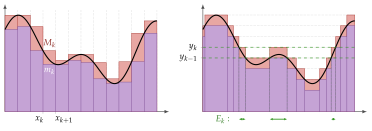
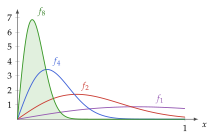
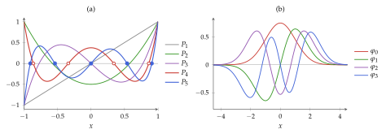
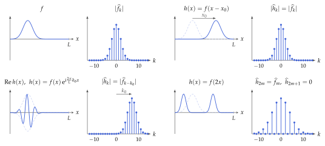
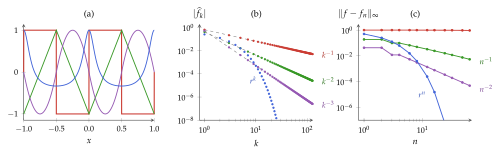
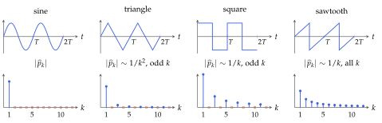
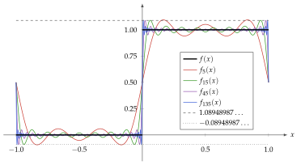
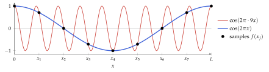
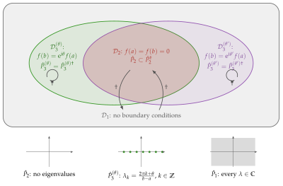
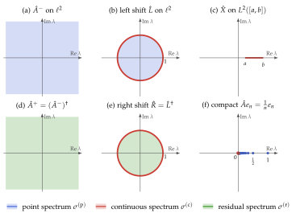

## Doel van dit hoofdstuk



* Inzicht krijgen in de complicaties van het werken met functieruimten:
  waarom de Lebesgue-integraal nodig is
* Orthonormale basissen voor functieruimten:
  * orthogonale veeltermen:
    * belangrijkste eigenschappen
    * voornaamste families die relevant zijn in de fysica
  * Fourierreeks:
    * eigenschappen
    * convergentie en convergentiesnelheid
    * verband met discrete Fouriertransformatie

## Doel van dit hoofdstuk

* Belangrijkste operatoren op functieruimten:
  integraaloperatoren, vermenigvuldigingsoperatoren, differentiaaloperatoren
* Eigenschappen van onbegrensde operatoren
  * Toegevoegde van een onbegrensde operator
  * Verschil tussen symmetrisch en zelftoegevoegd
  * Belang hiervan in de context van differentiaaloperatoren en randvoorwaarden
* Intuïtie krijgen voor de spectraaltheorie van begrensde en onbegrensde operatoren op oneindig-dimensionale Hilbertruimten aan de hand van relevante voorbeelden

# Terugblik: H4, H5 en H7

wat we nodig hebben

## Terugblik: normen en volledigheid (H4) {.scrollable}

* **$p$-norm** op $C^0([a,b])$: $\norm{f}_p = \left(\int_a^b \abs{f(x)}^p\,\drm x\right)^{1/p}$ [(Vb 4.3)]{style="color: grey; font-size: 80%"}
  * **Uniforme norm**: $\norm{f}_\infty = \max_{x\in[a,b]}\abs{f(x)}$ [(Vb 4.5)]{style="color: grey; font-size: 80%"}
  * Puntsgewijze convergentie komt van geen enkele norm [(Vb 4.6)]{style="color: grey; font-size: 80%"}

 

* **Cauchy-rij**: $\norm{v_n - v_m} \to 0$; **compleet**: elke Cauchy-rij convergeert [(Def 4.8–4.9)]{style="color: grey; font-size: 80%"}
  * **Banachruimte** = complete genormeerde vectorruimte [(Def 4.10)]{style="color: grey; font-size: 80%"}
  * $(C^0([a,b]), \norm{\cdot}_\infty)$ is Banach [(Vb 4.10)]{style="color: grey; font-size: 80%"}
  * $(C^0([a,b]), \norm{\cdot}_p)$ met $p < \infty$ is niet compleet, bv. $p = 2$ [(Vb 5.5)]{style="color: grey; font-size: 80%"}
* **Complete verzameling** $S$: $\overline{\bbF S} = V$ [(Def 4.11)]{style="color: grey; font-size: 80%"}
  * Weierstrass: de eentermen (monomen) $x^n$ zijn compleet in $(C^0([a,b]), \norm{\cdot}_\infty)$ [(Vb 4.12)]{style="color: grey; font-size: 80%"}

## Terugblik: begrensde operatoren (H4)

* **Begrensd**: $\norm{\map{A} v} \leq C \norm{v}$ voor alle $v \in V$ [(Def 4.16)]{style="color: grey; font-size: 80%"}
  * Begrensd $\Leftrightarrow$ continu [(Prop 4.12)]{style="color: grey; font-size: 80%"}
  * $\dim V < \infty$: elke lineaire afbeelding is begrensd [(Prop 4.13)]{style="color: grey; font-size: 80%"}
* **Operatornorm**: kleinste zo'n $C$ [(Def 4.19)]{style="color: grey; font-size: 80%"}
  $$\norm{\map{A}} = \sup_{v \neq 0} \frac{\norm{\map{A} v}}{\norm{v}}$$

## Terugblik: Hilbertruimten (H5)

* **Hilbertruimte**: inwendigproductruimte die compleet is voor $\norm{v} = \sqrt{\inner{v}{v}}$ [(Def 5.14)]{style="color: grey; font-size: 80%"}
  * Voorbeelden: $\ell^2$ [(Vb 5.4)]{style="color: grey; font-size: 80%"}, $L^2$ met $\inner{f}{g} = \int \overline{f(x)} g(x)\,\drm x$ [(Vb 5.6)]{style="color: grey; font-size: 80%"}
* **Parallellogramwet**: de norm komt van een inwendig product $\Leftrightarrow$ [(Prop 5.5, St 5.6)]{style="color: grey; font-size: 80%"}
  $$\norm{v + w}^2 + \norm{v - w}^2 = 2 \left(\norm{v}^2 + \norm{w}^2\right)$$
* **Projectiestelling**: $W$ gesloten deelruimte $\Rightarrow$ $V = W \oplus W^\perp$ [(St 5.13)]{style="color: grey; font-size: 80%"}
  * De beste benadering van $v$ in $W$ is de orthogonale projectie
* **Gram-Schmidt**: lineair onafhankelijke rij $\rightarrow$ orthonormale rij [(Def 5.20)]{style="color: grey; font-size: 80%"}

## Terugblik: orthonormale basissen (H5)

* **Complete orthonormale rij** $(e_i)$: orthonormaal met $\overline{\spanop\{e_i\}} = V$
* **Expansiestelling**: $(e_i)$ is een Schauderbasis [(St 5.23)]{style="color: grey; font-size: 80%"}
  $$\boxed{v = \sum_{i=1}^{+\infty} \inner{e_i}{v}\, e_i}$$
* **Plancherel**: $\norm{v}^2 = \sum_{i=1}^{+\infty} \abs{\inner{e_i}{v}}^2$ [(Gev 5.24)]{style="color: grey; font-size: 80%"}
* Voorbeeld: $f_k(x) = \frac{1}{\sqrt{L}}\erm^{\irm 2\pi k x/L}$ op $L^2([0,L])$ [(Vb 5.8)]{style="color: grey; font-size: 80%"}

## Terugblik: operatoren op Hilbertruimten (H5, H7) {.scrollable}

* **Riesz**: elke begrensde lineaire functionaal is $\xi[w] = \inner{v_\xi}{w}$ [(St 5.27)]{style="color: grey; font-size: 80%"}
* **Toegevoegde**: $\inner{w}{\map{A} v} = \inner{\map{A}^\dagger w}{v}$, met $\norm{\map{A}^\dagger} = \norm{\map{A}}$ [(Prop 5.28)]{style="color: grey; font-size: 80%"}
  * **Zelftoegevoegd**: $\map{A} = \map{A}^\dagger$ [(Def 5.23)]{style="color: grey; font-size: 80%"} $\Rightarrow$ eigenwaarden reëel [(Opm 5.43)]{style="color: grey; font-size: 80%"}
  * **Unitair**: $\map{U}^\dagger\map{U} = \idmap$ en $\map{U}\map{U}^\dagger = \idmap$ [(Prop 5.32)]{style="color: grey; font-size: 80%"}
  * **Normaal**: $\map{A}^\dagger\map{A} = \map{A}\map{A}^\dagger$ [(Def 5.24)]{style="color: grey; font-size: 80%"}
    * Eigenvectoren bij verschillende eigenwaarden zijn orthogonaal [(Prop 5.35)]{style="color: grey; font-size: 80%"}

 

* **Discrete Fouriertransformatie**: unitair op $\bbC^n$ [(Def 7.4)]{style="color: grey; font-size: 80%"}
  $$F_k = \frac{1}{\sqrt{n}} \sum_{j=0}^{n-1} f_j\, \erm^{-\irm 2\pi j k/n}$$
  * Verband met de Fourierreeks?

# Functieruimten en normen

(achtergrond en motivatie)

## Functieruimten {.scrollable}

::: {.definitie nr="8.1"}
Een **functieruimte** $Y^X$ is een verzameling van functies $f : X \to Y$, van een verzameling $X$ naar een vectorruimte $Y$ over $\bbF$, die een vectorruimte over $\bbF$ wordt door lineaire combinaties puntsgewijs te definiëren:
$$\boxed{(a f + b g)(x) = a f(x) + b g(x) \quad \forall x \in X}$$
:::

* $Y = \bbF$, $X = \{1, \ldots, n\}$: $Y^X \cong \bbF^n$
* $Y = \bbF$, $X = \bbN_0$: oneindig lange rijen
* Functieruimten in strikte zin: $X$ onaftelbaar, bv. $X = [a,b]$, $\bbR$ of $\Omega \subseteq \bbR^d$

::: {.opmerking nr="8.1"}
Bijkomende voorwaarden (continuïteit, kwadratische integreerbaarheid, …) blijven meestal behouden onder lineaire combinaties.\
Dit laat toe om deelruimten van $Y^X$ te construeren, bv. de continue of de kwadratisch integreerbare functies.
:::

## Lebesgue-ruimten

We willen minstens een norm (vanaf sectie 8.2: inwendig product):
$$\norm{f}_p = \left(\int_I \abs{f(x)}^p\,\drm x\right)^{1/p} \quad ?$$

* Vanaf nu $f : I \to \bbF$ met $I = [a,b]$ of $I = \bbR$ (voor de eenvoud)
* Mogelijke problemen:
  * de functie $f$ is mogelijk niet "integreerbaar" (binnen het gebruikte integraalconcept)
  * de integraal kan divergeren
  * de driehoeksongelijkheid geldt mogelijk niet
  * $\norm{f}_p = 0$ voor functies die niet de nulfunctie zijn

## Lebesgue-ruimten

::: {.definitie nr="8.2"}
$\mathcal{L}^p(I;\bbF)$ is de verzameling van functies $f : I \to \bbF$ die integreerbaar zijn en waarvoor $\int_I \abs{f(x)}^p\,\drm x$ eindig is
:::

* Precieze definitie hangt af van het integraalconcept (zie verder)
* Het geval $p = \infty$ laten we voorlopig buiten beschouwing

::: {.propositie nr="8.1"}
$\mathcal{L}^p(I;\bbF)$ is een vectorruimte, waarop $\norm{\cdot}_p$ een **seminorm** is
:::

::: {.bewijs}
Sleutel is de ongelijkheid van Minkowski $\norm{f + g}_p \leq \norm{f}_p + \norm{g}_p$ (zoals in H4, met integraal i.p.v. som).\
Niet positief definiet: $\norm{f}_p = 0$ voor bv. functies die enkel in eindig veel punten verschillen van nul
:::

## Van seminorm naar norm

Observatie 1: $U = \{ f \in \mathcal{L}^p(I;\bbF) \mid \norm{f}_p = 0 \}$ is een deelruimte van $\mathcal{L}^p(I;\bbF)$\
(wegens driehoeksongelijkheid en absolute homogeniteit)

::: {.definitie nr="8.3"}
Functies waarvoor $\norm{f - g}_p = 0 \Leftrightarrow f - g \in U$ noemen we **"bijna overal" gelijk**; dit is een equivalentierelatie
:::

Observatie 2: $\norm{f - g}_p = 0 \Rightarrow \norm{f}_p = \norm{g}_p$ (wegens $\abs{\norm{f}_p - \norm{g}_p} \leq \norm{f - g}_p$)

::: {.opmerking nr="8.4"}
De naam wordt verklaard in de sectie over de Lebesgue-integraal: $\norm{f - g}_p = 0$ als en slechts als $f$ en $g$ enkel verschillen op een verzameling met maat nul
:::

## Van seminorm naar norm

::: {.definitie nr="8.4"}
**Lebesgue-ruimte** $L^p(I;\bbF) = \mathcal{L}^p(I;\bbF)/U$: de vectorruimte van equivalentieklassen van functies die bijna overal gelijk zijn

$\norm{\cdot}_p$ heeft dezelfde waarde voor elke representant en is een **norm** op $L^p(I;\bbF)$
:::

::: {.opmerking nr="8.5"}
In de praktijk spreken we nog steeds over de elementen van $L^p(I;\bbF)$ als functies
:::

 

**Is $L^p(I;\bbF)$ metrisch compleet (een Banachruimte)?**

$\rightarrow$ hangt af van de definitie van de integraal zelf

## Riemann-integraal

::: {.definitie nr="8.5"}
Partitie $P$ van $[a,b]$: $\Delta_k = [x_{k-1}, x_k]$ met $a = x_0 < x_1 < \cdots < x_n = b$, en
$m_k = \inf_{x\in\Delta_k} f(x)$, $M_k = \sup_{x\in\Delta_k} f(x)$:
$$s_{f,P} = \sum_{k=1}^n m_k (x_k - x_{k-1}) \quad\text{en}\quad S_{f,P} = \sum_{k=1}^n M_k (x_k - x_{k-1})$$
Een begrensde functie $f$ is **Riemann-integreerbaar** als $s_f = \sup_P s_{f,P}$ en $S_f = \inf_P S_{f,P}$ samenvallen; dan is $\int_a^b f(x)\,\drm x = s_f = S_f$
:::

<!-- the Riemann panel of fig-riemann-lebesgue (panels separated around x = 175 pt of 372.695 x 131.534 pt) -->

## Riemann-integraal

::: {.opmerking nr="8.6"}
Enkel begrensde functies zijn Riemann-integreerbaar op $[a,b]$\
Onbegrensde functies, bv. $x^{-1/2}$ op $(0,1]$: **oneigenlijke integraal** $\lim_{\epsilon\to 0}\int_\epsilon^1 f(x)\,\drm x$\
$\rightarrow$ vereist dat $f$ enkel onbegrensd is nabij geïsoleerde punten
:::

::: {.opmerking nr="8.7"}
Functies met discontinuïteiten kunnen integreerbaar zijn, zolang er "niet te veel" zijn
:::

::: {.voorbeeld nr="8.1"}
**Dirichlet-functie** $\chi_{\bbQ}(x) = \begin{cases} 1, & x \in \bbQ\\ 0, & x \in \bbR\setminus\bbQ\end{cases}$: elk interval bevat rationale en irrationale getallen, dus $m_k = 0$, $M_k = 1$\
$\Rightarrow s_{\chi_\bbQ} = 0 \neq 1 = S_{\chi_\bbQ}$: niet Riemann-integreerbaar
:::

## Riemann-integreerbare functies zijn niet compleet {.scrollable}

::: {.voorbeeld nr="8.2"}
$q_1, q_2, \ldots$: aftelling van de rationale getallen in $[0,1]$
$$f_N(x) = \sum_{n=1}^N 2^{-n} \min\left(\abs{x - q_n}^{-1/2}, N\right)$$

* Elke $f_N$ is continu, dus Riemann-integreerbaar
* $\int_0^1 \abs{x - q}^{-1/2}\,\drm x \leq 4 \Rightarrow \norm{f_N}_1 \leq 4$, en $f_N \leq f_{N+1}$\
  $\Rightarrow \norm{f_M - f_N}_1 = \norm{f_M}_1 - \norm{f_N}_1$: Cauchyrij voor $\norm{\cdot}_1$
* Limiet $f(x) = \sum_{n=1}^{+\infty} 2^{-n}\abs{x - q_n}^{-1/2}$ is onbegrensd op elk deelinterval\
  $\Rightarrow$ niet Riemann-integreerbaar, zelfs niet als oneigenlijke integraal
:::

$\rightarrow$ Dit gebrek aan compleetheid dwong Lebesgue tot een nieuwe definitie van de integraal:

* Riemann-integreerbaar $\Rightarrow$ Lebesgue-integreerbaar, met dezelfde waarde
* Ook de limiet $f$ is Lebesgue-integreerbaar, met $\int_0^1 f(x)\,\drm x \leq 4$

## Lebesgue-integraal

Idee: partitioneer de "$y$-as" (de mogelijke functiewaarden) i.p.v. de "$x$-as"

<!-- labels centred under the two panels (centred at x = 86 and x = 284.5 of 372.695 pt) -->

Riemann

Lebesgue

## Lebesgue-integraal

::: {.definitie nr="8.6"}
Voor $0 \leq f(x) < M$: partitie $0 = y_0 < y_1 < \cdots < y_n = M$, $E_k = f^{-1}([y_{k-1}, y_k))$ en
$$l_{f,P} = \sum_{k=1}^n y_{k-1}\,\mu(E_k) \quad\text{en}\quad L_{f,P} = \sum_{k=1}^n y_k\,\mu(E_k)$$
met $\mu(E_k)$ de "grootte" van $E_k$: limiet is de **Lebesgue-integraal**\
Algemene $f$: $l_f = l_{f^+} - l_{f^-}$ $\Rightarrow$ $f$ integreerbaar $\Leftrightarrow$ $\abs{f}$ integreerbaar
:::

* Een functie waarvoor alle $E_k$ meetbaar zijn (zie verder) heet **meetbaar**

## Maten {.scrollable}

Waar zit het probleem? In de "grootte" $\mu(E_k)$: $E_k$ is niet noodzakelijk een interval

::: {.definitie nr="8.7"}
Een **maat** $\mu$ kent aan deelverzamelingen $A \subseteq I$ een grootte $\mu(A) \in [0, +\infty]$ toe met
$$\mu(\emptyset) = 0, \quad \mu\Big(\bigcup_i A_i\Big) = \sum_i \mu(A_i) \quad\text{voor aftelbaar veel disjuncte } A_i$$
Enkel gedefinieerd op de **meetbare verzamelingen**: gesloten onder complement, aftelbare unie en doorsnede
:::

* Gewenst: $\mu([a,b]) = b - a$; algemene $B$: overdekken met aftelbaar veel intervallen,
  $\mu(B) = \inf \sum_i \ell_i$

::: {.opmerking nr="8.8"}
Er bestaat geen translatie-invariante, aftelbaar additieve $\mu$ met $\mu([a,b]) = b - a$ op alle deelverzamelingen $\rightarrow$ beperken tot meetbare verzamelingen: **Lebesgue-maat**
:::

## Nulverzamelingen en "bijna overal" {.scrollable}

::: {.propositie nr="8.2"}
Elke aftelbare deelverzameling van $\bbR$ heeft Lebesgue-maat nul
:::

::: {.bewijs}
Overdek het $n$-de punt met een interval van lengte $\epsilon/2^n$: totale lengte $\leq \epsilon$, voor elke $\epsilon > 0$
:::

::: {.voorbeeld nr="8.3"}
Dirichlet-functie: $\int_I \chi_\bbQ\,\drm x = \mu(\bbQ \cap I) = 0$
:::

::: {.definitie nr="8.8"}
Een verzameling met maat nul is een **nulverzameling**; een eigenschap geldt **bijna overal** als ze enkel faalt op een nulverzameling
:::

::: {.opmerking nr="8.9"}
Ook onaftelbare nulverzamelingen bestaan, bv. de Cantorverzameling
:::

::: {.propositie nr="8.3"}
$\norm{f}_p = 0 \Leftrightarrow f(x) = 0$ bijna overal, i.e. $\mu(\{x \in I \mid f(x) \neq 0\}) = 0$
:::

## Limieten en integralen omwisselen

Compleetheid vereist dat we limieten en integralen kunnen omwisselen:
$$\int \lim_{n\to\infty} f_n\,\drm x \quad\leftrightarrow\quad \lim_{n\to\infty} \int f_n\,\drm x$$

::: {.voorbeeld nr="8.4"}
$f_n(x) = 2 n^2 x \exp(-n^2 x^2)$ op $[0,1]$: $f_n \to 0$ puntsgewijs, maar $\int_0^1 f_n(x)\,\drm x = 1 - \exp(-n^2) \to 1$
:::

{height="225px" fig-align="center"}

## Gedomineerde convergentie

$\rightarrow$ Omwisselen is niet toegelaten in het algemeen, voor geen enkele definitie van de integraal

* Riemann: typisch enkel bij uniforme convergentie
* Lebesgue: toegelaten als de rij gedomineerd wordt door een integreerbare functie:

::: {.stelling nr="8.4" title="gedomineerde convergentie"}
Rij meetbare functies $f_n \to f$ bijna overal, met $\abs{f_n(x)} \leq g(x)$ voor alle $n$ en een integreerbare $g$:
$$\boxed{\lim_{n\to\infty} \int_I f_n(x)\,\drm x = \int_I f(x)\,\drm x}$$
:::

::: {.opmerking nr="8.10"}
Voorbeeld 8.4 voldoet niet: elke $g \geq f_n$ gedraagt zich als $2/(\erm x)$ voor kleine $x$, niet integreerbaar op $[0,1]$
:::

## Compleetheid van $L^p$

 

::: {.stelling nr="8.5" title="Riesz-Fischer"}
$L^p(I)$ is een Banachruimte voor $p \geq 1$ (zonder bewijs)
:::

 

$\rightarrow$ Met de Lebesgue-integraal zijn de $L^p$-ruimten wel compleet, in tegenstelling tot de Riemann-integreerbare functies (Voorbeeld 8.2)

## Bijkomende opmerkingen

::: {.opmerking nr="8.11"}
Voor $p = \infty$: **essentieel supremum**
$$\norm{f}_\infty = \operatorname*{ess\,sup}_{x\in I} \abs{f} = \inf\{M \geq 0 \mid \mu(\{x \in I \mid \abs{f(x)} > M\}) = 0\}$$
:::

::: {.opmerking nr="8.12"}
Gewogen ruimte $L^p_w(I)$ met $\norm{f}_{p,w} = \left(\int_I w(x)\abs{f(x)}^p\,\drm x\right)^{1/p}$, $w \geq 0$ en strikt positief bijna overal
:::

::: {.opmerking nr="8.13"}
De ruimten $L^p(I)$ verschillen voor verschillende $p$: bv. $1/\sqrt{x} \in \mathcal{L}^1([0,1])$ maar $\notin \mathcal{L}^p([0,1])$ voor $p \geq 2$\
$I$ compact: $L^q(I) \subseteq L^p(I)$ voor $q \geq p$; $I = \bbR$: geen inclusie
:::

## Bijkomende opmerkingen

::: {.opmerking nr="8.14"}
$I = [a,b]$ compact: $\overline{C^\infty(I)} = L^p(I)$, en ook $\overline{C^k(I)} = L^p(I)$\
$\rightarrow$ geldt voor elke $p$: de sluiting hangt zelf af van $\norm{\cdot}_p$
:::

::: {.opmerking nr="8.15"}
$I = \bbR$: continue functies hebben niet noodzakelijk een eindige $p$-norm\
$\rightarrow$ **drager** $\operatorname{supp}(f) = \overline{\{x \in I \mid f(x) \neq 0\}}$ en $C_c^k(\bbR)$: functies met compacte drager, dicht in $L^p(\bbR)$
:::

::: {.opmerking nr="8.16"}
$L^p(I)$ is **separabel**: er bestaat een aftelbare fundamentele verzameling

* $I$ compact: eentermen (monomen) $\{x^n, n \in \bbN\}$ (Weierstrass)
* $I = \bbR$: $\{x^n \chi_{[-N,N]} \mid n \in \bbN, N \in \bbN_0\}$
:::

# Hilbertruimten en inwendig product

## Hilbertruimten en inwendig product {.scrollable}

::: {.propositie nr="8.6"}
$L^2(I)$ heeft een inwendig product
$$\boxed{\inner{f}{g} = \int_I \overline{f(x)}\, g(x)\,\drm x}$$
met $\inner{f}{f} = \norm{f}_2^2$, en is daarmee een **Hilbertruimte** (compleet wegens Riesz-Fischer)
:::

::: {.opmerking nr="8.17"}
Gewogen: $\inner{f}{g}_w = \int_I w(x)\overline{f(x)}\, g(x)\,\drm x$ met $w \geq 0$ en strikt positief bijna overal\
$\rightarrow$ $L^2_w(I)$ is opnieuw een Hilbertruimte
:::

::: {.opmerking nr="8.18"}
Nog algemener: $\inner{f}{g}_w = \iint_I w(x,y)\overline{f(x)}\, g(y)\,\drm x\,\drm y$ met $w(x,y) = \overline{w(y,x)}$\
$\rightarrow$ voorwaarden voor positief definiet minder eenvoudig, weinig gebruikt
:::

# Orthogonale veeltermen

## Orthogonale veeltermen

* $I$ eindig: $\{x^n, n \in \bbN\}$ is een fundamentele verzameling voor $L^2(I)$\
  (Weierstrass, Voorbeeld 4.12, en dichtheid van continue functies)
* $I = \bbR$ of $I = \bbR_{\geq 0}$: monomen niet kwadratisch integreerbaar\
  $\rightarrow$ $L^2_w(I)$ met goed gekozen $w$: monomen opnieuw fundamenteel\
  (moeilijker te bewijzen, en niet voor elke $w$: $w$ moet snel genoeg dalen)
* Gram-Schmidt $\rightarrow$ orthogonale veeltermen $\{p_n, n \in \bbN\}$: een orthogonale basis
* Verschillende families door keuze van $I$ en $w$

## Algemene eigenschappen

::: {.propositie nr="8.7"}
$p_n(x)$ is een reële veelterm van graad $n$, orthogonaal op alle veeltermen van graad $< n$
:::

::: {.opmerking nr="8.19"}
Niet steeds genormaliseerd: ook bv. $p_n(x) = x^n + \cdots$
:::

::: {.opmerking nr="8.20"}
Symmetrisch interval en $w(-x) = w(x)$: $p_n(-x) = (-1)^n p_n(x)$, enkel even (oneven) machten voor $n$ even (oneven)
:::

::: {.opmerking nr="8.21"}
Orthogonale veeltermen zijn reëel: geen complexe toevoeging nodig
:::

## Recursierelatie

::: {.propositie nr="8.8"}
$$\boxed{x\, p_n(x) = a_n p_{n+1}(x) + b_n p_n(x) + c_n p_{n-1}(x)}$$
met $c_0 = 0$ en $c_n \inner{p_{n-1}}{p_{n-1}}_w = a_{n-1}\inner{p_n}{p_n}_w$
:::

::: {.bewijs}
Idee: $x\, p_n$ is orthogonaal op veeltermen van graad $\leq n - 2$, want de factor $x$ kan naar het andere argument van het inwendig product
:::

::: {.opmerking nr="8.22"}
Vermenigvuldigen met $x$ heeft een tridiagonale matrixrepresentatie t.o.v. de basis $p_n$; symmetrisch als de basis orthonormaal is
:::

::: {.opmerking nr="8.23"}
Symmetrisch interval en $w$ even: $b_n = 0$
:::

## Projector en nulpunten {.scrollable}

::: {.propositie nr="8.9"}
Orthogonale projector op de veeltermen van graad $\leq n$:
$$(\map{P}_n f)(x) = \int_I w(y) K_n(x,y) f(y)\,\drm y, \quad K_n(x,y) = \sum_{k=0}^n \frac{p_k(x)\, p_k(y)}{\inner{p_k}{p_k}_w}$$
met (**Christoffel-Darboux**) voor $x \neq y$:
$$K_n(x,y) = \frac{a_n}{\inner{p_n}{p_n}_w} \frac{p_{n+1}(x)\, p_n(y) - p_n(x)\, p_{n+1}(y)}{x - y}$$
:::

::: {.propositie nr="8.10"}
$p_n$ heeft $n$ verschillende nulpunten in het inwendige van $I$; de nulpunten van $p_n$ en $p_{n+1}$ alterneren
:::

## Legendre-veeltermen {.scrollable}

* $I = [-1,+1]$, $w(x) = 1$:
  $$\begin{aligned} &P_0(x) = 1, \quad P_1(x) = x, \quad P_2(x) = \tfrac{1}{2}(3x^2 - 1),\\ &P_3(x) = \tfrac{1}{2}(5x^3 - 3x), \quad P_4(x) = \tfrac{1}{8}(35x^4 - 30x^2 + 3), \quad \ldots\end{aligned}$$
  genormaliseerd zodat $P_n(1) = 1$
* Genererende functie (Legendre 1782): $$\frac{1}{\sqrt{1 - 2xt + t^2}} = \sum_{n=0}^{+\infty} P_n(x)\, t^n$$
  $\rightarrow$ via $\int_{-1}^{+1} \frac{1}{\sqrt{1 - 2xt + t^2}\sqrt{1 - 2xs + s^2}}\,\drm x = \frac{1}{\sqrt{ts}}\log\frac{1 + \sqrt{ts}}{1 - \sqrt{ts}}$:
  $$\inner{P_n}{P_m} = \int_{-1}^{+1} P_n(x) P_m(x)\,\drm x = \frac{2}{2n+1}\delta_{n,m}$$

## Legendre-veeltermen

* Afgeleide naar $t$ van de genererende functie $\rightarrow$ Bonnet-recursieformule:
  $$(n+1) P_{n+1}(x) + n P_{n-1}(x) = (2n+1)\, x P_n(x)$$
* Rodrigues-formule: $P_n(x) = \frac{1}{2^n n!}\frac{\drm^n}{\drm x^n}(x^2 - 1)^n$

<!-- panel (a) of fig-orthogonal-polynomials (474.4 x 165.989 pt): x < 235 pt, without the label above y = 17 pt -->

::: {style="text-align: center; color: grey; font-size: 80%;"}
$P_1, \ldots, P_5$: de nulpunten van $P_4$ en $P_5$ alterneren
:::

## Hermite-veeltermen

* $I = \bbR$, $w(x) = \exp(-x^2)$:
  $$\begin{aligned} &H_0(x) = 1, \quad H_1(x) = 2x, \quad H_2(x) = 4x^2 - 2,\\ &H_3(x) = 8x^3 - 12x, \quad H_4(x) = 16x^4 - 48x^2 + 12, \quad \ldots\end{aligned}$$
* Genererende functie: $$\exp(2xt - t^2) = \sum_{n=0}^{+\infty} \frac{1}{n!} H_n(x)\, t^n$$
  $\rightarrow$ $\inner{H_m}{H_n}_w = \int_{-\infty}^{+\infty} \erm^{-x^2} H_m(x) H_n(x)\,\drm x = 2^n n! \sqrt{\pi}\,\delta_{m,n}$
* Recursie $H_{n+1}(x) + 2n H_{n-1}(x) = 2x H_n(x)$, Rodrigues $H_n(x) = (-1)^n \erm^{x^2}\frac{\drm^n}{\drm x^n}\erm^{-x^2}$

## Hermite-functies

:::: {.columns}
::: {.column width="57%"}
::: {.opmerking nr="8.24"}
De Hermite-veeltermen vormen een orthogonale basis van $L^2_w(\bbR)$ (monomen zijn hier fundamenteel; zonder bewijs)\
$f(x) \mapsto \erm^{-x^2/2} f(x)$ is een unitaire afbeelding van $L^2_w(\bbR)$ naar $L^2(\bbR)$:
$$\varphi_n(x) = \frac{1}{\sqrt{2^n n! \sqrt{\pi}}} H_n(x)\, \erm^{-x^2/2}$$
vormen een orthonormale basis van $L^2(\bbR)$\
$\rightarrow$ eigenbasis van de harmonische oscillator in de kwantummechanica
:::
:::
::: {.column width="43%"}
<!-- panel (b) of fig-orthogonal-polynomials: x > 235 pt, without the label above y = 17 pt -->

::: {style="text-align: center; color: grey; font-size: 80%;"}
Hermite-functies $\varphi_0, \ldots, \varphi_3$
:::
:::
::::

## Laguerre-veeltermen

* $I = [0,+\infty)$, $w(x) = \exp(-x)$:
  $$\begin{aligned} &L_0(x) = 1, \quad L_1(x) = 1 - x, \quad L_2(x) = \tfrac{1}{2}(x^2 - 4x + 2),\\ &L_3(x) = \tfrac{1}{6}(-x^3 + 9x^2 - 18x + 6), \quad \ldots\end{aligned}$$
* Genererende functie: $$\frac{1}{1 - t}\exp\left(-x\frac{t}{1 - t}\right) = \sum_{n=0}^{+\infty} L_n(x)\, t^n$$
  $\rightarrow$ $\inner{L_m}{L_n}_w = \delta_{m,n}$ (orthonormaal)
* Recursie $(n+1) L_{n+1}(x) + n L_{n-1}(x) = (2n + 1 - x) L_n(x)$
* Waterstofatoom: **veralgemeende** Laguerre-veeltermen $L_n^{(\alpha)}$, orthogonaal met $w(x) = x^\alpha \erm^{-x}$

## Chebyshev-veeltermen {.scrollable}

* $I = [-1,1]$, $w(x) = (1 - x^2)^{-1/2}$:
  $T_0(x) = 1, \quad T_1(x) = x, \quad T_2(x) = 2x^2 - 1, \quad T_3(x) = 4x^3 - 3x, \quad \ldots$
* Substitutie $x = \cos\theta$: $$\inner{f}{g}_w = \int_{-1}^{+1} \frac{f(x)\, g(x)}{\sqrt{1 - x^2}}\,\drm x = \int_0^\pi f(\cos\theta)\, g(\cos\theta)\,\drm\theta$$
  $\rightarrow$ $T_n(\cos\theta) = \cos(n\theta)$, $\inner{T_m}{T_n}_w = \begin{cases}\pi, & m = n = 0\\ \frac{\pi}{2}\delta_{n,m}, & \text{anders}\end{cases}$
* Recursie $T_{n+1}(x) = 2x T_n(x) - T_{n-1}(x)$

::: {.opmerking nr="8.25"}
Vooral in numerieke analyse: $2^{1-n} T_n$ is de monische veelterm van graad $n$ met kleinste $\norm{\cdot}_\infty$ op $[-1,1]$
:::

::: {.opmerking nr="8.26"}
Legendre en Chebyshev: speciale gevallen van Jacobi-veeltermen, $w(x) = (1 - x)^\alpha (1 + x)^\beta$
:::

## Overzicht {.scrollable}

|                   | $I$         | $w(x)$                      | normalisatie                    | $\inner{p_n}{p_n}_w$                    |
|:------------------|:-----------:|:---------------------------:|:-------------------------------:|:---------------------------------------:|
| Legendre $P_n$    | $[-1,1]$    | $1$                         | $P_n(1) = 1$                    | $\frac{2}{2n+1}$                        |
| Hermite $H_n$     | $\bbR$      | $\erm^{-x^2}$               | $H_n(x) = 2^n x^n + \cdots$     | $2^n n! \sqrt{\pi}$                     |
| Laguerre $L_n$    | $[0,+\infty)$ | $\erm^{-x}$               | $L_n(0) = 1$                    | $1$                                     |
| Chebyshev $T_n$   | $[-1,1]$    | $\frac{1}{\sqrt{1 - x^2}}$  | $T_n(1) = 1$                    | $\frac{\pi}{2}$ ($\pi$ voor $n = 0$)    |

|           | genererende functie                                                     | recursierelatie                                           |
|:----------|:-----------------------------------------------------------------------:|:---------------------------------------------------------:|
| Legendre  | $\sum_n P_n(x)\, t^n = \frac{1}{\sqrt{1 - 2xt + t^2}}$                  | $(n+1) P_{n+1} = (2n+1)\, x P_n - n P_{n-1}$              |
| Hermite   | $\sum_n \frac{H_n(x)}{n!} t^n = \erm^{2xt - t^2}$                      | $H_{n+1} = 2x H_n - 2n H_{n-1}$                           |
| Laguerre  | $\sum_n L_n(x)\, t^n = \frac{\erm^{-xt/(1-t)}}{1 - t}$                  | $(n+1) L_{n+1} = (2n + 1 - x) L_n - n L_{n-1}$            |
| Chebyshev | $\sum_n T_n(x)\, t^n = \frac{1 - xt}{1 - 2xt + t^2}$                    | $T_{n+1} = 2x T_n - T_{n-1}$                              |

## Toepassing: Gaussische kwadratuur {.scrollable}

* Numerieke benadering van een integraal uit functiewaarden in $n$ punten $x_i \in I$:
  $$\boxed{\int_I w(x) f(x)\,\drm x \approx \sum_{i=1}^n a^i f(x_i)}$$

::: {.propositie nr="8.11"}
De benadering kan exact gemaakt worden voor elke veelterm $f$ van graad $\leq n - 1$
:::

* Lineair systeem met Vandermonde-matrix:
  $$\begin{bmatrix} 1 & 1 & \cdots & 1\\ x_1 & x_2 & \cdots & x_n\\ \vdots & & \ddots & \vdots\\ x_1^{n-1} & x_2^{n-1} & \cdots & x_n^{n-1}\end{bmatrix}\begin{bmatrix} a^1\\ a^2\\ \vdots\\ a^n\end{bmatrix} = \begin{bmatrix} b^0\\ b^1\\ \vdots\\ b^{n-1}\end{bmatrix}, \quad b^k = \int_I w(x)\, x^k\,\drm x$$

## Toepassing: Gaussische kwadratuur

* Ook de punten $x_i$ vrij kiezen: $2n$ parameters, exact tot graad $2n - 1$?\
  Niet-lineair probleem, maar:

::: {.stelling nr="8.12" title="Gauss"}
Kies de $x_i$ als de nulpunten van de orthogonale veelterm $p_n$ bij $I$ en $w$: de benadering is exact voor elke veelterm van graad $\leq 2n - 1$
:::

::: {.bewijs}
Deling: $f = p_n q + r$ met $q$, $r$ van graad $\leq n - 1$. Dan is $\int w\, p_n q\,\drm x = 0$ (orthogonaliteit) en $r(x_i) = f(x_i)$ (want $p_n(x_i) = 0$), dus
$$\int w f\,\drm x = \int w r\,\drm x = \sum_i a^i r(x_i) = \sum_i a^i f(x_i)$$
:::

## Toepassing: Gaussische kwadratuur {.scrollable}

::: {.opmerking nr="8.27"}
* Graad $2n - 1$ is optimaal: voor $f = p_n^2$ geeft de benadering $0$, terwijl $\int_I w\, p_n^2\,\drm x > 0$
* Alle gewichten zijn positief: $a^i = \int_I w(x)\,\ell_i(x)^2\,\drm x > 0$ met $\ell_i$ de Lagrange-veelterm ($\ell_i(x_j) = \delta_{ij}$)\
  $\rightarrow$ belangrijk voor numerieke stabiliteit
:::

::: {.voorbeeld nr="8.5"}
Gauss-Legendre op $[a,b]$: herschaal $x = \frac{a+b}{2} + \frac{b-a}{2}\tilde{x}$, met $\tilde{x} \in [-1,1]$
:::

::: {.voorbeeld nr="8.6"}
Gauss-Laguerre op $[0,+\infty)$ voor $f(x) \approx \erm^{-x}\cdot$ veelterm: $\int_0^{+\infty} f\,\drm x \approx \sum_i a^i \erm^{x_i} f(x_i)$
:::

::: {.opmerking nr="8.28"}
Nulpunten en gewichten voor grote $n$ nauwkeurig berekenen: aparte kunst
:::

# Fourierreeksen

## Periodieke functies

::: {.definitie nr="8.9"}
$f : \bbR \to \bbF$ is **periodiek met periode $L$** als $f(x + L) = f(x)$ voor alle $x \in \bbR$
:::

::: {.opmerking nr="8.29"}
Volledig bepaald door de waarden op $[0, L)$; omgekeerd periodiek uitbreiden
:::

::: {.opmerking nr="8.30"}
Functie op een cirkel met omtrek $L$: $\bbT_L = \bbR/(L\bbZ)$ (eendimensionale torus)
:::

## Trigonometrische veeltermen

::: {.definitie nr="8.10"}
**Trigonometrische veelterm** van graad $n$:
$$f(x) = \frac{a_0}{2} + \sum_{k=1}^n a_k \cos\left(\tfrac{2\pi}{L} k x\right) + \sum_{k=1}^n b_k \sin\left(\tfrac{2\pi}{L} k x\right) = \sum_{k=-n}^{+n} c_k \exp\left(\irm \tfrac{2\pi}{L} k x\right)$$
met $a_k = c_k + c_{-k}$ en $b_k = \irm (c_k - c_{-k})$
:::

## Fouriermodes

::: {.propositie nr="8.13"}
In $L^2([0,L])$ is de verzameling Fouriermodes
$$S = \left\{\varphi_k(x) = \frac{1}{\sqrt{L}}\erm^{+\irm\frac{2\pi}{L} k x} ; k \in \bbZ\right\}$$
een orthonormale basis van de ruimte van trigonometrische veeltermen
:::

::: {.opmerking nr="8.31"}
Equivalente reële basis met $\cos$ en $\sin$: handig voor even/oneven functies
:::

::: {.opmerking nr="8.32"}
$d$-dimensionale torus: $\varphi_{\vec{k}}(\vec{x}) = \frac{1}{(L_1\cdots L_d)^{1/2}}\erm^{+\irm\left(\frac{2\pi}{L_1} k_1 x_1 + \cdots + \frac{2\pi}{L_d} k_d x_d\right)}$, $\vec{k} \in \bbZ^d$
:::

## Fouriercoëfficiënten en Fourierreeks

::: {.definitie nr="8.11"}
**Fouriercoëfficiënten**:
$$\boxed{\hat{f}_k = \inner{\varphi_k}{f} = \frac{1}{\sqrt{L}}\int_0^L f(x)\,\erm^{-\irm\frac{2\pi}{L} k x}\,\drm x}$$
:::

::: {.propositie nr="8.14"}
Orthogonale projectie op trigonometrische veeltermen van graad $\leq n$:
$$f_n(x) = (\map{P}_n f)(x) = \sum_{k=-n}^{+n} \hat{f}_k \varphi_k(x) = \int_0^L D_n(x - t) f(t)\,\drm t$$
met de **Dirichlet-kern** $D_n(x) = \frac{1}{L}\sum_{k=-n}^{+n}\erm^{+\irm\frac{2\pi}{L} k x} = \frac{\sin\left(\frac{(2n+1)\pi}{L} x\right)}{L \sin\left(\frac{\pi}{L} x\right)}$
:::

## Fourierreeks {.scrollable}

::: {.definitie nr="8.12"}
De (formele) reeks $\lim_{n\to\infty} f_n(x) = \frac{1}{\sqrt{L}}\sum_{k\in\bbZ}\hat{f}_k\,\erm^{+\irm\frac{2\pi}{L} k x}$ is de **Fourierreeks** van $f$\
$\rightarrow$ in welke zin ze convergeert (naar $f$): zie verder
:::

::: {.propositie nr="8.15"}
$\hat{f}_k$ is goed gedefinieerd voor elke $f \in L^1([0,L])$, want voor alle $k \in \bbZ$
$$\abs{\hat{f}_k} \leq \frac{1}{\sqrt{L}}\int_0^L \abs{f(x)\,\erm^{-\irm\frac{2\pi}{L} k x}}\,\drm x = \frac{1}{\sqrt{L}}\int_0^L \abs{f(x)}\,\drm x = \frac{\norm{f}_1}{\sqrt{L}}$$
Voor de rij $\hat{f} = (\hat{f}_k)_{k\in\bbZ}$ volgt
$$\boxed{\norm{\hat{f}}_\infty = \sup_{k\in\bbZ}\abs{\hat{f}_k} \leq \frac{\norm{f}_1}{\sqrt{L}} < \infty}$$
dus $\hat{f} \in \ell^\infty(\bbZ)$
:::

## Fouriercoëfficiënten: eigenschappen

::: {.propositie nr="8.16"}
* Lineariteit: $h(x) = a f(x) + b g(x) \implies \hat{h}_k = a\hat{f}_k + b\hat{g}_k$
* Translatie: $h(x) = f(x - x_0) \implies \hat{h}_k = \erm^{-\irm\frac{2\pi}{L} k x_0}\hat{f}_k$
* Modulatie: $h(x) = f(x)\,\erm^{\irm\frac{2\pi}{L} k_0 x} \implies \hat{h}_k = \hat{f}_{k - k_0}$
* Conjugatie: $h(x) = \overline{f(x)} \implies \hat{h}_k = \overline{\hat{f}_{-k}}$
* Tijd-/frequentie-omkering: $h(x) = f(-x) \implies \hat{h}_k = \hat{f}_{-k}$
* Discrete herschaling: $h(x) = f(sx) \implies \hat{h}_k = \begin{cases}\hat{f}_{k/s}, & k \text{ veelvoud van } s\\ 0, & \text{anders}\end{cases}, \quad s \in \bbN_0$
:::

## Fouriercoëfficiënten: eigenschappen

{height="320px" fig-align="center"}

* Translatie: enkel de fasen veranderen; modulatie: het spectrum verschuift over $k_0$
* Herschaling ($s = 2$): periode $L/2$, enkel even $k$, spectrum twee keer breder

## Convoluties

::: {.definitie nr="8.13"}
**Periodieke convolutie** van $f, g \in L^1([0,L])$:
$$(f * g)(x) = \int_0^L f(x - y \bmod L)\, g(y)\,\drm y = \int_0^L f(y)\, g(x - y \bmod L)\,\drm y = (g * f)(x)$$
:::

::: {.propositie nr="8.17"}
$f * g \in L^1([0,L])$ (wegens omwisselen van integralen: Fubini)
:::

::: {.propositie nr="8.18"}
$$\boxed{h = f * g \quad\implies\quad \hat{h}_k = \sqrt{L}\,\hat{f}_k\,\hat{g}_k}$$
:::

## Convergentie in $L^1$

* De partieelsommen $f_n = \map{P}_n f$ convergeren niet noodzakelijk naar $f$ in 1-norm
* Wel: het gemiddelde van de partieelsommen (ook van graad $n$):
  $$\tilde{f}_n = \map{Q}_n f = \frac{f_0 + f_1 + \cdots + f_n}{n + 1}$$

::: {.stelling nr="8.19"}
Voor $f \in L^1([0,L])$: $\lim_{n\to\infty}\norm{\tilde{f}_n - f}_1 = 0$ (zonder bewijs)\
$\rightarrow$ trigonometrische veeltermen zijn dicht in $L^1([0,L])$
:::

::: {.opmerking nr="8.33"}
Vergelijk: $\lim_{n\to\infty}(s_0 + \cdots + s_n)/(n+1)$ kan bestaan als $\lim_{n\to\infty} s_n$ niet bestaat, bv. $s_n = (-1)^n$
:::

## Convergentie in $L^2$

::: {.stelling nr="8.21"}
Voor $f \in L^2([0,L])$: $\lim_{n\to\infty}\norm{f_n - f}_2 = 0$\
De afbeelding $f \mapsto \hat{f}$ is unitair van $L^2([0,L])$ naar $\ell^2(\bbZ)$, met
$$\boxed{\norm{f}_2^2 = \int_0^L \abs{f(x)}^2\,\drm x = \sum_{k\in\bbZ}\abs{\hat{f}_k}^2 = \norm{\hat{f}}_2^2}$$
:::

::: {.bewijs}
Enkel compleetheid van $S$ is nodig (expansiestelling). Als $\inner{\varphi_k}{g} = 0$ voor alle $k$, dan is $\map{Q}_n g = 0$, dus $\norm{g}_1 = \lim_{n\to\infty}\norm{g - \map{Q}_n g}_1 = 0$ (Stelling 8.19)
:::

::: {.opmerking nr="8.34"}
Ook convergentie in $p$-norm voor $p > 1$, en puntsgewijs bijna overal (Carleson-Hunt); veel moeilijker
:::

## Verval van de Fouriercoëfficiënten {.scrollable}

::: {.lemma nr="8.20" title="Riemann-Lebesgue"}
Voor $f \in L^1([0,L])$: $\lim_{k\to\pm\infty}\hat{f}_k = 0$
:::

* Intuïtie: voor grote $\abs{k}$ oscilleert de integrand zo snel dat $\hat{f}_k$ uitmiddelt tot nul

::: {.bewijs}
Benader $f$ in 1-norm door een trigonometrische veelterm $\tilde{f}_N$ (Stelling 8.19). Die heeft geen componenten met $\abs{k} > N$.\
Voor $\abs{k} > N$ geeft Propositie 8.15 dus $\abs{\hat{f}_k} \leq \norm{f - \tilde{f}_N}_1/\sqrt{L}$: willekeurig klein
:::

$\rightarrow$ Propositie 8.15 gaf enkel $\hat{f} \in \ell^\infty(\bbZ)$; de coëfficiënten gaan bovendien naar nul, maar zonder bepaalde snelheid

::: {.opmerking nr="8.35"}
Bijkomende regulariteit van $f$ $\Rightarrow$ sneller dalende $\hat{f}_k$ $\Rightarrow$ sterkere convergentie, bv. uniform: zie verder
:::

## Gladheid en convergentiesnelheid {.scrollable}

* Tot nu: $f \in L^2([0,L])$ $\Rightarrow$ $f_n \to f$ in 2-norm\
  Vraag: wanneer convergeert $f_n$ **uniform**, en hoe snel?
* Elke $f_n$ is continu en $(C^0, \norm{\cdot}_\infty)$ is Banach: een uniforme limiet is continu\
  $\Rightarrow$ enkel mogelijk als $f$ continu is op de cirkel:

::: {.definitie nr="8.14"}
$f \in C^0(\bbT_L^1)$ als $f$ continu is op $(0,L)$ en $\lim_{y\to 0^+} f(y) = \lim_{y\to L^-} f(y)$
:::

* Continuïteit is nodig, maar niet voldoende; wel voldoende: een **absoluut convergente**\
  Fourierreeks (Def 4.13), $\sum_k \norm{\hat{f}_k\varphi_k}_\infty = \frac{1}{\sqrt{L}}\sum_k\abs{\hat{f}_k} < \infty$ (zie verder)
* Rode draad van wat volgt:
  $$\boxed{\text{gladheid van } f \quad\Rightarrow\quad \text{verval van } \hat{f}_k \quad\Rightarrow\quad \text{(snelheid van) uniforme convergentie}}$$

## Van gladheid naar verval van $\hat{f}_k$ {.scrollable}

::: {.propositie nr="8.22"}
$f \in C^p(\bbT_L^1)$: $h(x) = f^{(p)}(x) \implies \hat{h}_k = \left(\irm\frac{2\pi}{L} k\right)^p\hat{f}_k$ (partiële integratie)
:::

* Plancherel voor $f^{(p)}$: $\left(\frac{2\pi}{L}\right)^{2p}\sum_{k\in\bbZ}\abs{k}^{2p}\abs{\hat{f}_k}^2 = \norm{f^{(p)}}_2^2 < \infty$\
  $\rightarrow$ de gladheid van $f$ zit in het verval van $\hat{f}_k$:

::: {.definitie nr="8.15"}
**Sobolevruimte** voor $p \in \bbR_{\geq 0}$:
$$H^p([0,L]) = \left\{f \in L^2([0,L]) \;\middle|\; \sum_{k\in\bbZ}\abs{k}^{2p}\abs{\hat{f}_k}^2 < \infty\right\}$$
:::

::: {.opmerking nr="8.36"}
$f \in H^p$: $\hat{f}_k$ daalt sneller dan $1/\abs{k}^p$; bij machtsverval $\abs{\hat{f}_k} \sim c/\abs{k}^\alpha$ geldt $\alpha > p + 1/2$
:::

## Van verval naar uniforme convergentie {.scrollable}

* Kern: $\norm{f_n - f_m}_\infty \leq \frac{1}{\sqrt{L}}\sum_{n < \abs{k} \leq m}\abs{\hat{f}_k}$: absoluut convergent $\Rightarrow$ Cauchyrij in $\norm{\cdot}_\infty$

::: {.propositie nr="8.23"}
Voor $f \in H^p([0,L])$ met $p > 1/2$ convergeert $f_n$ uniform naar $f$, met
$$\boxed{\norm{f_n - f}_\infty \leq \frac{C_p}{n^{p - 1/2}}\left[\sum_{k\in\bbZ}\abs{k}^{2p}\abs{\hat{f}_k}^2\right]^{1/2}, \quad C_p = \sqrt{\frac{2}{L(2p - 1)}}}$$
:::

::: {.bewijs}
Cauchy-Schwarz op $\abs{\hat{f}_k} = \abs{k}^{-p}\cdot\abs{k}^p\abs{\hat{f}_k}$; $\sum\abs{k}^{-2p} < \infty$ vereist $p > 1/2$
:::

::: {.opmerking nr="8.37"}
$H^0 = L^2$; $H^q \subseteq H^p$ voor $q \geq p$
:::

::: {.opmerking nr="8.38"}
$H^{1/2 + \epsilon} \subseteq C^0(\bbT_L^1) \subseteq H^0$: bv. $f \in C^1(\bbT_L^1)$ heeft uniform convergerende Fourierreeks
:::

::: {.opmerking nr="8.39"}
Algemener $H^{p + 1/2 + \epsilon} \subseteq C^p(\bbT_L^1) \subseteq H^p$
:::

## Gladheid en convergentiesnelheid: voorbeelden

{height="205px" fig-align="center"}

* Stap (discontinu): $\abs{\hat{f}_k} \sim 1/k$, geen uniforme convergentie
* Rood is (op een factor na) de afgeleide van groen, en groen die van paars\
  $\rightarrow$ elke bijkomende orde continue afgeleiden: een extra factor $1/\abs{k}$ in $\abs{\hat{f}_k}$ en $1/n$ in $\norm{f - f_n}_\infty$
* Analytische functie (blauw): exponentieel verval (zonder bewijs)

## Toepassing: toonhoogte en klankkleur

* Muzieknoot: periodiek drukverloop $p(t)$ met periode $T$ $\rightarrow$ toonhoogte $1/T$
* $p(t) = \sum_k \hat{p}_k\,\erm^{\irm 2\pi k t/T}$: boventonen $k/T$; de $\abs{\hat{p}_k}$ bepalen de **klankkleur**
* Sprong (zaagtand, bv. viool): $1/k$, klinkt scherper dan een knik (driehoek): $1/k^2$
* $p(t + T/2) = -p(t)$ (blokgolf, bv. klarinet) $\Rightarrow \hat{p}_k = 0$ voor even $k$ (Prop. 8.16)

{height="215px" fig-align="center"}

## Convoluties en producten {.scrollable}

::: {.propositie nr="8.24"}
Voor $f, g \in L^2([0,L])$ is $h = f * g$ continu, met uniform convergerende Fourierreeks
:::

::: {.bewijs}
$\hat{f}, \hat{g} \in \ell^2(\bbZ) \Rightarrow \hat{h} = \sqrt{L}\,\hat{f}\hat{g} \in \ell^1(\bbZ)$ (Cauchy-Schwarz)
:::

::: {.definitie nr="8.16"}
**Discrete convolutie** van $\hat{f}, \hat{g} \in \ell^1(\bbZ)$:
$(\hat{f} * \hat{g})_k = \sum_{l\in\bbZ}\hat{f}_{k-l}\,\hat{g}_l = (\hat{g} * \hat{f})_k \in \ell^1(\bbZ)$
:::

::: {.opmerking nr="8.40"}
$\norm{\hat{f} * \hat{g}}_1 \leq \norm{\hat{f}}_1\norm{\hat{g}}_1$
:::

::: {.opmerking nr="8.41"}
$\hat{f} \in \ell^1(\bbZ)$: absoluut en dus uniform convergente Fourierreeks $\Rightarrow f$ continu
:::

::: {.propositie nr="8.25"}
$f, g \in C^0(\bbT_L^1)$ met $\hat{f}, \hat{g} \in \ell^1(\bbZ)$: $h = fg \implies \hat{h}_k = \frac{1}{\sqrt{L}}(\hat{f} * \hat{g})_k$
:::

## Stuksgewijze continuïteit en Gibbsfenomeen {.scrollable}

* **Stuksgewijs continu**: continu op de cirkel, behalve in eindig veel punten\
  $\rightarrow$ geen uniforme convergentie, en sterke oscillaties van $f_n$ rond de discontinuïteiten

::: {.voorbeeld nr="8.7"}
Stapfunctie $f(x) = H(x) = \frac{1}{2}(1 + \sgn(x))$ op $[-L/2, +L/2]$, met Fouriercoëfficiënten
$$\hat{f}_k = \begin{cases}\sqrt{L}/2, & k = 0\\ -\irm\sqrt{L}/(\pi k), & k \text{ oneven}\\ 0, & k \neq 0 \text{ even}\end{cases}$$
Dus $\abs{\hat{f}_k} \sim 1/\abs{k}$: te traag voor absolute of uniforme convergentie (beide zouden een continue $f$ geven). De partieelsommen zijn
$$f_{2m+1}(x) = \frac{1}{2} + \frac{2}{\pi}\sum_{l=0}^m \frac{\sin\left(\frac{2\pi}{L}(2l+1)x\right)}{2l+1} = \frac{1}{2} + \frac{2}{\pi}\left[\sin\left(\tfrac{2\pi}{L}x\right) + \tfrac{1}{3}\sin\left(\tfrac{6\pi}{L}x\right) + \cdots\right]$$
:::

## Gibbsfenomeen: het voorbeeld

{height="300px" fig-align="center"}

* In het sprongpunt: $f_n(0) = 1/2 = (f(0^-) + f(0^+))/2$ voor alle $n$
* Rond de sprong schiet $f_n$ over: het gebied wordt smaller voor grotere $n$, maar de overshoot blijft even hoog

## Gibbsfenomeen: hoogte van de overshoot {.scrollable}

::: {.voorbeeld nr="8.7" title="vervolg"}
Evalueer $f_n$ in $x = L/(2n)$, met $n = 2m$:
$$f_{2m}\left(\frac{L}{4m}\right) = \frac{1}{2} + \frac{1}{\pi}\left(\frac{\pi}{m}\right)\sum_{l=0}^{m-1}\frac{\sin\left(\pi\frac{2l+1}{2m}\right)}{\pi\frac{2l+1}{2m}} \quad\xrightarrow{m\to\infty}\quad \frac{1}{2} + \frac{1}{\pi}\int_0^\pi\frac{\sin x}{x}\,\drm x$$
want de som is de middelpuntsregel voor $\int_0^\pi \sin(x)/x\,\drm x$ met $m$ intervallen van breedte $\pi/m$
:::

**Gibbsfenomeen**: in een sprong $f(x_0^\pm) = f_0 \pm a/2$ geldt
$$\lim_{n\to\infty} f_n(x_0) = f_0, \quad \lim_{n\to\infty} f_n\left(x_0 \pm \frac{L}{2n}\right) = f(x_0^\pm) \pm a\cdot 0.0894898\ldots$$

* Overshoot van $\approx 9\,\%$ van de sprong, die niet verdwijnt: geen uniforme convergentie
* Stuksgewijs continu afleidbare $f$: wel puntsgewijze convergentie naar $(f(x^+) + f(x^-))/2$

## Relatie met discrete Fouriertransformatie {.scrollable}

* $f \in C^0(\bbT_L^1)$ met $\hat{f} \in \ell^1(\bbZ)$: $f(x) = \frac{1}{\sqrt{L}}\sum_{k\in\bbZ}\hat{f}_k\,\erm^{+\irm\frac{2\pi}{L} k x}$ (absoluut en uniform convergent)
* Bemonster: $f_j = f(x_j)$ met $x_j = j\epsilon$, $j = 0, 1, \ldots, N - 1$ en $N = L/\epsilon$
* Discrete Fouriertransformatie van de bemonsterde waarden:
  $$\boxed{F^k = \frac{1}{\sqrt{N}}\sum_{j=0}^{N-1} f_j\,\erm^{-\irm\frac{2\pi}{N} k j} = \frac{1}{\sqrt{\epsilon}}\sum_{p\in\bbZ}\hat{f}_{k + pN}}$$
* Snel dalende $\hat{f}_k$: $F^k \approx \hat{f}_k/\sqrt{\epsilon}$ voor $0 \leq k \leq N/2$ en $F^k \approx \hat{f}_{k-N}/\sqrt{\epsilon}$ voor $N/2 < k \leq N - 1$

## Aliasing

* Op het rooster zijn de modes $k$ en $k + pN$ niet te onderscheiden: **aliasing**

{height="195px" fig-align="center"}

* $f$ trigonometrische veelterm van graad $n$ ($\hat{f}_k = 0$ voor $\abs{k} > n$):\
  exacte reconstructie uit $N \geq 2n + 1$ punten, d.w.z. $\epsilon \leq L/(2n + 1)$\
  $\rightarrow$ H9: Shannon-Nyquist bemonsteringsstelling

# Operatoren op Hilbertruimten

## Veelvoorkomende operatoren op functieruimten

Hilbertruimte $H = L^2(I)$: lineaire afbeeldingen $f \mapsto g$

::: {.definitie nr="8.17"}
**Integraaloperatoren**: $g(x) = (\map{A} f)(x) = \int_I A(x,y) f(y)\,\drm y$\
$A : I \times I \to \bbC$: de **kern** van de integraaloperator (niet te verwarren met $\ker\map{A}$)
:::

::: {.opmerking nr="8.42"}
Meest directe veralgemening van een matrix: $w^i = A^i{}_j v^j$
:::

* Identiteit als integraaloperator: resolutie van de identiteit t.o.v. een orthonormale basis
  $$f(x) = \sum_{n=0}^{+\infty}\inner{\varphi_n}{f}\varphi_n(x) = \int_I \left[\sum_{n=0}^{+\infty}\varphi_n(x)\overline{\varphi_n(y)}\right] f(y)\,\drm y$$
  $\rightarrow$ kern $\sum_n \varphi_n(x)\overline{\varphi_n(y)}$ "is" $\delta(x - y)$ (zie H9)

## Veelvoorkomende operatoren op functieruimten {.scrollable}

::: {.definitie nr="8.18"}
**Vermenigvuldigingsoperatoren**: $g(x) = (\map{M}_h f)(x) = h(x) f(x)$, met $h$ al dan niet in $L^2(I)$
:::

::: {.opmerking nr="8.43"}
Vergelijkbaar met diagonaalmatrices; als integraaloperator: $A(x,y) = h(x)\,\delta(x - y)$ (zie H9)
:::

::: {.opmerking nr="8.44"}
**Positie-operator** $(\map{X} f)(x) = x f(x)$, en $\map{M}_h = h(\map{X})$
:::

::: {.definitie nr="8.19"}
**Differentiaaloperatoren**: bv. $g(x) = (\map{D} f)(x) = f'(x)$\
Algemene lineaire differentiaaloperator $\sum_{j=0}^n a_j(x)\map{D}^j$; constante coëfficiënten: $p(\map{D})$ met $p$ een veelterm
:::

::: {.opmerking nr="8.45"}
**Momentumoperator** $\map{P} = -\irm\map{D}$
:::

## Veelvoorkomende operatoren op functieruimten

::: {.definitie nr="8.20"}
Voor functies op $\bbR$:

* **Translatie-operator**: $(\map{\tau}_a f)(x) = f(x - a)$ voor $a \in \bbR$
* **Herschalingsoperator**: $(\map{\sigma}_s f)(x) = f(sx)$ voor $s \in \bbR_{\neq 0}$, of $s \in \bbR_{>0}$
* **Spiegeloperator**: $(\map{\pi} f)(x) = f(-x)$

Voor functies op $\bbR^d$: analoog, en bv. ook rotaties
:::

## Domein van een operator

* Niet elke operator is gedefinieerd op de volledige Hilbertruimte:
  * $\map{D}$ werkt enkel op afleidbare functies
  * $\map{X} f$ is mogelijk niet kwadratisch integreerbaar als $I = \bbR$

::: {.definitie nr="8.21"}
Het **domein** $\D_{\map{A}}$: de deelruimte van vectoren waarop $\map{A}$ gedefinieerd is, met $\map{A} v \in H$
:::

::: {.definitie nr="8.22"}
Het **bereik** $\R_{\map{A}} = \im(\map{A}) = \{\map{A} v \mid v \in \D_{\map{A}}\}$
:::

::: {.opmerking nr="8.46"}
Begrensde $\map{A}$ is continu: uitbreiden naar $\overline{\D_{\map{A}}}$, en nul op $\overline{\D_{\map{A}}}^\perp$\
$\rightarrow$ begrensde operatoren: domein steeds volledig $H$
:::

## Domein van een operator {.scrollable}

::: {.definitie nr="8.23"}
$\map{A}$ is **dicht gedefinieerd** (densely defined) als $\D_{\map{A}}$ dicht is in $H$
:::

::: {.opmerking nr="8.47"}
Onbegrensde operatoren zijn niet continu: actie niet eenduidig uit te breiden naar heel $H$
:::

* Vanaf nu: $\End(H)$ = verzameling van dicht gedefinieerde operatoren\
  $\rightarrow$ geen vectorruimte: $\map{A} + \map{B}$ enkel gedefinieerd op $\D_{\map{A}} \cap \D_{\map{B}}$, mogelijk $\{0\}$

::: {.voorbeeld nr="8.8"}
$C_c^\infty(\bbR)$ is dicht in $L^2(\bbR)$, en $\map{X}$ en $\map{P}$ zijn erop gedefinieerd
:::

* Een operator wordt bepaald door zijn actie **en** zijn domein

::: {.definitie nr="8.24"}
$\map{B}$ is een **extensie** van $\map{A}$, $\map{A} \subset \map{B}$: $\D_{\map{A}} \subseteq \D_{\map{B}}$ en $\map{A} v = \map{B} v$ voor $v \in \D_{\map{A}}$
:::

## Domein van een operator

::: {.opmerking nr="8.48"}
Waarom niet altijd het grootst mogelijke domein? Zie verder (randvoorwaarden)
:::

::: {.opmerking nr="8.49"}
$\D_{\map{A} + \map{B}} = \D_{\map{A}} \cap \D_{\map{B}}$, $\D_{\map{A}\map{B}} = \{v \in \D_{\map{B}} \mid \map{B} v \in \D_{\map{A}}\}$\
$\rightarrow$ $\map{A}\map{B} + \map{A}\map{C} \subset \map{A}(\map{B} + \map{C})$, geen gelijkheid
:::

::: {.opmerking nr="8.50"}
In de fysica wordt het domein meestal genegeerd
:::

## Begrensde en onbegrensde operatoren {.scrollable}

::: {.propositie nr="8.26"}
Integraaloperator: begrensd als $\int_I\int_I \abs{A(x,y)}^2\,\drm y\,\drm x < \infty$
$$\norm{\map{A} f}^2 = \int_I \abs{\int_I A(x,y) f(y)\,\drm y}^2\drm x \leq \left(\int_I\int_I \abs{A(x,y)}^2\,\drm y\,\drm x\right)\norm{f}^2$$
(Cauchy-Schwarz voor elke vaste $x$)
:::

::: {.opmerking nr="8.51"}
Dit is $\norm{A}_2^2$ voor $A \in L^2(I \times I)$: Hilbert-Schmidt-operatoren (zie Sectie 8.6)
:::

::: {.propositie nr="8.27"}
$\map{M}_h = h(\map{X})$ is begrensd als en slechts als $h$ essentieel begrensd is, met $\norm{\map{M}_h} = \norm{h}_\infty$
:::

::: {.opmerking nr="8.52"}
$\map{X}$ is begrensd als $I$ begrensd is, onbegrensd op $L^2(\bbR)$
:::

## Begrensde en onbegrensde operatoren {.scrollable}

::: {.propositie nr="8.28"}
Differentiaaloperatoren $p(\map{D})$ van orde $n \geq 1$ zijn onbegrensd op $L^2(I)$
:::

::: {.bewijs}
Voor $\map{P} = -\irm\map{D}$. Op $L^2([0,L])$: $\map{P}\varphi_k = \frac{2\pi k}{L}\varphi_k$ met $\norm{\varphi_k} = 1$, voor alle $k \in \bbZ$.\
Op $L^2(\bbR)$: $g(x) = f(x)\,\erm^{\irm\omega x}$ met $\norm{g} = \norm{f} = 1$ geeft $\norm{g'} \geq \abs{\omega\norm{g} - \norm{f'}}$, willekeurig groot voor grote $\omega$
:::

::: {.opmerking nr="8.53"}
Translatie en herschaling zijn begrensd op $L^2(\bbR)$: $\norm{\map{\tau}_a f} = \norm{f}$, $\norm{\map{\sigma}_s f} = \abs{s}^{-1/2}\norm{f}$\
$\rightarrow$ $\map{\tau}_a$ en $\sqrt{\abs{s}}\,\map{\sigma}_s$ zijn unitair
:::

## Commutatoren {.scrollable}

* Algemener argument waarom $\map{P}$ onbegrensd is:\
  $((\map{D}\map{X} - \map{X}\map{D}) f)(x) = \frac{\drm}{\drm x}(x f(x)) - x f'(x) = f(x)$\
  $\rightarrow$ $\irm\commutator{\map{P}}{\map{X}} = \map{D}\map{X} - \map{X}\map{D}$ is de identiteit (op een geschikt domein)

::: {.propositie nr="8.29"}
Voor begrensde operatoren $\map{A}$ en $\map{B}$ op $H$ kan $\commutator{\map{A}}{\map{B}} = \map{A}\map{B} - \map{B}\map{A}$ niet gelijk zijn aan $\idmap$
:::

::: {.bewijs}
Uit $\commutator{\map{A}}{\map{B}} = \idmap$ volgt $\commutator{\map{A}}{\map{B}^n} = n\map{B}^{n-1}$, en dus
$$n\norm{\map{B}^{n-1}} \leq 2\norm{\map{A}}\norm{\map{B}}\norm{\map{B}^{n-1}} \quad\text{voor alle } n$$
Met $\map{B}^{n-1} \neq \zeromap$ (anders volgt $\idmap = \zeromap$) kan dat niet voor grote $n$
:::

::: {.opmerking nr="8.54"}
Dus $\map{X}$ en $\map{P}$ kunnen niet allebei begrensd zijn: op begrensde $I$ (waar $\map{X}$ begrensd is) is $\map{P}$ onbegrensd; op $\bbR$ zijn beide onbegrensd
:::

## Commutatoren

::: {.voorbeeld nr="8.9"}
$H = \ell^2(\bbN)$ met basis $\{e_n, n \in \bbN\}$:
$$\map{A}^- e_n = \begin{cases} o, & n = 0\\ \sqrt{n}\, e_{n-1}, & n > 0\end{cases}, \quad \map{A}^+ e_n = \sqrt{n+1}\, e_{n+1}$$

* $\commutator{\map{A}^-}{\map{A}^+} e_n = e_n$: beide onbegrensd
* Domein $\D_{\map{A}^\pm} = \{v \in \ell^2(\bbN) \mid \sum_{n\in\bbN} n\abs{v^n}^2 < \infty\}$\
  $\map{A}^-\map{A}^+$: enkel voor $\sum_n n^2\abs{v^n}^2 < \infty$
* Beide domeinen zijn dicht: bevatten alle vectoren met eindig veel niet-nul-componenten
:::

## Toegevoegde van een onbegrensde operator {.scrollable}

* Riesz-representatie (H5) niet rechtstreeks bruikbaar: $v \mapsto \inner{w}{\map{A} v}$ is niet langer continu

::: {.definitie nr="8.25"}
$\D_{\map{A}^\dagger}$: alle $w \in H$ waarvoor $v \mapsto \inner{w}{\map{A} v}$ een begrensde (continue) lineaire functionaal is op $\D_{\map{A}}$
:::

::: {.opmerking nr="8.55"}
$\D_{\map{A}^\dagger}$ is een deelruimte
:::

::: {.propositie nr="8.30"}
Er bestaat een toegevoegde operator $\map{A}^\dagger$ met
$$\boxed{\inner{w}{\map{A} v} = \inner{\map{A}^\dagger w}{v} \quad \forall v \in \D_{\map{A}}, w \in \D_{\map{A}^\dagger}}$$
:::

::: {.bewijs}
Breid de functionaal uit naar heel $H$ (want $\D_{\map{A}}$ is dicht) en pas Riesz toe; uniek omdat $\D_{\map{A}}$ dicht is
:::

## Toegevoegde: eigenschappen en voorbeelden

::: {.opmerking nr="8.56"}
$\map{A}^\dagger$ is niet noodzakelijk dicht gedefinieerd, mogelijk zelfs $\D_{\map{A}^\dagger} = \{0\}$
:::

::: {.voorbeeld nr="8.10"}
$\inner{w}{\map{A}^- v} = \sum_{n\in\bbN}\sqrt{n+1}\,\overline{w^n}\, v^{n+1} = \inner{\map{A}^+ w}{v}$\
$\Rightarrow (\map{A}^-)^\dagger = \map{A}^+$: het domein van $\map{A}^+$ is reeds maximaal
:::

::: {.propositie nr="8.31"}
$\map{A} \subset \map{B} \Rightarrow \map{B}^\dagger \subset \map{A}^\dagger$ (kleiner domein voor $\map{A}$ $\Rightarrow$ groter domein voor $\map{A}^\dagger$)
:::

::: {.propositie nr="8.32"}
Als $\map{A}^\dagger$ dicht gedefinieerd is: $\map{A} \subset \map{A}^{\dagger\dagger}$
:::

## Symmetrische en zelftoegevoegde operatoren {.scrollable}

::: {.definitie nr="8.26"}
**Symmetrische** (hermitische) operator:
$$\boxed{\inner{w}{\map{A} v} = \inner{\map{A} w}{v} \quad \forall v, w \in \D_{\map{A}}}$$
:::

::: {.opmerking nr="8.57"}
In de functionaalanalyse is $\bbF = \bbC$ en spreekt men van symmetrisch i.p.v. hermitisch
:::

::: {.definitie nr="8.27"}
**Zelftoegevoegde** operator: $\map{A} = \map{A}^\dagger$, d.w.z. $\D_{\map{A}^\dagger} = \D_{\map{A}}$ en $\map{A}^\dagger v = \map{A} v$
:::

* Voor begrensde operatoren vallen beide samen, voor onbegrensde niet

::: {.propositie nr="8.33"}
$\map{A}$ symmetrisch $\Rightarrow \map{A}^\dagger$ dicht gedefinieerd en $\map{A} \subset \map{A}^{\dagger\dagger} \subset \map{A}^\dagger$
:::

## Voorbeeld: momentumoperator op $L^2([a,b])$

::: {.voorbeeld nr="8.11"}
$(\map{P} f)(x) = -\irm f'(x)$, met partiële integratie:
$$\inner{g}{\map{P} f} = -\irm\left[\overline{g(b)} f(b) - \overline{g(a)} f(a)\right] + \inner{\map{P} g}{f}$$
$\map{P}_1$ op $\D_1 = \{f \in L^2([a,b]) \mid f$ afleidbaar met $f' \in L^2([a,b])\}$, geen randvoorwaarden\
$\rightarrow$ niet symmetrisch (randterm)

$\map{P}_2$ op $\D_2 = \{f \in \D_1 \mid f(a) = f(b) = 0\}$\
$\rightarrow$ symmetrisch, maar $\map{P}_2^\dagger = \map{P}_1$: niet zelftoegevoegd\
$\rightarrow$ omgekeerd: $\map{P}_1^\dagger = \map{P}_2$ (randterm moet nul zijn voor alle $f \in \D_1$)

$\map{P}_3$ op $\D_3 = \{f \in \D_1 \mid f(b) = \erm^s f(a)\}$ met $s \in \bbC$: extensie van $\map{P}_2$, want $\D_2 \subseteq \D_3 \subseteq \D_1$
:::

## Voorbeeld: momentumoperator op $L^2([a,b])$

::: {.voorbeeld nr="8.11"}
$(\map{P} f)(x) = -\irm f'(x)$, met partiële integratie:
$$\inner{g}{\map{P} f} = -\irm\left[\overline{g(b)} f(b) - \overline{g(a)} f(a)\right] + \inner{\map{P} g}{f}$$
$\map{P}_3$ op $\D_3 = \{f \in \D_1 \mid f(b) = \erm^s f(a)\}$ met $s \in \bbC$:

Symmetrisch als $-\irm\left[\erm^{\overline{s} + s} - 1\right]\overline{g(a)} f(a) = 0$ $\rightarrow$ $s = \irm\theta$ zuiver imaginair\
Toegevoegde: $\D_{\map{P}_3^\dagger} = \{g \in \D_1 \mid g(b) = \erm^{-\overline{s}} g(a)\}$\
$\rightarrow$ voor $s = \irm\theta$, $\theta \in [0, 2\pi)$: **zelftoegevoegd**

**Gedraaide randvoorwaarden** (*twisted boundary conditions*) $f(b) = \erm^{\irm\theta} f(a)$: periodiek ($\theta = 0$) en antiperiodiek ($\theta = \pi$)
:::

## Voorbeeld: momentumoperator op $L^2([a,b])$

::: {.voorbeeld nr="8.11"}
Eigenwaarden en eigenvectoren:

$\map{P}_1$: $\erm^{\irm\lambda x}$ is eigenvector voor elke $\lambda \in \bbC$

$\map{P}_2$: geen eigenwaarden

$\map{P}_3^{(\theta)}$ op $[0,L]$: $\varphi_k(x) = \frac{1}{\sqrt{L}}\erm^{\irm\frac{2\pi}{L}\left(k + \frac{\theta}{2\pi}\right)x}$, eigenwaarden $\lambda_k = \frac{2\pi}{L}\left(k + \frac{\theta}{2\pi}\right)$
:::

{height="215px" fig-align="center"}

## Positie- en momentumoperator op $L^2(\bbR)$ {.scrollable}

::: {.voorbeeld nr="8.12"}
$\map{X}$ op $L^2([a,b])$: begrensd en zelftoegevoegd\
Op $L^2(\bbR)$: symmetrisch op elk domein, zelftoegevoegd op het maximale domein
$$\D_{\map{X}} = \left\{f \in H \;\middle|\; \int_{-\infty}^{+\infty}\abs{x f(x)}^2\,\drm x < \infty\right\}$$
:::

::: {.voorbeeld nr="8.13"}
$\map{P}$ op $L^2(\bbR)$ is zelftoegevoegd op het maximale domein (zonder bewijs)
$$\D_{\map{P}} = \left\{f \in H \;\middle|\; \int_{-\infty}^{+\infty}\abs{f'(x)}^2\,\drm x < \infty\right\}$$
$f \in \D_{\map{P}}$ voldoet aan $f(\pm\infty) = 0$: geen bijkomende randvoorwaarden nodig voor $g$
:::

# Spectraaltheorie

(bewijzen zijn technisch en niet belangrijk; voorbeelden zijn instructief en belangrijk)

## Eigenwaarden en eigenvectoren {.scrollable}

* Momentumoperator: soms geen eigenwaarden, soms volledig $\bbC$

::: {.voorbeeld nr="8.14"}
$\map{A}^\pm$ op $\ell^2(\bbN)$: voor alle $\lambda \in \bbC$ is
$$v = \sum_{n=0}^{+\infty}\frac{\lambda^n}{\sqrt{n!}}\erm^{-\abs{\lambda}^2/2} e_n$$
genormeerd ($\norm{v} = 1$) met $\map{A}^- v = \lambda v$.\
$\map{A}^+ = (\map{A}^-)^\dagger$ heeft daarentegen geen eigenwaarden.\
Anders dan voor matrices, waar $\mat{A}^\hermitian$ eigenwaarde $\overline{\lambda}$ heeft voor elke eigenwaarde $\lambda$ van $\mat{A}$
:::

::: {.opmerking nr="8.58"}
Andere interpretatie van dit voorbeeld: $\map{A}^-$ heeft een rechtse eigenvector voor elke $\lambda \in \bbC$, maar geen linkse; voor $(\map{A}^-)^\dagger$ omgekeerd
:::

## Eigenwaarden en eigenvectoren

::: {.voorbeeld nr="8.15"}
Positie-operator $\map{X}$ op $L^2([a,b])$ (begrensd en zelftoegevoegd): $x f(x) = \lambda f(x)$ heeft geen oplossingen in $L^2([a,b])$.

Wel een **benaderende eigenvector** voor $\lambda \in (a,b)$:
$$f_{\lambda,\epsilon}(x) = \begin{cases}\frac{1}{\sqrt{2\epsilon}}, & \abs{x - \lambda} < \epsilon\\ 0, & \text{elders}\end{cases} \quad\rightarrow\quad \norm{x f_{\lambda,\epsilon} - \lambda f_{\lambda,\epsilon}}^2 = \int_{\lambda-\epsilon}^{\lambda+\epsilon}\frac{(x - \lambda)^2}{2\epsilon}\,\drm x = \frac{\epsilon^2}{3}$$
Geen zinvolle limiet voor $\epsilon \to 0$: $(f_{\lambda,1/n})$ is geen Cauchyrij
:::

## Compacte operatoren

::: {.definitie nr="8.28"}
$\map{A}$ is **compact** als voor elke begrensde rij $(v_n)$ de rij $(\map{A} v_n)$ een convergente deelrij bevat
:::

* Gedragen zich het meest als matrices; belangrijk voor Greense functies (H10)

::: {.opmerking nr="8.59"}
Compact $\Rightarrow$ begrensd; $\idmap$ op oneindig-dimensionale $H$ is begrensd maar niet compact
:::

::: {.opmerking nr="8.60"}
M.a.w.: de sluiting van het beeld van een begrensde verzameling is compact
:::

::: {.opmerking nr="8.61"}
Begrensde operatoren met eindige rang zijn compact; omgekeerd is elke compacte operator willekeurig goed te benaderen door eindige rang
:::

## Compacte operatoren: eigenschappen

::: {.propositie nr="8.34"}
Een lineaire combinatie van compacte operatoren is compact
:::

::: {.propositie nr="8.35"}
De samenstelling van een compacte en een begrensde operator (in beide volgordes) is compact
:::

::: {.propositie nr="8.36"}
De toegevoegde van een compacte operator is compact
:::

::: {.propositie nr="8.37"}
Een limiet (in operatornorm) van compacte operatoren is compact
:::

## Hilbert-Schmidt-operatoren {.scrollable}

::: {.definitie nr="8.29"}
**Hilbert-Schmidt-operator**: $\norm{\map{A}}_{\text{HS}}^2 = \sum_{n=1}^{+\infty}\norm{\map{A} e_n}^2 < \infty$ voor een orthonormale basis $\{e_n\}$
:::

::: {.opmerking nr="8.62"}
Integraaloperator: $\norm{\map{A}}_{\text{HS}}^2 = \int_I\int_I\abs{A(x,y)}^2\,\drm x\,\drm y$\
Onafhankelijk van de gekozen orthonormale basis
:::

::: {.propositie nr="8.38"}
Elke Hilbert-Schmidt-operator is compact
:::

::: {.bewijs}
Benader met eindige rang $\map{A}_r v = \sum_{n=1}^r \inner{e_n}{v}\map{A} e_n$:
$$\norm{\map{A} - \map{A}_r} \leq \left(\sum_{n>r}\norm{\map{A} e_n}^2\right)^{1/2} \to 0$$
dus $\map{A}$ is een limiet van compacte operatoren, en compact volgens Propositie 8.37
:::

## Spectrale decompositie van compacte operatoren

::: {.lemma nr="8.39"}
Een zelftoegevoegde compacte operator $\map{A} \neq \zeromap$ heeft een eigenwaarde $\lambda = \pm\norm{\map{A}}$
:::

::: {.stelling nr="8.40"}
Zelftoegevoegde compacte operator: spectrale decompositie
$$\boxed{\map{A} = \sum_n \lambda_n\map{P}_{\lambda_n} \quad\Rightarrow\quad H = V_0 \oplus \bigoplus_n V_{\lambda_n}}$$

* $V_0 = \ker(\map{A})$, mogelijk oneindig-dimensionaal
* Eindig of aftelbaar veel $\lambda_n \neq 0$, reëel, met eindig-dimensionale $V_{\lambda_n}$
* $\abs{\lambda_n}$ niet-stijgend, $\abs{\lambda_1} = \norm{\map{A}}$, en $\lim_{n\to\infty}\lambda_n = 0$
:::

## Schmidt-decompositie {.scrollable}

::: {.stelling nr="8.41"}
Compacte operator $\map{A}$: niet-stijgende rij $\sigma_n > 0$ met orthonormale verzamelingen $\{u_n\}$ en $\{v_n\}$ zodat $\map{A} u_n = \sigma_n v_n$, $\map{A}^\dagger v_n = \sigma_n u_n$ en
$$\boxed{\map{A} w = \sum_n \sigma_n v_n\inner{u_n}{w} \quad \forall w \in H}$$
met $\lim_{n\to\infty}\sigma_n = 0$ (bij oneindig veel termen): **Schmidt-decompositie**
:::

::: {.bewijs}
Volgt uit de spectrale decompositie van de zelftoegevoegde compacte operator $\map{A}^\dagger\map{A}$
:::

::: {.opmerking nr="8.63"}
Veralgemening van de singulierewaardenontbinding; belangrijk voor kwantumverstrengeling
:::

::: {.opmerking nr="8.64"}
Afknotten bij $\sigma_n > \epsilon$: benadering met eindige rang en fout $\leq \epsilon$
:::

## Spectrum van algemene operatoren {.scrollable}

* $\map{A}$ injectief $\Rightarrow$ inverse $\map{A}^{-1}$ met domein $\R_{\map{A}}$

::: {.definitie nr="8.30"}
**Resolvente** $R_\lambda(\map{A}) = (\map{A} - \lambda\idmap)^{-1}$, voor $\lambda$ waarvoor $\map{A} - \lambda\idmap$ injectief is,\
met domein $\D_{R_\lambda(\map{A})} = \R_{\map{A} - \lambda\idmap} = \im(\map{A} - \lambda\idmap)$
:::

::: {.definitie nr="8.31"}
**Resolventverzameling**: alle $\lambda \in \bbC$ waarvoor $R_\lambda(\map{A})$ bestaat, begrensd is en dicht gedefinieerd
:::

::: {.propositie nr="8.42"}
De resolventverzameling is open (meetkundige reeks rond $\lambda_0$)
:::

::: {.definitie nr="8.32"}
Het complement is het **spectrum** $\sigma_{\map{A}}$, met disjuncte bijdragen:

* **Puntspectrum** $\sigma^{(p)}$: $\map{A} - \lambda\idmap$ niet injectief: eigenwaarden
* **Continu spectrum** $\sigma^{(c)}$: $R_\lambda$ bestaat en is dicht gedefinieerd, maar onbegrensd: benaderende eigenvectoren
* **Residueel spectrum** $\sigma^{(r)}$: $R_\lambda$ bestaat maar is niet dicht gedefinieerd: $\overline{\im(\map{A} - \lambda\idmap)} \neq H$
:::

## Spectrum van algemene operatoren

::: {.opmerking nr="8.65"}
Het spectrum is gesloten
:::

::: {.opmerking nr="8.66"}
$\map{A}$ begrensd: $\abs{\lambda} > \norm{\map{A}} \Rightarrow \lambda \notin \sigma_{\map{A}}$ (meetkundige reeks)
:::

::: {.opmerking nr="8.67"}
Sommige bijdragen kunnen leeg zijn\
Puntspectrum niet noodzakelijk aftelbaar, continu spectrum niet noodzakelijk onaftelbaar (zie voorbeelden)
:::

::: {.voorbeeld nr="8.16"}
$\map{A}^-$ op $\ell^2(\bbN)$: $\sigma^{(p)} = \bbC$
:::

## Spectrum: voorbeelden

::: {.voorbeeld nr="8.17"}
$\map{X}$ op $L^2([a,b])$ heeft geen eigenwaarden: $\sigma^{(p)} = \emptyset$.\
$R_\lambda(\map{X}) f = (x - \lambda)^{-1} f$ is dicht gedefinieerd (continue $f$, nul rond $\lambda$).\
Voor $\lambda \notin [a,b]$ begrensd, voor $\lambda \in [a,b]$ onbegrensd $\Rightarrow \sigma^{(c)} = [a,b]$
:::

::: {.voorbeeld nr="8.18"}
Compacte $\map{A} e_n = \frac{1}{n} e_n$ op $\ell^2$: $\sigma^{(p)} = \{1/n \mid n \in \bbN_0\}$.\
$R_0(\map{A})$ is dicht gedefinieerd maar onbegrensd, want $\norm{R_0(\map{A}) e_n} = n$ $\Rightarrow \sigma^{(c)} = \{0\}$
:::

## Spectrum: verschuivingsoperatoren {.scrollable}

::: {.voorbeeld nr="8.19"}
Verschuivingsoperatoren op $\ell^2$:
$$\map{L}(v^0, v^1, v^2, \ldots) = (v^1, v^2, v^3, \ldots), \quad \map{R}(v^0, v^1, v^2, \ldots) = (0, v^0, v^1, \ldots)$$
Met $\map{L}^\dagger = \map{R}$ en $\norm{\map{L}} = \norm{\map{R}} = 1$ ligt $\abs{\lambda} > 1$ niet in het spectrum.

$\map{R}$ heeft geen eigenwaarden; $v_\lambda = \sum_n \lambda^n e_n$ is eigenvector van $\map{L}$ voor $\abs{\lambda} < 1$ $\Rightarrow \sigma_{\map{L}}^{(p)} = \{\abs{\lambda} < 1\}$

Domein van $R_\lambda(\map{R})$: $\overline{\im(\map{R} - \lambda\idmap)} = \ker(\map{L} - \overline{\lambda}\idmap)^\perp \neq H$ voor $\abs{\lambda} < 1$ $\Rightarrow \sigma_{\map{R}}^{(r)} = \{\abs{\lambda} < 1\}$

Het spectrum is gesloten: $\sigma_{\map{L}}^{(c)} = \sigma_{\map{R}}^{(c)} = \{\abs{\lambda} = 1\}$, met benaderende eigenvectoren
$$v_{\lambda,n} = \frac{1}{\sqrt{n}}\sum_{k=0}^{n-1}\erm^{\irm k\phi} e_k \quad (\lambda = \erm^{\irm\phi})$$
:::

::: {.opmerking nr="8.68"}
Algemeen: eigenwaarde $\lambda$ van $\map{A}$ $\Rightarrow$ $\overline{\lambda} \in \sigma_{\map{A}^\dagger}^{(p)} \cup \sigma_{\map{A}^\dagger}^{(r)}$
:::

* Bv. $\map{A}^+ = (\map{A}^-)^\dagger$ (Voorbeeld 8.14) heeft geen eigenwaarden: volledige $\bbC$ is residueel spectrum

## Spectrum: overzicht

{height="410px" fig-align="center"}

## Spectrum van zelftoegevoegde operatoren {.scrollable}

::: {.propositie nr="8.43"}
Zelftoegevoegde $\map{A}$: $\sigma^{(r)} = \emptyset$ en $\sigma = \sigma^{(p)} \cup \sigma^{(c)} \subseteq \bbR$
:::

::: {.bewijs}
Eigenwaarden zijn reëel.\
**Residueel:** $\im(\map{A} - \lambda\idmap)^\perp = \ker(\map{A} - \overline{\lambda}\idmap) \neq \{o\}$ $\Rightarrow$ $\overline{\lambda} = \lambda$ eigenwaarde: tegenspraak\
**Continu:** neem het imaginaire deel van $\inner{w}{\map{A} w} - \lambda\norm{w}^2 = \inner{w}{v}$ met $w = R_\lambda(\map{A}) v$:
$$\abs{\imag\lambda}\,\norm{w}^2 \leq \norm{w}\norm{v} \quad\Rightarrow\quad \norm{R_\lambda(\map{A}) v} \leq \norm{v}/\abs{\imag\lambda}$$
dus $R_\lambda(\map{A})$ is begrensd voor $\imag\lambda \neq 0$
:::

::: {.propositie nr="8.44"}
Zelftoegevoegde $\map{A}$ op een separabele $H$: $\sigma^{(p)}$ is aftelbaar\
(één genormeerde eigenvector per eigenwaarde: orthonormaal)
:::

## Spectrale decompositie van zelftoegevoegde operatoren {.scrollable}

* $\sigma^{(c)} = \emptyset$: $\map{A} = \sum_{\lambda\in\sigma^{(p)}}\lambda\map{P}_\lambda$, met een volledige basis van eigenvectoren
* $\sigma^{(c)} \neq \emptyset$: bv. $\map{X}$ op $L^2([a,b])$ met projectoren $(\map{E}_\lambda f)(x) = \begin{cases} f(x), & x < \lambda\\ 0, & x \geq \lambda\end{cases}$
  $$\map{X} \approx \sum_{k=1}^n \frac{\lambda_{k-1} + \lambda_k}{2}\left(\map{E}_{\lambda_k} - \map{E}_{\lambda_{k-1}}\right) \quad\to\quad \map{X} = \int_a^b \lambda\,\drm\map{E}_\lambda$$
* Algemeen: $\map{A} = \sum_{\lambda\in\sigma^{(p)}}\lambda\map{P}_\lambda + \int\lambda\,\drm\map{E}_\lambda$
* Fysica: $\int\lambda\,\drm\map{E}_\lambda = \int\lambda\map{P}_\lambda\,\drm\lambda$ met "eigenvectoren" genormaliseerd als $\inner{w_\lambda}{w_\mu} = \delta(\lambda - \mu)$, bv. $\delta(x - \lambda)$ voor $\map{X}$
